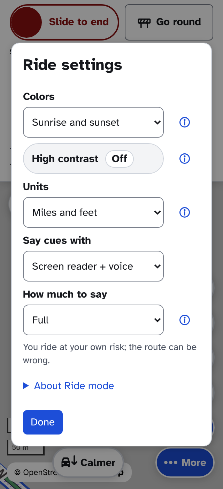
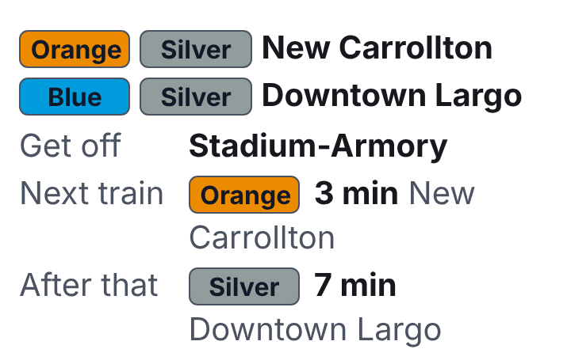

**RouteMaker 0.19.1**
- Ride settings open as a popup over the map, with Colors, High contrast and Units first
- Changing Units in a ride's settings takes effect at once
- The compass button is now the one way to turn the map to your heading, and the cue choice "Both" is now "Screen reader + voice"
- A bike + transit ride goes on by itself at the station: no Done, and the ride picks up when you get off the train
- Bikeshare + transit's walking option can be started as a ride
- The train screen is shorter: each line and where it ends, where to get off, and the next trains in minutes
- MARC trips no longer say "the MARC MARC"

