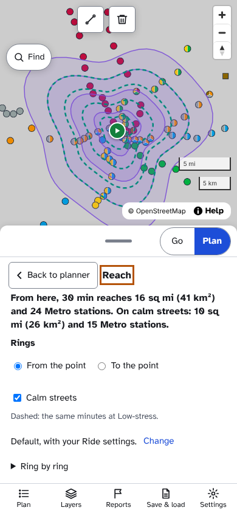
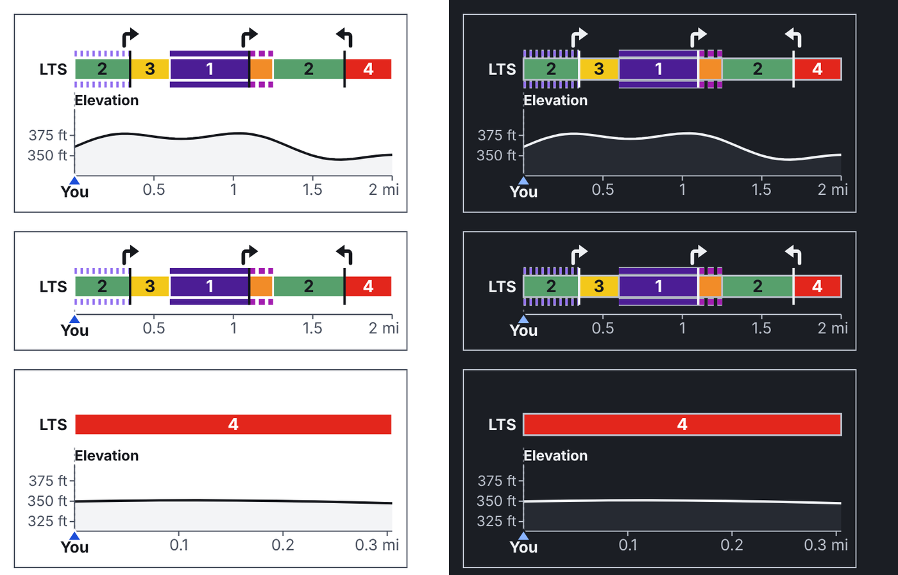
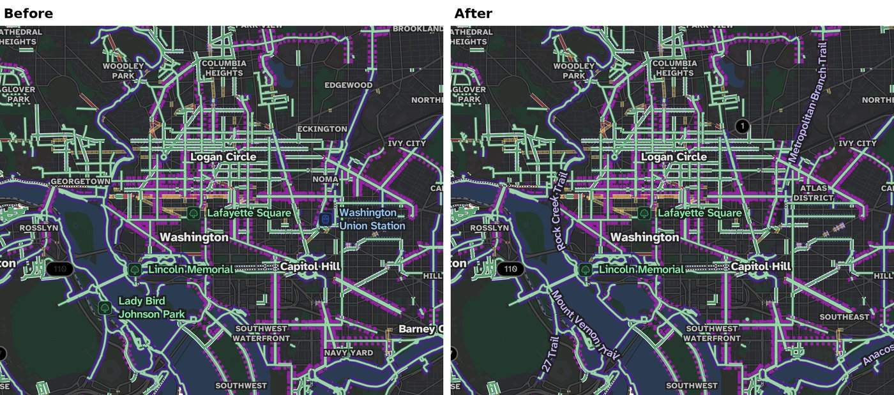

**RouteMaker 0.20.0**
- Reach, in Plan > Find: rings show how far you can ride in 15, 30, 45 or 60 minutes
- Ride's stress graph is now a colour ribbon under the turns, with trail and bike-lane edges
- Long trail names show on the map, and route numbers are easy to read in dark mode
- Baltimore City DOT's bike racks and corrals are on the map
- A ride started part way waits to see which way you're going, and riding the route backwards counts as off route
- A shared ride's link ends when the ride does
- In a tunnel the whole screen turns dark, not just the map
- Run and Walk keep off closures for people on foot

