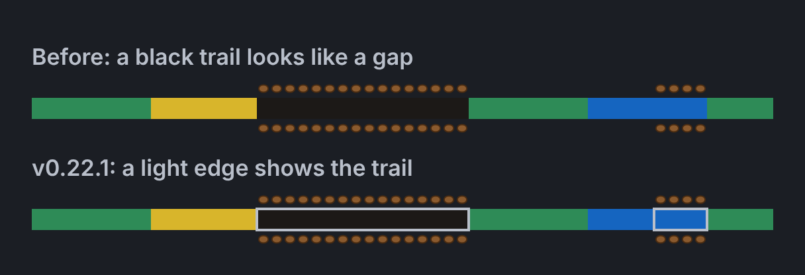

**RouteMaker 0.22.1**
- Rebalance Ride remembers the dock you chose: if the page reloads on the way, Resume rides on to it
- Mountain-bike trails on the dark ride panel have a light edge, so a black trail no longer looks like a gap
- Rebalance Ride says when the drop-off list arrives
- Route tags wrap onto a new row instead of scrolling sideways

