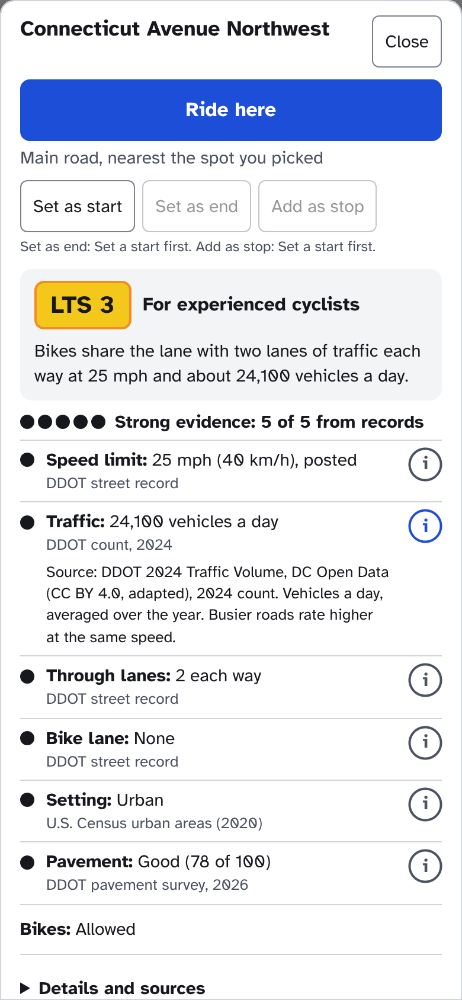
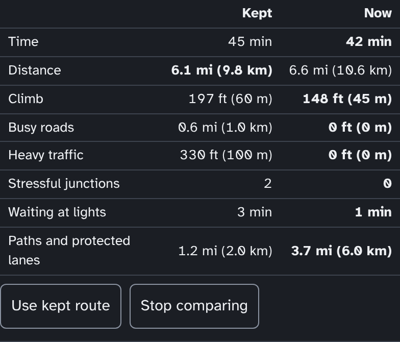

RouteMaker 0.27.0
- Tap a road to see its level in big colours, why it got it, and the facts behind it

- Plan: Keep a route to compare it with the next one, and pick One way, Loop or Out and back

- Plan for later: set a day and start time in When
- Ride with your phone in a pocket: a turn card on the lock screen, a tone and a buzz before each turn
- Download a map for riding with no signal in Settings, and Ride finds its way back to the route with it
- Long rides get the calm search too, and each route shows its paved, gravel and dirt miles
- Check a route file: open a GPX and see its busiest stretches, each with a calmer way round
- Cargo and Tandem: tap a barrier's mark to plan a way around it
