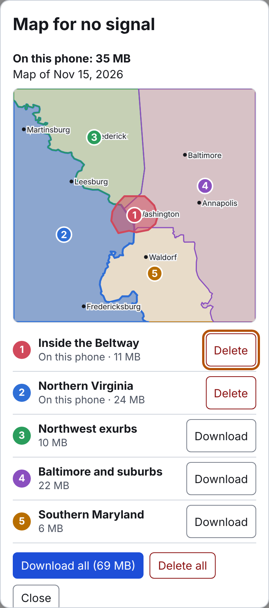

RouteMaker 0.27.1
- Map for no signal: pick any areas on a small map, or download them all, and delete what you don't need (new area borders come with the next map update)

- A via point dropped on a road keeps the route on that road, even with a trail right beside it
- Calm streets now break ties: of two otherwise equal routes, the one on calmer streets wins
- Transit trips: "Next stop" once you leave the stop before, and no early "You have arrived"
- A short bike-open sidewalk that is the only link between two trails is drawn and routed (from the next map rebuild)
- Beta: the area downloads for riding with no signal now download, and every map install builds them
