# How a way gets its tier

[Index](README.md). Sources: [literature.md](literature.md). Junctions:
[intersections.md](intersections.md).

Paths are relative to the repository root and line numbers are
for `main` when this set was written. A tier is set once per data rebuild, in the
`CLASSIFY_STRESS` stage (`src/pipeline/run.py:1942-2143`), then changed by approved
override rows in `APPLY_OVERRIDES` (`run.py:2262-2370`). Stage order is at
`run.py:3266-3280`.

## The scale

| Tier | Name in the code | Words, in the road panel and the legend alike (`frontend/src/lib/stepWords.ts`, `frontend/src/stressStyle.js` `TIER_SHAPES`) |
|---|---|---|
| 1 | `Stress.LTS1` | Comfortable for everyone |
| 2 | `Stress.LTS2` | Fine for adults |
| 3 | `Stress.LTS3` | For experienced cyclists |
| 4 | `Stress.LTS4` | High stress: busy, fast traffic |
| 5 | `Stress.AVOID` | Avoid |

`stress.Stress`. Tiers 1-4 are Furth's levels. Tier 5 is the owner's
"legal but to be avoided" (2026-09-27) and is never produced by the Furth tables. The
panel and the legend use one set of words, the owner's 441l (checked 2026-11-12), and
the half steps have theirs (`STEP_WORDS`): 1.5 "Probably comfortable for older children",
2.5 "Fine for most confident adults", 3.5 "Stressful even for experienced cyclists",
4.5 "A very high-stress road".

## Inputs

| Input | Where it comes from | How it is read |
|---|---|---|
| OSM tags | The region extract (Geofabrik, OSM contributors, ODbL) | `highway`, `maxspeed`, `lanes`/`lanes:forward`/`:backward`, `oneway`, `cycleway*` and width and buffer, `parking*`, `shoulder*`, `surface`, `tracktype`, `smoothness`, `motor_vehicle`/`motorcar`/`vehicle`/`access`, `bicycle`, `expressway`, `service`, `maxspeed:type`/`source:maxspeed` |
| Traffic counts (AADT) | DDOT 2024 Traffic Volume (DC Open Data), VDOT AADT, and the DC Roadway Block count where no count layer reached the way | Matched to ways by geometry (`src/pipeline/conflation.py`; `run.py:1914-1940`). A trail-class way never takes a motor count (`run.py:1916-1925`). A divided road's second carriageway (named one-way pair) takes the count conflation gave the first, for every agency's counts (`conflation.share_with_carriageways`; Maryland's only before v0.16.0). A street no count line of any layer was a candidate for (in heading, end to end, and covering half of it: one that bends, as Falstaff Road does, 0.58 along one line but pointing away from it; or one that runs past several count lines, none covering half of it) takes the VDOT counts it runs along, block by block, the highest of them, and only where no street alongside claims the same stretch (`conflation._along_counts`; the Virginia review, the owner, 2026-10-31). |
| AADT smoothing | `src/pipeline/aadt_smoothing.py` | See below. |
| DC agency street record | DC Roadway Block (DDOT / DC GIS) | Posted speed, lanes, one-way, bike lane, parking and parking width override the way's own tags in the District (`run.py:1992-2028`; `conflation.overlay_road_facts`, `conflation.py:902-`; OWNER-DECISIONS 190). A bike facility OSM maps as a separate way stays there. The owner may withhold a block's speed (`agency_blocks` in an override file; see [overrides.md](overrides.md)). |
| Urban or rural | The coverage polygon's urban-area layer (U.S. Census Bureau) | Picks the default speed table, and whether Oregon's rural table is read (`stress.rural_table_applies`). |
| State | State polygons from the extract (`src/pipeline/states.py`) | Which state's entry in `stress.SPEED_LAW` an unposted way is read by. Local data, not logic. A missing state refuses the rebuild. |
| Divided roads | `src/routemaker/divided.py` | A one-way carriageway of a two-way road is scored as the two-way road (`stress._classify`). |
| Separate bikeway beside a road | `routemaker.facility.separate_pairs` | Kept for the fast-highway rule (`stress.fast_multilane`). The classifier's level for the road itself no longer changes with it (2026-11-13). |
| Curated speed limits | `fixtures/speed/` (`src/routemaker/speed_corrections.py`; OWNER-DECISIONS 131) | Fill a missing `maxspeed` only. A posted speed wins, by direction or as a list too (`run.py:2029-2031`). |
| Curated bike lanes | `fixtures/bike_lanes/` (`src/routemaker/bike_lanes.py`; OWNER-DECISIONS 433) | Add a painted lane OSM lacks (`run.py:2032-2034`). The owner's reading then holds the way at LTS 4 on 3 or more lanes a direction or at 45 mph or more (`bike_lanes.owner_tier`, `bike_lanes.py:86-102`; `run.py:2069-2074`). |
| Named corridors | `fixtures/corridors/` (`src/routemaker/corridors.py`; OWNER-DECISIONS 284-286, 294-296) | Set the tier on owner-judged stretches, matched by street name and an axis, not by way id (`run.py:2100-2109`). |
| Override rows | The `Override` table, approved rows only | Applied last. See [overrides.md](overrides.md). |

## How the level is worked out, rule by rule

Everything below is `src/routemaker/stress.py` (`classify`, `_classify`). Symbols are
named instead of line numbers. Sources are listed in full in [literature.md](literature.md).
Changed 2026-11-13: the classifier now reads the published tables as published. The local
count steps, floors and reliefs that had been stacked on them are gone, and so is the rule
that an agency's rating replaces the formula's.

Labels used in the review boxes: **law** (a statute, cited), **literature** (a published
source, cited), **measured on our data** (and on what), **the owner's choice** (dated),
**our default, unmeasured**.

One rule runs through every section (the owner, 2026-11-13): **missing data never lowers a
level.** Where a fact is not on the map and two published readings apply, the more stressful
one is taken, and the reason says the fact was not mapped.

## How evidence becomes inputs

The formula works from six plain facts about a road: how fast traffic travels, how much
traffic there is, how many through lanes run each way, what bike facility it has, whether
it has a shoulder, and whether it is in town or in the country. Each fact is taken from the
best evidence that road has. Where a road has no record of a fact, the formula uses a stated
estimate and says so. That is why the same formula can rate a back road in West Virginia
from three map tags and a District street from counts, lane records and widths: better
data sharpens the same six facts, it never switches on a different set of rules.

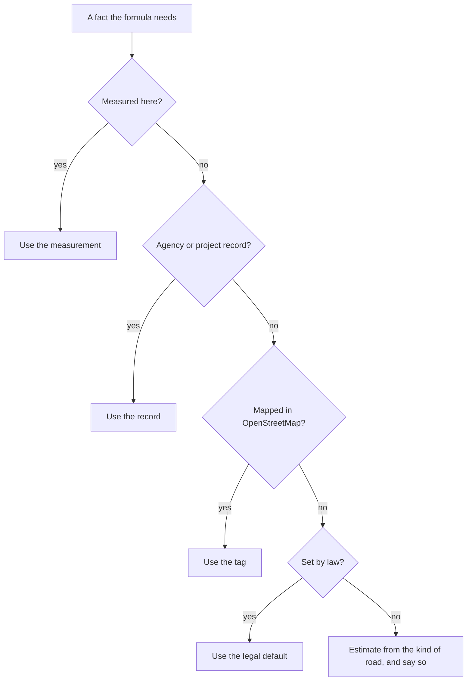

| Fact | Best evidence first |
|---|---|
| Travel speed | measured speed (`observed_speed_mph`) > posted limit (agency record, then OSM `maxspeed`) > the statute's default for the state (`SPEED_LAW`) > class default (ours) |
| Traffic | count (`aadt`) > an estimate for this road (`estimated_aadt`) > the usual count of the road's class and setting (`CLASS_COUNT`) |
| Through lanes | agency record > OSM `lanes` > one each way |
| Bike facility | OSM `cycleway*`, width, parking; unknown width is read as narrow, unknown parking as the worse of the two lane tables |
| Shoulder | OSM `shoulder:width` or a marked lane's width > `cycleway=shoulder` > unknown |
| Setting | census urban area or not |

Two worked examples, from running the code:

| | Sparse (rural West Virginia) | Rich (the District) |
|---|---|---|
| What is known | `highway=tertiary`, nothing else | secondary, posted 25 mph, 4 lanes, 14,200 a day, a 6 ft lane with no parking, measured speed 31 mph |
| Level | 3 | 2 |
| Reason | "rural road, 400 to 1,500 a day, shoulder unknown, no count: traffic read from the road's class" | "bike lane, adequate width, 30 mph, multilane" |
| Confidence note | estimated: travel speed (the statute's default, nothing posted); lanes (read as one each way); traffic (the usual count of the road's class and setting, no count); shoulder (not mapped, read as under 4 ft) | every input measured or mapped |

Full reasoning and citations (for review)

- The owner, 2026-11-13: "Our 'formula' should be reasoned to allow for a wide variety of
  unstructured data, but should be general. More data simply produces a tuned formula
  better", and "We want something that can be applied just knowing a few parameters like
  you'd see in rural WV, and a higher-tuned version when there's a bunch of rich data
  sources, like you see in DC."
- Logic and local data are kept apart. Logic: the tables and the order of steps in
  `_classify`. Local data, each behind an argument or a small table: the statutory speeds
  (`SPEED_LAW`, one entry a state, chosen by `jurisdiction`), the usual count of a class
  (`CLASS_COUNT`), the census urban layer (`urban`), count layers (`aadt`, matched in
  `src/pipeline/conflation.py`), agency street records (`conflation.overlay_road_facts`),
  and agency stress ratings (comparison only, see the last section).
- **No function names a place.** `test_no_logic_names_a_place` walks every function in
  `stress.py` and fails on any string that is a US state code or names a jurisdiction,
  agency or road. **Adding Pennsylvania is a data entry only**: one `SpeedLaw` in
  `SPEED_LAW` with its citation (`test_a_new_state_is_a_data_entry_only` does it with
  made-up figures and no code). A state with no entry reads the class defaults and the
  note says "class default, our default", never "law". Still naming places outside the
  classifier: `agency_lts.PROHIBITING_LEVELS` (MDOT SHA's 5 is a ban, an access fact),
  the Montgomery check in `pipeline/lts_sentinels.py`, and one `state_of == "DC"` in
  `pipeline/run.py` that picks the ways for the District's discrepancy report.
- Which rung was used is recorded on every result: `StressResult.assumed` lists the facts
  that were estimated, `speed_source` and `count_source` say which rung supplied the speed
  and the count, `StressResult.evidence` says it in words, and the rule text ends "no
  count: traffic read from the road's class" (`CLASS_COUNT_RULE`) or "no count: traffic
  from an estimate for this road" (`ESTIMATE_COUNT_RULE`). The note is a statement, not a
  number, and changes no level.
- Not yet one resolver per fact: speed is resolved at the top of `_classify`, the count in
  three lines after it, lanes in `tags.lanes_per_direction` and the pipeline's overlay.
  Gathering each into one function that returns value, source, date and rung, in the field
  names of the raw-inputs plan (`speed`, `lanes`, `shoulder`, each with `used` and `from`),
  is follow-up work.
- Slots that exist but have no data yet: `observed_speed_mph` (any public measured-speed
  dataset) and `estimated_aadt` (a modelled volume). The rebuild passes both to the
  classifier from one optional file, `<reference_dir>/way-observations.json`
  (`pipeline/way_observations.py`: way id, speed, count, and who measured it). **No source
  is installed**: the file is absent on every rebuild so far, and then nothing changes. It
  is tested with a synthetic file (`tests/test_way_observations.py`). A
  rider-reported input (driver behaviour, close passes) would be one more evidence source
  for travel speed or traffic, fed the same way; it is not built because no such data
  exists. Lane width and shoulder width are already inputs because the published tables use
  them. Pavement condition is not an input: neither published table uses it.

## Travel speed

The tables are written for the speed traffic really travels at. The formula does not have
that for any road yet, so it reads the posted limit, and where nothing is posted, the limit
the state's law sets. Where the state is not known, or its law does not clearly cover the
road, it uses a default for the kind of road and says that the figure is ours, not law. This is the formula's main known weakness: on a street where
drivers go well over the sign, the level comes out too calm, and the roads the owner has
flagged as wrongly calm are mostly of this kind. The fix is measured speeds, which the
formula already accepts, not a correction for each road.

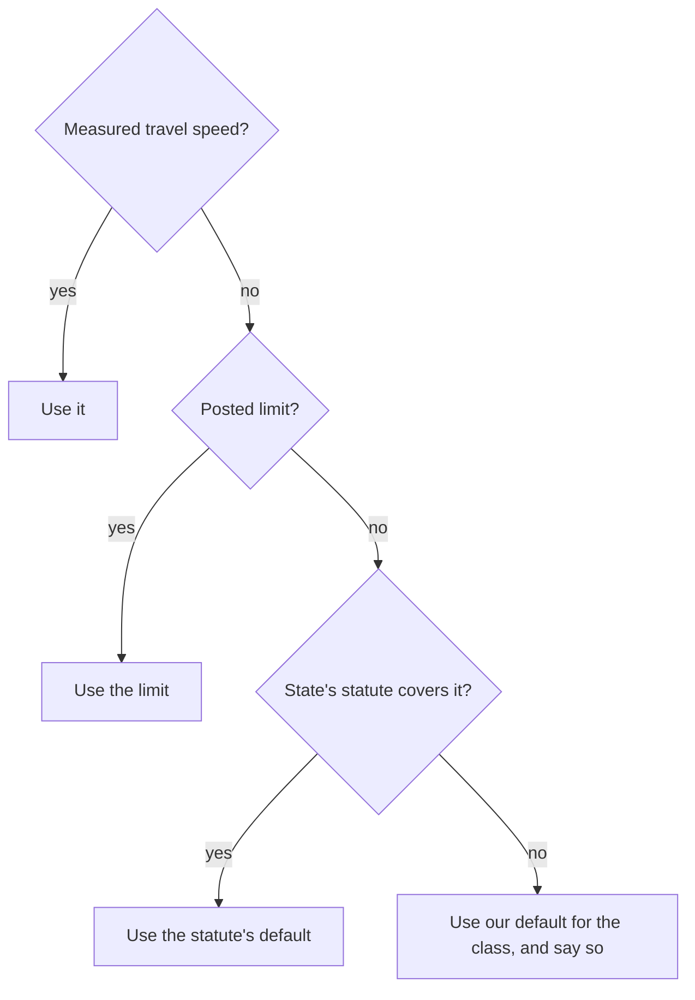

| State (`SPEED_LAW`) | Local streets and minor through roads in town | Open country | Label |
|---|---|---|---|
| District of Columbia | 20 mph on every street; alleys 15 | (none) | law: 18 DCMR 2200.6 |
| Maryland | 30; 35 on a divided road | 50; 55 divided | law: Transportation Article 21-801.1 |
| Virginia | 25 | 55; 35 unpaved | law: Code of Virginia 46.2-870 to 46.2-878 |
| West Virginia | 25 | 55 | law: W. Va. Code 17C-6-1(b) |
| A state with no entry | class default | class default | our default, unmeasured |

Not law in any state (our defaults, unmeasured): 35 mph on an unposted urban secondary or
primary road, 45 on an urban trunk, 20 on a service road, 15 on a track or living street,
and every figure used where the state is not known.

Full reasoning and citations (for review)

- Furth's column heading is "Prevailing Speed (mph)" (Furth 2022). Oregon's is "posted or
  prevailing speed" (Oregon DOT 2025, Exhibits 14-6 and 14-7).
- **Law.** A statutory default is in the same class as a sign (the owner, 2026-11-13: "DC
  20 mph default is the DC code. It's just a fact."). District: 18 DCMR 2200.6, "On all
  streets and highways, unless otherwise designated in accordance with § 2200.2, the
  maximum lawful speed shall be twenty miles per hour (20 mph)", read 2026-11-13 in DDOT's
  rulemaking of 2020-06-01; the 15 mph alley figure is from DDOT's speeding-laws page (the
  DCMR subsection itself was not opened). Maryland's and Virginia's figures are as their
  state DOTs state them (the statutes' own text was not opened); West Virginia's is from
  the project's record. Code: `SPEED_LAW` (data), `statutory_default_mph` and
  `default_speed` (the two functions that read it; neither names a state).
- **Maryland's residential 30** (changed 2026-11-13; the owner: law is law). Until then the
  classifier read 25, MDOT's imputation for local roads in its own stress method (MDOT
  2022), and the confidence note called it "the law's default". At the statute's 30 mph an
  uncounted residential street is LTS 2 (Furth's unlaned row, 0 to 750 a day); at 25 it
  was 1. This is the largest single change on the map, and it goes the stressful way. A
  Maryland residential street gets calmer again where it is posted 25 or where a measured
  speed says so, not by assuming it.
- **"District".** The statutes say "business district" and "residence district". The map
  does not record districts, so inside a census urban area the district figure is read on
  residential, unclassified and tertiary roads, and outside one on residential streets
  only (`DISTRICT_HIGHWAY_URBAN`, `DISTRICT_HIGHWAY_RURAL`). Our reading, unmeasured. On an
  urban secondary or primary road the district figure would be 25 or 30, lower than MDOT's
  35; reading it there would lower a level on a guess, so the 35 stays and is labelled our
  default.
- **Statute or default, in the note.** `StressResult.speed_source` is "statute", "class
  default" or "narrow road rule", and the confidence note says which: "travel speed (the
  statute's default, nothing posted)" or "travel speed (class default, our default;
  nothing posted)".
- **A sign that repeats the default changes nothing** (tested for every class and state):
  the rules that look at the limit read the speed the road is rated at, posted or not.
- **Measured speed.** `classify(observed_speed_mph=...)` is read in place of the limit by
  every table; the result still reports the limit (`StressResult.speed_mph`) and keeps the
  measurement (`StressResult.observed_speed_mph`). The owner, 2026-11-13: "There can be
  room here for additional data inputs like ... 'drivers rarely obey the speed limit on
  these roads', but these need to be solved with more data, not specific overrides." No
  speed dataset is wired in; tested with made-up values only (`TestObservedSpeed`).
- **Waiting on speed data** (roads the owner rates higher than the formula does, each
  posted or statutory 20 to 30 mph and built wide): Minnesota Avenue, Connecticut Avenue
  between K Street and Dupont Circle, 16th Street NW, R Street NW from 1st Street to Florida
  Avenue, the busiest block of 1st Street NW. They are open questions, not exceptions.
- **Narrow and winding rural roads** are a second stand-in for travel speed; see that
  section.

## The base table: streets and roads with no bike facility

For a road with no bike lane, the level comes from one published table: Furth's "bikes in
mixed traffic" table, version 2.2. It asks three things: how fast, how many through lanes
each way, and how much traffic. A slow, quiet local street is level 1. A street with a
centerline and more than 1,500 vehicles a day at 25 mph is level 3. Two lanes each way is
level 3 at best, and level 4 once it is both 30 mph or more and busy.

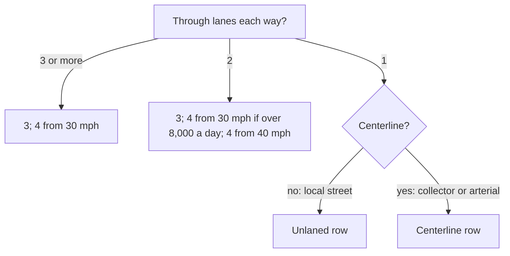

Levels by posted speed (mph):

| Row | Vehicles a day | 20 | 25 | 30 | 35 | 40 | 45+ |
|---|---|---|---|---|---|---|---|
| Unlaned (local street) | 750 or fewer | 1 | 1 | 2 | 2 | 3 | 3 |
| | 751 to 1,500 | 1 | 1 | 2 | 3 | 3 | 3 |
| | 1,501 to 3,000 | 2 | 2 | 2 | 3 | 3 | 4 |
| | over 3,000 | 2 | 2 | 3 | 3 | 4 | 4 |
| One lane each way with a centerline | 1,000 or fewer | 1 | 1 | 2 | 2 | 3 | 3 |
| | 1,001 to 1,500 | 2 | 2 | 2 | 3 | 3 | 4 |
| | over 1,500 | 2 | 3 | 3 | 3 | 4 | 4 |
| Two lanes each way | 8,000 or fewer | 3 | 3 | 3 | 3 | 4 | 4 |
| | over 8,000 | 3 | 3 | 4 | 4 | 4 | 4 |
| Three or more each way | any | 3 | 3 | 4 | 4 | 4 | 4 |

Full reasoning and citations (for review)

- **Literature.** Furth, P. G. (2022), "Level of Traffic Stress Criteria for Road Segments,
  version 2.2", table "Bikes in mixed traffic". `MIXED_TRAFFIC_ROWS` is the table cell for
  cell; `tests/test_stress_published_tables.py` types it a second time from the source.
  Furth's speed bands are 0 to 23.5, to 28.5, to 33.5, to 38.5, to 43.5, to 48.5 and above;
  his last two columns are equal in this table, so six are kept (`SPEED_COLUMN_MAX_MPH`).
  Count breaks are his: a band starts at 751, 1,001, 1,501, 3,001 and 8,001.
- **What changed 2026-11-13.** The module's header said "Furth 2017" but the bands were
  those of Mekuria, Furth and Nixon (2012): 35 mph was LTS 4 at any count. On top sat local
  steps at 5,000, 8,000, 9,000, 12,000 and 20,000 a day, an "arterial floor", a "collector
  floor", a rule reading city multi-lane streets as one lane, and a one-way relief. Each
  had been added to make particular streets come out right. All are removed; the owner,
  2026-11-13: "Own calls were mainly to help tune the formula not override it", and "The
  end goal is a proof of concept that can be made widely applicable. Fiddling with details
  will make that a lot less likely."
- **Where we are not the table: the centerline.** OSM rarely records a centerline
  (`lane_markings`). `mixed_traffic_row` uses `lane_markings` where tagged and otherwise
  the road class: residential, living street, unclassified, service and track read the
  unlaned row; tertiary and above the centerline row (`UNLANED_HIGHWAY`). Our default,
  unmeasured. A known miss in both directions: a wide residential street with a painted
  centerline is rated a level too calm above 1,500 a day at 25 mph, and a collector with no
  centerline a level too harsh.
- **Narrow one-way streets.** Furth has a third one-lane row for a narrow one-way (same
  levels, breaks at 601 and 1,001). Street width is seldom mapped, so a one-lane one-way
  is read as "wide" on the centerline row. Our default.
- **No half steps in this table.** The scale still has half steps (1.5, 4.5), but none is
  produced here. Before, 2.5 and 3.5 came from the local count steps.
- **Known limits.** Posted speed stands in for prevailing speed (see Travel speed). Trucks,
  grades, lighting and pavement are not inputs. Furth's table tops out at 4.
- **What would change it.** Measured speeds; a centerline record; a rider-comfort survey on
  local streets that contradicts a cell.

## Traffic counts, and roads nobody counted

Most small streets have never had their traffic counted. The formula reads such a road at
the count that kind of road usually carries here, in town or in the country, and puts that
number through the same table as a counted road. There is no separate "no count" rule and
no floor. So a real count can move a road either way from the estimate, and a very busy
counted road can never come out calmer than the same road uncounted.

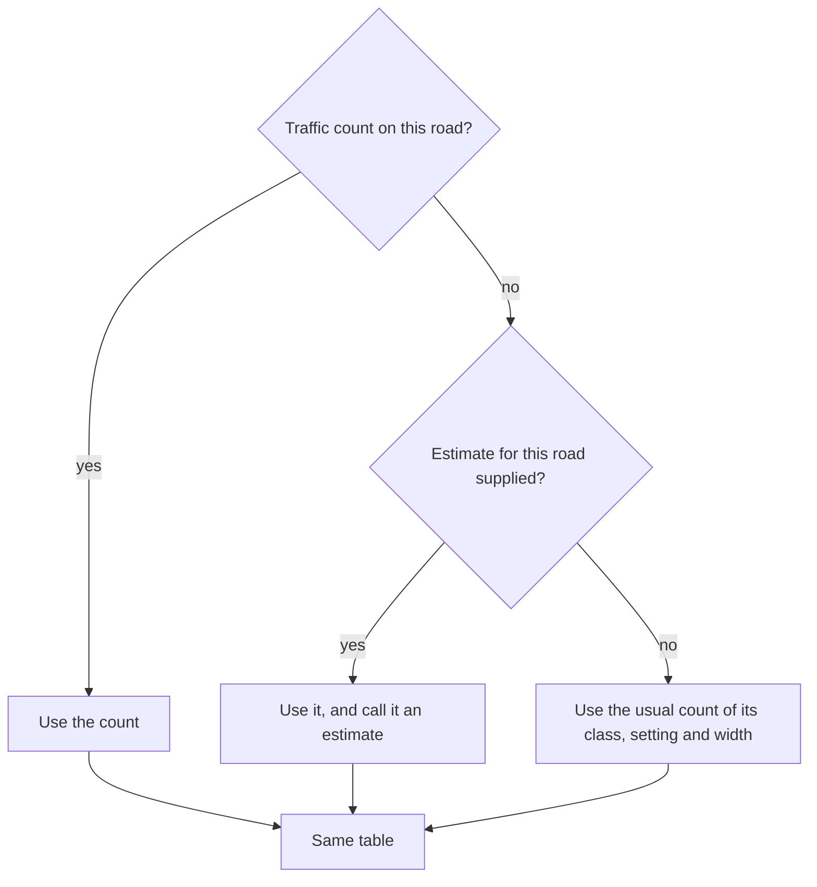

Vehicles a day an uncounted road is read at (`CLASS_COUNT`):

| Road class (OSM) | In town, 1 lane each way | In town, 2 or more | Country, 1 lane each way | Country, 2 or more |
|---|---|---|---|---|
| residential (and service, track, living street) | 380 | 2,500 | 180 | (180) |
| unclassified | 1,800 | 3,400 | 220 | (220) |
| tertiary | 4,400 | 6,900 | 1,300 | (1,300) |
| secondary | 9,300 | 14,000 | 3,200 | 8,200 |
| primary | 14,000 | 25,000 | 7,500 | 16,000 |
| trunk | 18,000 | 39,000 | 13,000 | 25,000 |

Label: **measured on our data**. Figures in brackets had too few counted miles to measure
and repeat the one-lane figure (our default). An unpaved country road is read as a country
residential street (our default).

Full reasoning and citations (for review)

- **Measured on our data.** Each figure is the mile-weighted median count of the counted
  miles of that class, setting and width in the region sweep of 2026-11
  (`reports/region-sweep`, every way of the map with its count), to two significant
  figures. Counted miles behind each: urban one-lane residential 3,779 of 19,773; urban
  unclassified 103 of 741; urban tertiary 1,817 of 2,849; urban secondary 1,095 of 1,287;
  urban primary 340 of 419; rural residential 1,436 of 10,581; rural unclassified 351 of
  1,313; rural tertiary 1,776 of 3,515; rural secondary 1,356 of 1,664; rural primary 678
  of 769. Multi-lane cells rest on 21 (urban residential and unclassified) to 1,597 (urban
  primary) counted miles.
- **Its weakness.** Counted roads are not a random sample: agencies count the busier roads
  of a class first. On local streets (19% counted in town, 14% in the country) the median
  leans high, which is the more stressful way. Service roads, tracks and living streets
  are too seldom counted to measure and read the residential figure (our default). Links
  read their parent class. A class in neither table reads as a secondary (our default,
  the stressful way).
- **Literature for the idea.** Oregon DOT (2025), APM chapter 14: the criteria use "the
  two-way average daily traffic (ADT) or functional class if ADT is not available"
  (Exhibits 14-6 and 14-7), and section 14.5: "If ADTs are not readily available, the
  methodology allows a mid-range value to substitute." Until 2026-11-13 (review r1) the
  figures were the middles of Oregon's bands (375, 1,125, 2,250, 4,500), with a separate
  "over 8,000" reading for every road of two or more lanes each way and a floor of 3 on
  uncounted arterials. The "over 8,000" was measured on arterials and applied to every
  class, and the floor made 30,000 counted vehicles rate calmer than no count (a 20 mph
  one-lane secondary: uncounted 3, counted at 30,000 a day 2). Both are gone.
- **No floor.** An uncounted one-lane arterial at 20 mph is 2, as Furth's table has it at
  any count over 1,500. That reverses OWNER-DECISIONS 141 ("Make arterials LTS 3 or greater
  unless there s bike infrastructure") at 20 mph on one-lane arterials, on the owner's
  instruction of 2026-11-13 (no floor; one table). Such a road becomes 3 again with a
  measured speed over 23.5 mph.
- **An estimate for one road.** `classify(estimated_aadt=...)` is read in place of the
  class figure, through the same table. The rule then ends "no count: traffic from an
  estimate for this road" and the note says "a supplied estimate". A real count outranks
  it. The rebuild feeds it from `way-observations.json` where that file exists (it does
  not today). The idea of inferring a band from surroundings is the owner's (2026-11-09:
  "don't apply a uniform standard"); whether such an inference predicts real counts has
  not been tested.
- **Unpaved country roads** read the country residential figure whatever their class
  (`UNPAVED_RURAL_COUNT_AS`). The owner's choice in substance (2026-10-12: "We shouldn't
  overrate sparsely used rural roads"); our default, unmeasured. In town an unpaved road
  reads its class like any other.
- **Smoothing.** `pipeline.aadt_smoothing` still replaces a spike with the street's median
  before the classifier reads it; it tells a moved level from `VOLUME_GATES`, which is
  every published break: 400, 751, 1,001, 1,501, 3,001, 7,001, 8,001 and 18,000.
- **Known limits.** A class is a coarse guide, and the estimate is a region's median, not
  the road's. What would change it: counts, a tested estimate per road, or the same medians
  recomputed for another region (the table is data).

## Bike lanes

A painted bike lane is rated by Furth's two bike-lane tables: one for a lane with no
parking beside it, one for a lane beside parked cars. Speed, lanes each way and the lane's
width decide. A lane never makes a street worse than the same street without it. Where the
map does not say whether cars park beside the lane, both tables are read and the more
stressful answer is used. A stripe under 4 ft [1.2 m] wide is not counted as a lane. A
track separated from traffic by a curb or posts is level 1.

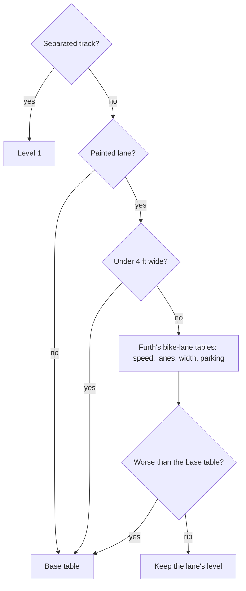

Levels with a lane and no parking beside it (wide is 6 ft [1.8 m] or more):

| Lanes each way | Width | 25 mph or less | 30 | 35 | 40 | 45 | 50+ |
|---|---|---|---|---|---|---|---|
| 1 | wide | 1 | 1 | 2 | 3 | 3 | 3 |
| 1 | narrower | 2 | 2 | 2 | 3 | 3 | 4 |
| 2 | wide | 2 | 2 | 2 | 3 | 3 | 3 |
| 2 | narrower | 2 | 2 | 2 | 3 | 4 | 4 |
| 3 or more | any | 3 | 3 | 3 | 4 | 4 | 4 |

Full reasoning and citations (for review)

- **Literature.** Furth (2022), "Conventional bike lanes, advisory bike lanes, and
  shoulders not adjacent to a parking lane" and "... alongside a parking lane" (reach, the
  lane plus the parking lane, of 15 ft or more against less; LTS 1, 2, 2, 3 by speed for
  one lane each way with the reach, 2, 2, 3, 3 without; 2 or 3 then 3 for two lanes; 3 for
  wider). Code: `LANE_LEVELS`, `LANE_BESIDE_PARKING_LEVELS`, `_bike_lane_tier`; typed a
  second time in the tests.
- **Note 4** under both tables: "Use mixed traffic criteria if it would result in lower
  LTS." Applied to lanes and shoulders (`NOTE_4_RULE`). Before 2026-11-13 a lane made a
  quiet street worse: 25 mph, 1,000 a day was 1 bare and 2 with a lane.
- **Width.** The tables are in feet and OSM widths are metres to one decimal, so a 6 ft
  lane is mapped 1.8 m. A width meets a criterion at the exact conversion or its
  one-decimal rounding, whichever is smaller (`meets_width`): 1.8 m meets 6 ft, 1.2 m meets
  4 ft, and 15 ft stays 4.57 m. (Review r1: 6 ft was compared as 1.8288 m, so a lane mapped
  1.8 read as narrow.) A parking lane's width comes from an agency record where there is
  one (`parking_width_m`). On a two-way street a lane measured on one side only is an
  unmeasured lane (`lane_width_m`).
- **Parking not mapped** (review r1, finding 1). Reading unknown parking as present is the
  more stressful reading up to 35 mph and the calmer one from 40 mph, because Furth's
  beside-parking table stops at 3 where his other table goes on to 4. It rated a 45 mph
  six-lane road with a lane 3 where the bare road, and the same lane with `parking=no`,
  were 4. Now both tables are read and the higher level is taken; the reason says "parking
  not mapped". Mapping the parking, either way, never raises a level (tested over a grid).
- **Minimum widths** (literature: Furth 2022, note 2 under each table, opened
  2026-11-13): "Minimum bike lane width is 4 ft next to a curb and 3.5 ft next to a road
  edge or discontinuous gutter seam. For narrower bike lanes, use Mixed Traffic criteria."
  and "Minimum bike lane reach is 12 ft." OSM does not say curb or road edge, so 4 ft is
  used (the more stressful). Under it the road is rated as if it had no lane
  (`LANE_TOO_NARROW_RULE`). The 12 ft reach is checked only where an agency records the
  parking lane's width.
- **One-way streets beside parking.** Furth's "1-way multilane" row is the same as his
  two-lanes-each-way row, so a one-way of three or more lanes reads that row (review r1).
- **What changed 2026-11-13.** The old table was the 2012 one (no credit from 35 mph).
  Four local rules gave some of it back or took more away, and are removed because the
  2.2 table covers them: the "decent lane" at 40 mph (now 3 by the table itself), the
  floor of 3 beside two or more lanes each way (Furth has 2 for two lanes, 3 for three),
  the 2.5 step for a lane on a street over 9,000 a day (no lane table has a count), and its
  exemption at 20 mph.
- **Our defaults, unmeasured.** Unknown width is read as narrow. Furth's note 1 (a lane
  that is often blocked) and note 3 (a marked buffer, or 2 ft for a centre turn lane, added
  to the width) are not modelled. Leaving the buffer out is the more stressful reading.
- **On-road tracks** (`cycleway=track`) are level 1 here. The road's own level is kept on
  the result (`StressResult.road_level`) so the side-path rule in the junction and side-path
  package can raise a track beside a busy road as it does a separately mapped path; that
  rule is not in this package.
- **Known limits.** Beck et al. (2019) measured closer passes where a painted lane exists;
  the table does not reflect it.

## One-way streets

A one-way street is rated on its own lanes: one lane is read like a two-way street with a
centerline, two lanes like a street with two lanes each way. There is no extra credit for
being one-way.

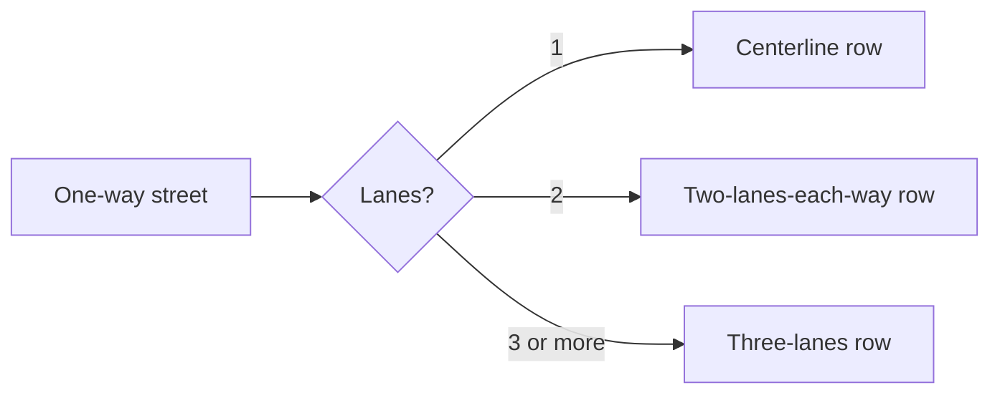

Full reasoning and citations (for review)

- **Literature.** Furth (2022) puts a "wide 1-way, 1-lane" street on the centerline row and
  counts lanes "per direction". No published table makes a one-way calmer than a two-way at
  the same lanes and count: Furth v2.0, Oregon (Exhibit 14-6, note 1) and MDOT read a
  one-way's count at 1.5 times.
- **The owner's observation** (OWNER-DECISIONS 109, 2026-09-30): "we shouldn't have the same
  criteria for 2 way traffic vs 1 way. 1 Way is typically lower stress at similar
  characteristics." What was wrong at the time was real and is fixed: `lanes=2` on a one-way
  was read as a two-way total. The extra relief built on it (two lanes read as one; count
  steps skipped) had no source and is removed. A two-lane one-way at 25 mph is now 3 where
  it was 1 to 2.5; that is the published reading and an open question against his
  observation.
- A carriageway of a divided road is not a one-way street (`routemaker.divided`).
- Code: `mixed_traffic_row`.

## Rural roads

Outside towns, a two-lane road at 45 mph or more is rated by Oregon's rural table: daily
traffic and the paved shoulder decide, not the speed limit. Under 400 vehicles a day it is
level 2. With real traffic and no shoulder it is level 4. This goes by where the road is
and how fast it is, not by what class the map gives it. A rural road under 45 mph is rated
like any street, but never worse than the rural table would rate it, and never below 2. A
town street at 25 mph or less is the exception: it is rated as a street and may be 1.

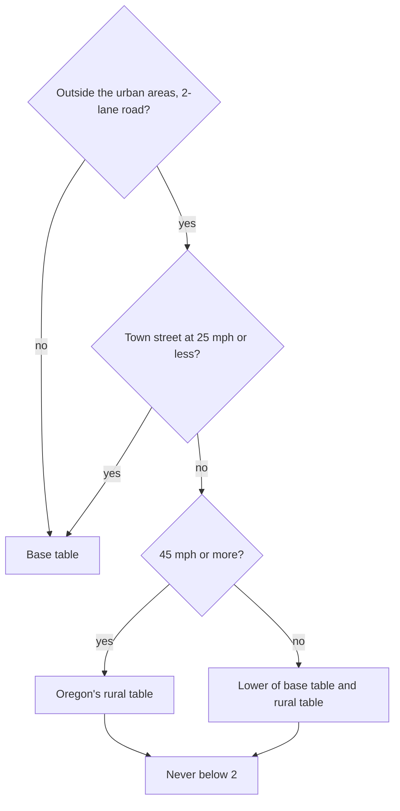

| Vehicles a day | Shoulder under 4 ft, none, or unknown | 4 to under 6 ft | 6 ft or more |
|---|---|---|---|
| Under 400 | 2 | 2 | 2 |
| 400 to 1,500 | 3 | 2 | 2 |
| 1,501 to 7,000 | 4 | 3 | 2 |
| Over 7,000 | 4 | 4 | 3 |

Full reasoning and citations (for review)

- **Literature, at 45 mph or more.** Oregon DOT (2025), APM chapter 14, section 14.4.8,
  Exhibit 14-17, "BLTS Rural Segment Criteria with posted speeds 45 mph or greater".
  `RURAL_LEVELS` is the exhibit cell for cell, and its lowest cell is R2.
- **The owner's choice, under 45 mph: never below 2** (`RURAL_MIN_LEVEL`; 2026-11-13: "the
  rural table's minimum is the floor"; the reason on record: LTS 1 is for children, "LTS 1
  is something kids can go on", 2026-10-13). This is NOT Oregon's. For rural roads under
  45 mph Oregon uses its ordinary tables with an R suffix, which allow level 1; its
  sentence "the minimum BLTS is R2" is about rural intersection crossings (review r1,
  finding 9). An earlier version of this page labelled the minimum literature at every
  speed.
- **Our default, under 45 mph: the lower of the two tables.** `_classify` takes the lower
  of the base table and the rural table, so a lower limit can never make the same road
  worse. Before, a rural road carrying 1,000 a day was 3 unposted and 4 posted 40. The two
  published tables do not meet at the seam (at 300 a day Furth has 3 at 40 mph and Oregon
  R2 at 45), which is why the lower is taken. Unmeasured.
- **What changed 2026-11-13.** The rural rule lived in override rows, as a half-step
  reading picked on a decision card on 2026-11-09: 2, 2.5, 3, then 4 from 3,000 a day, and
  one level lower with a 4 ft shoulder. It was calmer than Oregon by half a level at 400 to
  1,500 a day and a whole level at 1,500 to 3,000, with no source for the difference, and a
  whole level harsher than Oregon at 3,000 to 7,000 with a 6 ft shoulder. The published
  cells are used now, in the classifier, for every rural road (rows still pin the roads
  they name). The owner, 2026-11-13, confirmed dropping the separate "rural floor" rule:
  "go with that"; the table's own minimum does the job on the roads it rates.
- **45 mph "or more" includes the default.** An unposted rural through road is 50 or
  55 mph by statute, in the same class as a sign.
- **Town streets.** `built_up`: outside the census urban areas the only built-up signals in
  OSM are that the way is a residential street or has a sidewalk mapped. A road with either,
  rated at 25 mph or less (posted, or the default it is read at), is rated by the base
  table alone and may be 1 (`BUILT_UP_MAX_MPH`). Our default, unmeasured. A sign that
  repeats the default changes nothing (review r1, finding 12: an unposted rural residential
  street read at 25 was 2, and the same street posted 25 was 1). So a rural residential
  street is 1 in Virginia and West Virginia (statute 25) and 2 in Maryland (statute 30).
- **Which roads** (`rural_table_applies`): by setting and speed, not a class list (review
  r1, finding 6: trunk and the links were missing, so a rural trunk with a wide shoulder
  was 3 where a primary was 2). Outside the urban areas, two-way, one lane each way, not
  divided. Left out: service roads, tracks and living streets (`RURAL_NOT_ROADS`), which
  are not roads through the country. Multi-lane and one-way rural roads use the base table
  (Oregon's exhibit is for two-lane roads).
- **The urban line.** With a posted speed and a count, the same road rates within one level
  inside and outside the urban layer (tested over a grid).
- **Uncounted roads** get the usual count of their class in the country (previous
  section): unclassified 2 (220 a day), tertiary 3 (1,300), secondary and above 4. Nothing
  open to cars at the statutory rural speed rates 1.
- **Known limits.** Oregon says an R level is not the same experience as the urban level of
  the same number, and that frequent sharp curves raise stress (footnote 2); neither is
  modelled. Jones (2004) found shoulder width and trucks, not volume, explained rural
  comfort ratings in Nebraska. A count of exactly 400 is read in the busier band.

## Shoulders

A paved shoulder wide enough to ride in works like a bike lane. On a rural road it moves
the road to a calmer column of the rural table: 4 ft [1.2 m] helps, 6 ft [1.8 m] helps
more. A marked bike lane of the same width counts the same. Almost no rural road has its
shoulder mapped, so the reason says "shoulder unknown" and the road is rated as if it had
none.

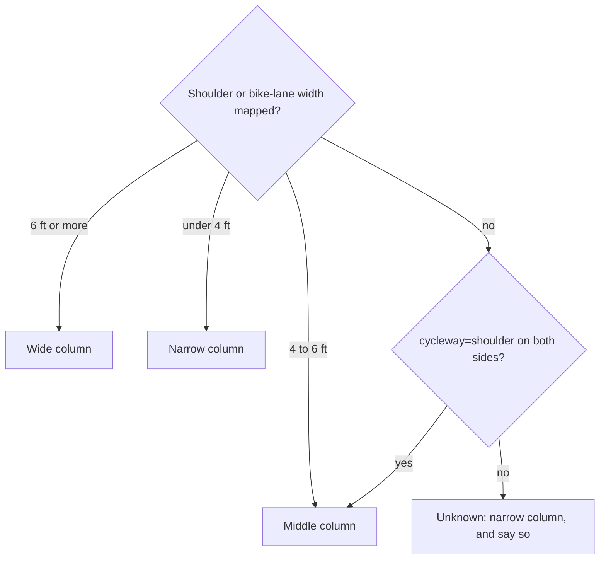

Full reasoning and citations (for review)

- **Literature.** Oregon (2025), Exhibit 14-17's three shoulder columns; a shoulder under
  4 ft "is not considered rideable". Furth (2022) scores "shoulders not adjacent to a
  parking lane" on the bike-lane table.
- Code: `rural_shoulder` reads `shoulder`, `shoulder:width` (worst side), a painted lane's
  width (`lane_width_m`) and `cycleway=shoulder` (`tags.cycleway_shoulder`: both sides of a
  two-way road, either side of a one-way). 4 ft is met by 1.2 m and 6 ft by 1.8 m
  (`meets_width`; review r1, finding 8: a 6 ft shoulder mapped 1.8 read as under 6 ft).
  `cycleway=shoulder` with no width is read as 4 ft (our default).
- A marked lane is never rated worse than an unmarked shoulder of the same width (review
  r1, finding 7: a rural road with a 1.8 m lane was 3 where the same road with a 1.8 m
  shoulder was 2). Tested over speeds, counts and widths.
- "Shoulder unknown" is never written as "no shoulder", and "shoulder" is added to
  `assumed`. Well under 1% of rural miles carry a shoulder tag.
- On any road, a surveyed shoulder of 4 ft or more is also read on Furth's bike-lane
  table, and the lower level is taken (note 4). Before 2026-11-13 a credited shoulder
  switched the traffic count off: at 30 mph and 8,000 a day a 1.6 m shoulder gave 4 and a
  1.7 m one gave 2.
- **What would change it.** A shoulder-width layer from a state road inventory, fed as
  evidence for this one fact.

## Narrow and winding rural roads

Some country lanes are so narrow or twisty that nobody drives the legal 50 mph on them.
Where the map shows that (no centerline, a surveyed width of 18 ft or less, or a line that
keeps bending), and the road has no posted limit and no count above 1,500 a day, it is read
at 25 mph. That makes it level 2, on an unclassified road and on a tertiary road alike.

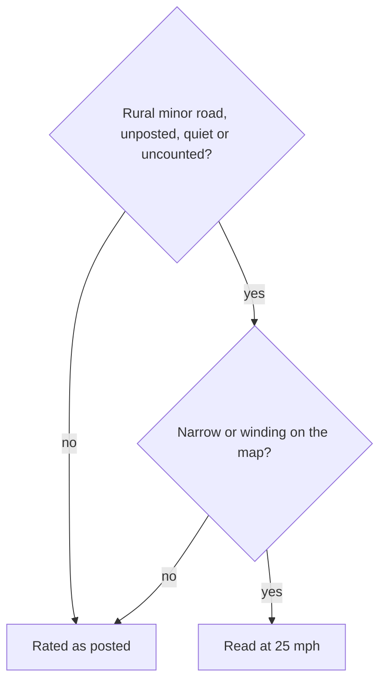

Full reasoning and citations (for review)

- **The owner's choice** (2026-10-13): "narrow windy roads that are unlikely to see people
  travelling at 35 on". An observation from roads he rides; the 25 mph figure and the
  geometry thresholds (`NARROW_RURAL_ROAD_MPH`, `NARROW_ROAD_MAX_WIDTH_M`,
  `WINDING_SINUOSITY`, `WINDING_MIN_LENGTH_M`, `TIGHT_BEND_RADIUS_M` and the rest) are our
  defaults, unmeasured. It is a stand-in for measured travel speed and should give way to
  it.
- **What the tables give at 25 mph** (review r1, finding 10; code, comment and this page
  now agree). Uncounted unclassified road: the unlaned row at 220 a day is 1, and the rural
  minimum makes it 2. Uncounted tertiary: the centerline row at its usual 1,300 a day
  (1,001 to 1,500) is 2. Both 2 is what the owner's rule intends. With the earlier class
  figure of 2,250 a tertiary came out 3 while the comment and this page said 2.
- **The cliff at 1,500 a day.** The rule switches off above a count of 1,500
  (`VOLUME_QUIET`), and the road is then read at its default 50 or 55 mph on the rural
  table: a narrow unclassified road is 2 at 1,500 a day and 4 at 1,501. That is the rule
  ending, not a table cell. Left as it is and stated here.
- **Known limits.** The audit of 2026-11-13 found the rule reaches 32 of 1,741 candidate
  miles and misses the three roads it was written for. It is kept because bend geometry is
  real evidence of speed, and because with the rural table a quiet counted lane no longer
  needs it (under 400 a day is 2 at any speed). Oregon's footnote says sharp curves raise
  stress; this rule says they lower speed. Both can be true; neither is measured here.
- Gravel: a rural gravel road with frequent tight bends counts as winding
  (`bends_slow_traffic`; the thresholds come from the project's gravel-speeds review of
  2026-10-30, cited in the code and not re-opened for this page).
  Straight gravel keeps its default speed and is read in the lowest traffic band (see
  Traffic counts). Maintained gravel itself moves no level.

## Floors and caps

A few rules sit after the tables. A road closed or nearly closed to cars is capped low. A
rough surface cannot be level 1. A rural road is not below 2.

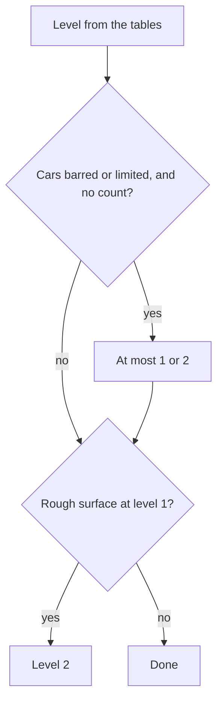

Full reasoning and citations (for review)

- **Motor traffic restricted** (`motor_restriction`; OWNER-DECISIONS 444): closed to motor
  vehicles or farm and forestry only, at most 1; private, destination, permit or delivery
  only, at most 2; one level higher where posted over 30 mph. Never where a count exists,
  never on a road open to buses. Our defaults.
- **Rough surface** (`is_rough`): dirt, grass, `tracktype` grade 4 or 5, very bad
  smoothness floor level 1 at 2. Our default.
- **Rural minimum 2**: literature at 45 mph or more (Oregon's lowest cell), the owner's
  choice below 45 mph (2026-11-13; see Rural roads).
- **Removed 2026-11-13**: the collector floor, the arterial floor (counted and uncounted),
  the city two-way floor and "busy" step, the painted-lane floor beside multiple lanes, and
  the separate rural floor applied after agency ratings.
- **The rebuild's check.** `pipeline.lts_sentinels` refuses a build with a rural road at
  LTS 1 that the classifier held at the minimum. It reads the classifier's own verdict
  (`StressResult.rural_minimum`), so the two cannot read a way differently (review r1,
  finding 13: the check read stored tags without a curated speed and could refuse a
  correct LTS 1 town street).

## Service roads

An alley, driveway or parking aisle that would be level 1 is level 1.5: few cars and low
speed, but delivery trucks, backing cars and blind exits.

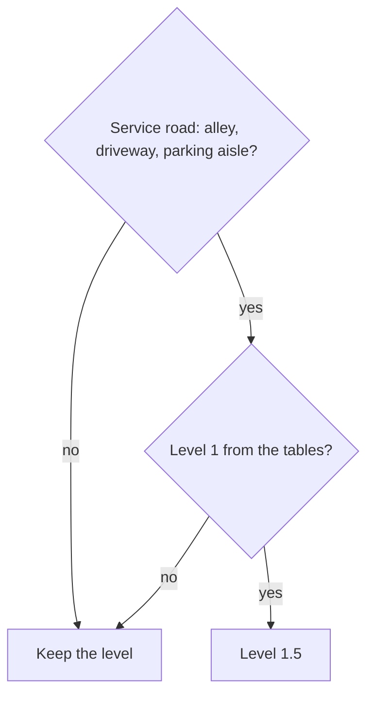

Full reasoning and citations (for review)

- `service_road_step`, applied by the rebuild after the classifier. Agreed by the owner on
  a decision card (2026-11-01: "Yes, all service roads 1.5"). Our default, kept; no
  published source; about 307,000 ways, low stakes.
- A rural service road was 2 under the old rural floor and is 1.5 now.

## Highways above level 4

The published tables stop at 4. Three rules mark the roads that are worse than an ordinary
level 4: a rural expressway, any multi-lane highway posted 55 mph or more, and a very busy
two-lane rural highway are 4.5. An expressway inside an urban area is "Avoid".

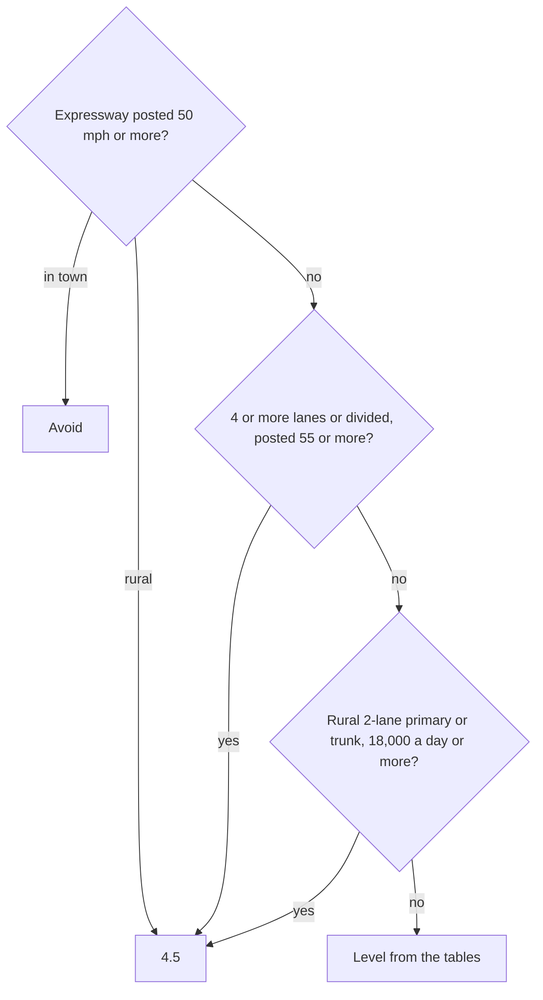

Full reasoning and citations (for review)

- **The owner's choices.** 2026-09-27: "Maybe make a 5th category for legal but to be
  avoided". 2026-10-17: "The rural road LTS 5s should be LTS4.5 they might be high stress,
  but there's often no way to avoid them." 2026-10-30: "Urban 55 mph are generally either
  avoid or 4.5 unless there's a specific reason to keep them". Code: `legal_but_avoid`,
  `rural_expressway`, `fast_multilane`, `busy_road_steps`.
- **Kept, with reasons.** No published table has a level above 4, so there is no better
  rule to replace these with; they are general (class, `expressway=yes`, posted speed,
  lanes) and name no road. Oregon rates freeways open to bicycles BLTS 4 whatever their
  shoulder, which supports treating them apart.
- **Flagged.** Three thresholds (tagged expressway from 50 mph, untagged multi-lane from
  55 mph, urban Avoid against rural 4.5) could be one rule; the owner's later words
  (2026-11-02: "4.5 and avoid aren't really all that different") point that way. Not done
  here: Avoid changes routing cost, which is another package. The 18,000 a day figure
  (`BUSY_RURAL_HIGHWAY_AADT`) was read off three roads, not measured: our default.
- A `bicycle=use_sidepath` road with its side path beside it is Avoid, and 4.5 where the
  path is on the road's own way (`USE_SIDEPATH_RULE`, `USE_SIDEPATH_ON_ROAD_RULE`;
  unchanged).

## Agency ratings are for comparison only

DDOT, Montgomery County and Maryland's state highway agency each publish their own stress
level for their roads. The map records them and shows them in the road panel beside ours,
but none of them sets the level any more. One thing an agency says is still used:
Maryland's "5" means bicycles are prohibited, which is a fact about access, not a stress
level.

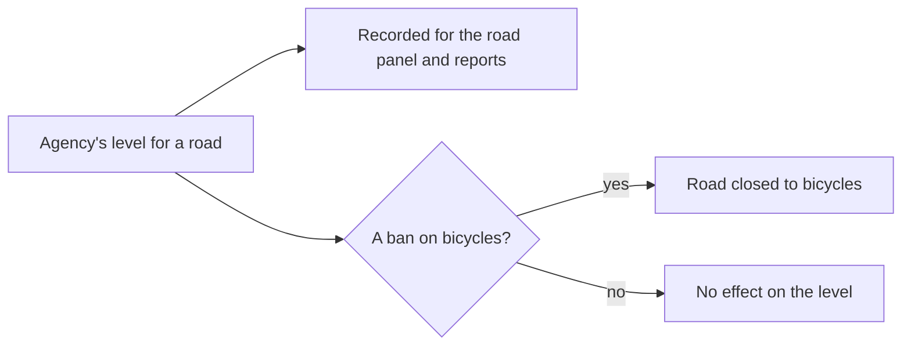

Full reasoning and citations (for review)

- Code: `agency_lts.COMPARISON_ONLY` now names every agency (`AGENCIES`); `chosen` skips
  them; `PROHIBITING_LEVELS` (MDOT SHA's 5) still closes the way.
- **History.** The owner, 2026-10-13: "Ratings from the local government win over a
  formula". 2026-10-30, of DDOT's 2020 layer: "6 year old data is too stale to rely on".
  2026-11-13: "If I say that a road is incorrectly rated that means that I feel the formula
  is wrong", and "The end goal is a proof of concept that can be made widely applicable."
  An agency layer exists in few places and each has its own method (Montgomery's scale runs
  0 to 5; MDOT's 5 is a ban), so a formula that leans on one is not portable.
- **Montgomery's 5.** It used to set 4.5 (`READ_AS`). It no longer sets anything; the road
  panel still explains the county's number in those words. Roads the county rates 5 get
  the formula's level, usually 4. Override rows written from the county's 5 are not touched
  here.
- **Not done here.** The machinery that read DDOT's and SHA's levels through the owner's
  earlier rules (`ddot_rules`, `mdot_sha_rules`) still runs, for the comparison columns
  only; removing it is follow-up.

## After `classify`, in `CLASSIFY_STRESS` and `APPLY_OVERRIDES`

1. **AADT smoothing** (`aadt_smoothing.py`; OWNER-DECISIONS 285, 296, 303) runs before
   `classify`. A way's count is replaced by the length-weighted median of the counts on
   the same street (name without quadrant, same state) within 1,312 ft [400 m], when the
   window holds at least 3 ways and 820 ft [250 m] of road (`aadt_smoothing.py:57-59`).
   It only ever lowers a count. The segment still publishes the agency's count. When the
   raw count gives a higher tier, that tier is kept as `stress_unsmoothed_tier`
   (`run.py:2054-2068`). The junction model and the calm-road breaks read the higher of
   the two, so the volume bunched at an intersection is charged there, not on the link
   (`src/core/junctions.py:765-773`; `src/pipeline/calm_roads.py:21-23`, `:98`). The
   rebuild can be told not to smooth (`RebuildContext.smooth_volume`, `run.py:671`).
2. **Curated bike lane, owner's tier** (`run.py:2069-2074`).
3. **Named corridors** (`run.py:2100-2109`): an entry sets the tier, up or down, for the
   ways of its role (through or side lanes) in its range along the axis. A way with a
   protected lane, a separate bikeway or a path facility is exempt, and so is any
   trail-class way (`corridors.py:27-33`). VALIDATE_SEGMENTS refuses a build whose sentinel
   stretches do not come out as the files say (`src/pipeline/lts_sentinels.py`).
4. **Stress override rows** (`run.py:2309`, `overrides.apply_stress`): they outrank
   everything above. See [overrides.md](overrides.md).
5. **Side paths, protected lanes and sidewalks beside a road** (`run.py`, `rate_side_paths`): last, once every street's level is final. The whole rule is in [side-paths.md](side-paths.md).
6. **Car-free for good** (`run.py:1484-`, called at `:2511`): a road closed to motor
   traffic outright, including by an approved `motor_vehicle=no` access row, becomes
   LTS 1 and a path, unless a curated stress row set its tier. A road closed to cars
   only at set times keeps its tier in the table. For a ride inside the closure it reads
   as tier 1 (`src/core/routing.py:377-382`; `stressStyle.js:664`) and is a path on the
   weekend graph (`run.py:1549-1550`).

## Closures are access, not stress

Whether a bicycle may use a way is decided by the access rules, never by the tier.

- OSM's `bicycle`/`access` tags, and the transform's own refusals (`lua/routemaker_remap.lua`).
- Military and secured areas (`src/pipeline/restricted_areas.py:1-40`): every road and
  path inside is closed (`rm:no_bicycle=military` / `secured`). The exceptions are an
  owner override, a numbered public route, a way signed `bicycle=designated` and, at the
  Pentagon, its listed ways (OWNER-DECISIONS 330, 437, 446-446c). Each closed way is
  listed in the rebuild's `military-closures.csv` / `secured-closures.csv`.
- Singletrack, natural-surface park trails and the other `rm:no_bicycle` reasons
  (`src/routemaker/trailaccess.py`, `singletrack.py`). Rated singletrack is closed on
  every graph. The mountain-bike class (`rm:no_bicycle=mtb`) is closed on every graph
  but the off-road one, which Gravel and Mountain Goat ride (`OFFROAD_PRESETS`,
  `src/core/presets.py`; `Variant`, `src/pipeline/variants.py`; OWNER-DECISIONS
  291(2)).
- The standing rule is to **err closed**: when it is unclear whether bikes are allowed,
  the way is closed, and the owner reopens it with evidence through an access override.

A closed way still has a tier in the segment table, but it is not routable. The stress
price is written only where the way is open to a bicycle: `use_sidepath` is never
written over a refusal (`may_penalise`, `routemaker_remap.lua:1195-1208`, `:551-562`).
The motor-restriction cap is skipped on a way closed to bicycles
(`stress.motor_restriction`; OWNER-DECISIONS 444).

## What the tier leaves the rebuild as

- `segment.stress_tier` (1-5), `stress_rule`, `stress_assumed`, the volume source, count
  and year, `stress_unsmoothed_tier`, and the adjustment columns (`schema.py:484`,
  `:571-579`; `src/pipeline/writers.py`).
- `rm:stress_tier` on each way of each graph variant (`run.py:2681`), read by
  `lua/graph.lua:67`, which drives the costs in [routing-costs.md](routing-costs.md).
- The stress tiles' `tier` property (`src/core/stress_tiles.py`), which [drawing.md](drawing.md) covers.
