# How a way gets its tier

[Index](README.md). Sources: [literature.md](literature.md). Junctions:
[intersections.md](intersections.md).

Paths are relative to the repository root and line numbers are
for `main` when this set was written. A tier is set once per data rebuild, in the
`CLASSIFY_STRESS` stage (`src/pipeline/run.py:1942-2143`), then changed by approved
override rows in `APPLY_OVERRIDES` (`run.py:2262-2370`). Stage order is at
`run.py:3266-3280`.

## The scale

| Tier | Name in the code | Words, in the road panel and the legend alike (`frontend/src/lib/stepWords.ts`, `frontend/src/stressStyle.js` `TIER_SHAPES`) |
|---|---|---|
| 1 | `Stress.LTS1` | Comfortable for everyone |
| 2 | `Stress.LTS2` | Fine for adults |
| 3 | `Stress.LTS3` | For experienced cyclists |
| 4 | `Stress.LTS4` | High stress: busy, fast traffic |
| 5 | `Stress.AVOID` | Avoid |

`stress.Stress`. Tiers 1-4 are Furth's levels. Tier 5 is the owner's
"legal but to be avoided" (2026-09-27) and is never produced by the Furth tables. The
panel and the legend use one set of words, the owner's 441l (checked 2026-11-12), and
the half steps have theirs (`STEP_WORDS`): 1.5 "Probably comfortable for older children",
2.5 "Fine for most confident adults", 3.5 "Stressful even for experienced cyclists",
4.5 "A very high-stress road".

## Inputs

| Input | Where it comes from | How it is read |
|---|---|---|
| OSM tags | The region extract (Geofabrik, OSM contributors, ODbL) | `highway`, `maxspeed`, `lanes`/`lanes:forward`/`:backward`, `oneway`, `cycleway*` and width and buffer, `parking*`, `shoulder*`, `surface`, `tracktype`, `smoothness`, `motor_vehicle`/`motorcar`/`vehicle`/`access`, `bicycle`, `expressway`, `service`, `maxspeed:type`/`source:maxspeed` |
| Traffic counts (AADT) | DDOT 2024 Traffic Volume (DC Open Data), VDOT AADT, and the DC Roadway Block count where no count layer reached the way | Matched to ways by geometry (`src/pipeline/conflation.py`; `run.py:1914-1940`). A trail-class way never takes a motor count (`run.py:1916-1925`). A divided road's second carriageway (named one-way pair) takes the count conflation gave the first, for every agency's counts (`conflation.share_with_carriageways`; Maryland's only before v0.16.0). A street no count line of any layer was a candidate for (in heading, end to end, and covering half of it: one that bends, as Falstaff Road does, 0.58 along one line but pointing away from it; or one that runs past several count lines, none covering half of it) takes the VDOT counts it runs along, block by block, the highest of them, and only where no street alongside claims the same stretch (`conflation._along_counts`; the Virginia review, the owner, 2026-10-31). |
| AADT smoothing | `src/pipeline/aadt_smoothing.py` | See below. |
| DC agency street record | DC Roadway Block (DDOT / DC GIS) | Posted speed, lanes, one-way, bike lane, parking and parking width override the way's own tags in the District (`run.py:1992-2028`; `conflation.overlay_road_facts`, `conflation.py:902-`; OWNER-DECISIONS 190). A bike facility OSM maps as a separate way stays there. The owner may withhold a block's speed (`agency_blocks` in an override file; see [overrides.md](overrides.md)). |
| Urban or rural | The coverage polygon's urban-area layer (U.S. Census Bureau) | Picks the default speed table, and whether Oregon's rural table is read (`stress.rural_table_applies`). |
| State | State polygons from the extract (`src/pipeline/states.py`) | Which law's default speed an unposted way is read at (`stress.statutory_default_mph` and the default tables). Local data, not logic. A missing state refuses the rebuild. |
| Divided roads | `src/routemaker/divided.py` | A one-way carriageway of a two-way road is scored as the two-way road (`stress._classify`). |
| Separate bikeway beside a road | `routemaker.facility.separate_pairs` | Kept for the fast-highway rule (`stress.fast_multilane`). The classifier's level for the road itself no longer changes with it (2026-11-13). |
| Curated speed limits | `fixtures/speed/` (`src/routemaker/speed_corrections.py`; OWNER-DECISIONS 131) | Fill a missing `maxspeed` only. A posted speed wins, by direction or as a list too (`run.py:2029-2031`). |
| Curated bike lanes | `fixtures/bike_lanes/` (`src/routemaker/bike_lanes.py`; OWNER-DECISIONS 433) | Add a painted lane OSM lacks (`run.py:2032-2034`). The owner's reading then holds the way at LTS 4 on 3 or more lanes a direction or at 45 mph or more (`bike_lanes.owner_tier`, `bike_lanes.py:86-102`; `run.py:2069-2074`). |
| Named corridors | `fixtures/corridors/` (`src/routemaker/corridors.py`; OWNER-DECISIONS 284-286, 294-296) | Set the tier on owner-judged stretches, matched by street name and an axis, not by way id (`run.py:2100-2109`). |
| Override rows | The `Override` table, approved rows only | Applied last. See [overrides.md](overrides.md). |

## How the level is worked out, rule by rule

Everything below is `src/routemaker/stress.py` (`classify`, `_classify`). Symbols are
named instead of line numbers. Sources are listed in full in [literature.md](literature.md).
Changed 2026-11-13: the classifier now reads the published tables as published. The local
count steps, floors and reliefs that had been stacked on them are gone, and so is the rule
that an agency's rating replaces the formula's.

Labels used in the review boxes: **law** (a statute, cited), **literature** (a published
source, cited), **measured on our data** (and on what), **the owner's choice** (dated),
**our default, unmeasured**.

## How evidence becomes inputs

The formula works from six plain facts about a road: how fast traffic travels, how much
traffic there is, how many through lanes run each way, what bike facility it has, whether
it has a shoulder, and whether it is in town or in the country. Each fact is taken from the
best evidence that road has. Where a road has no record of a fact, the formula uses a stated
estimate and says so. That is why the same formula can rate a back road in West Virginia
from three map tags and a District street from counts, lane records and widths: better
data sharpens the same six facts, it never switches on a different set of rules.

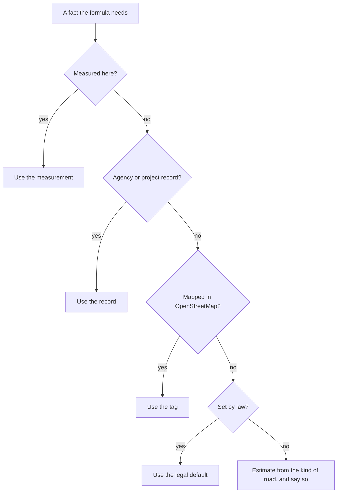

| Fact | Best evidence first |
|---|---|
| Travel speed | measured speed (`observed_speed_mph`) > posted limit (agency record, then OSM `maxspeed`) > the law's default for the place > class default |
| Traffic | count (`aadt`) > a caller's estimate (`estimated_aadt`) > the usual traffic of the road's class (`CLASS_AADT`) |
| Through lanes | agency record > OSM `lanes` > one each way |
| Bike facility | OSM `cycleway*`, width, buffer, parking; unknown width is read as narrow, unknown parking as present |
| Shoulder | OSM `shoulder:width` > `cycleway=shoulder` > unknown |
| Setting | census urban area or not |

Two worked examples, from running the code:

| | Sparse (rural West Virginia) | Rich (the District) |
|---|---|---|
| What is known | `highway=tertiary`, nothing else | secondary, posted 25 mph, 4 lanes, 14,200 a day, a 6 ft lane with no parking, measured speed 31 mph |
| Level | 4 | 2 |
| Reason | "rural road, 1,501 to 7,000 a day, shoulder unknown, no count: traffic read from the road's class" | "bike lane, adequate width, 30 mph, multilane" |
| Confidence note | estimated: travel speed (the law's default); lanes; traffic (from the class); shoulder | every input measured or mapped |

Full reasoning and citations (for review)

- The owner, 2026-11-13: "Our 'formula' should be reasoned to allow for a wide variety of
  unstructured data, but should be general. More data simply produces a tuned formula
  better", and "We want something that can be applied just knowing a few parameters like
  you'd see in rural WV, and a higher-tuned version when there's a bunch of rich data
  sources, like you see in DC."
- Logic and local data are kept apart. Logic: the tables and the order of steps in
  `_classify`. Local data, each behind an argument or a small table: the law's default
  speeds (`statutory_default_mph`, `URBAN_DEFAULT_MPH`, `DEFAULT_MAXSPEED_MPH_RURAL`, chosen
  by `jurisdiction`), the census urban layer (`urban`), count layers (`aadt`, matched in
  `src/pipeline/conflation.py`), agency street records (`conflation.overlay_road_facts`),
  and agency stress ratings (comparison only, see the last section). No rule in `_classify`
  names a road, a county or an agency (`tests/test_stress_published_tables.py`,
  `test_no_logic_names_a_place`).
- Which rung was used is recorded on every result: `StressResult.assumed` lists the facts
  that were estimated, `StressResult.evidence` says it in words, and the rule text ends
  "no count: traffic read from the road's class" where the class stood in for a count
  (`CLASS_COUNT_RULE`). The note is a statement, not a number, and changes no level.
- Not yet one resolver per fact: speed is resolved at the top of `_classify`, the count in
  three lines after it, lanes in `tags.lanes_per_direction` and the pipeline's overlay.
  Gathering each into one function that returns value, source, date and rung, in the field
  names of the raw-inputs plan (`speed`, `lanes`, `shoulder`, each with `used` and `from`),
  is follow-up work.
- Slots that exist but have no data yet: `observed_speed_mph` (any public measured-speed
  dataset, behind its own adapter) and `estimated_aadt` (a modelled volume). A
  rider-reported input (driver behaviour, close passes) would be one more evidence source
  for travel speed or traffic, fed the same way; it is not built because no such data
  exists. Lane width and shoulder width are already inputs because the published tables use
  them. Pavement condition is not an input: neither published table uses it.

## Travel speed

The tables are written for the speed traffic really travels at. The formula does not have
that for any road yet, so it reads the posted limit, and where nothing is posted, the limit
the law sets for that place. This is the formula's main known weakness: on a street where
drivers go well over the sign, the level comes out too calm, and the roads the owner has
flagged as wrongly calm are mostly of this kind. The fix is measured speeds, which the
formula already accepts, not a correction for each road.

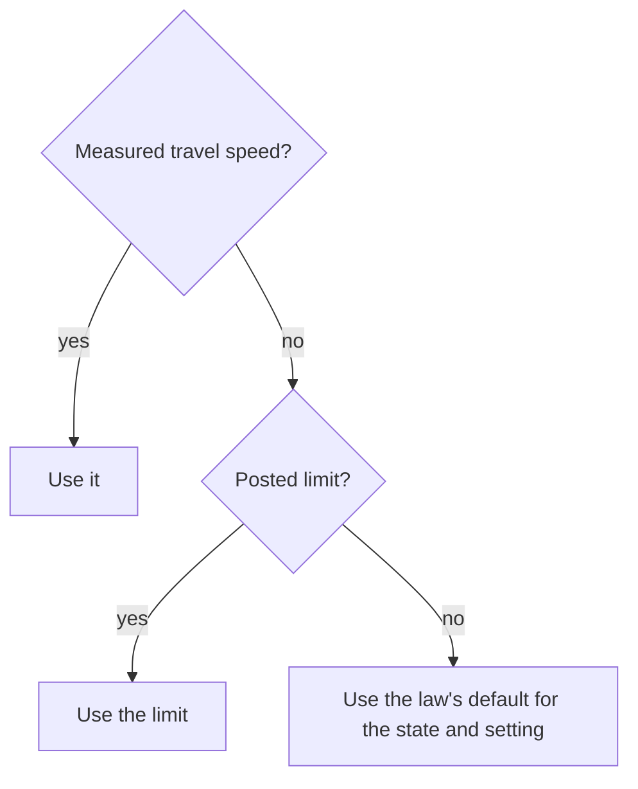

| Place | Nothing posted | Label |
|---|---|---|
| District of Columbia | 20 mph; alleys 15 mph | law: 18 DCMR 2200.6 |
| Maryland, urban | 25 residential, 30 minor through roads, 35 major | 30 and 35 are law (Transportation Article 21-801.1); 25 is MDOT's practice, not the statute |
| Virginia, West Virginia, urban | 25, 35 on major roads | 25 is law (Code of Virginia 46.2-870 to 46.2-878; W. Va. Code 17C-6-1); 35 our default |
| Outside urban areas | 50 or 55 by class | law (Maryland 50 undivided and 55 divided; Virginia and West Virginia 55); 50 on a Virginia minor road is below the statute and reads the same column |

Full reasoning and citations (for review)

- Furth's column heading is "Prevailing Speed (mph)" (Furth 2022). Oregon's is "posted or
  prevailing speed" (Oregon DOT 2025, Exhibits 14-6 and 14-7).
- **Law.** A statutory default is in the same class as a sign (the owner, 2026-11-13: "DC
  20 mph default is the DC code. It's just a fact."). District: 18 DCMR 2200.6, "On all
  streets and highways, unless otherwise designated in accordance with § 2200.2, the
  maximum lawful speed shall be twenty miles per hour (20 mph)", read 2026-11-13 in DDOT's
  rulemaking of 2020-06-01; the 15 mph alley figure is from DDOT's speeding-laws page (the
  DCMR subsection itself was not opened). Maryland: Transportation Article 21-801.1.
  Virginia: Code of Virginia 46.2-870 to 46.2-878. West Virginia: W. Va. Code 17C-6-1.
  Code: `DC_DEFAULT_MPH`, `DC_ALLEY_MPH`, `MD_URBAN_DEFAULT_MPH`, `VA_WV_URBAN_DEFAULT_MPH`,
  `DEFAULT_MAXSPEED_MPH_RURAL`, `statutory_default_mph`.
- **Where the tables are not the statute.** Maryland's statute says 30 mph on a residential
  street; the classifier reads 25, MDOT's imputation for local roads in its own stress
  method (MDOT 2022). At 25 mph an uncounted residential street is LTS 1; at the statute's
  30 mph it would be LTS 2 (Furth's unlaned row, 0 to 750 a day), not 3. Which to read is
  open; it moves every unposted Maryland residential street by one level. The urban 35,
  40 and 45 mph for unposted primary and trunk roads in the generic table
  (`DEFAULT_MAXSPEED_MPH_URBAN`) are our default, unmeasured.
- **Measured speed.** `classify(observed_speed_mph=...)` is read in place of the limit by
  every table; the result still reports the limit (`StressResult.speed_mph`) and keeps the
  measurement (`StressResult.observed_speed_mph`). The owner, 2026-11-13: "There can be
  room here for additional data inputs like ... 'drivers rarely obey the speed limit on
  these roads', but these need to be solved with more data, not specific overrides." No
  speed dataset is wired in; tested with made-up values only (`TestObservedSpeed`).
- **Waiting on speed data** (roads the owner rates higher than the formula does, each
  posted or statutory 20 to 30 mph and built wide): Minnesota Avenue, Connecticut Avenue
  between K Street and Dupont Circle, 16th Street NW, R Street NW from 1st Street to Florida
  Avenue, the busiest block of 1st Street NW. They are open questions, not exceptions.
- **Narrow and winding rural roads** are a second stand-in for travel speed; see that
  section.

## The base table: streets and roads with no bike facility

For a road with no bike lane, the level comes from one published table: Furth's "bikes in
mixed traffic" table, version 2.2. It asks three things: how fast, how many through lanes
each way, and how much traffic. A slow, quiet local street is level 1. A street with a
centerline and more than 1,500 vehicles a day at 25 mph is level 3. Two lanes each way is
level 3 at best, and level 4 once it is both 30 mph or more and busy.

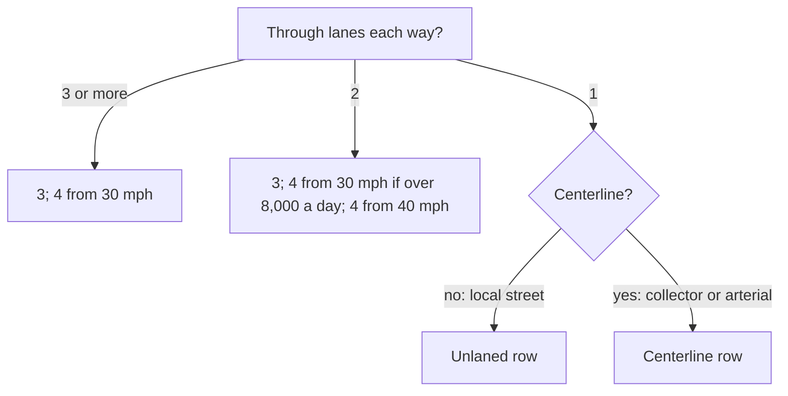

Levels by posted speed (mph):

| Row | Vehicles a day | 20 | 25 | 30 | 35 | 40 | 45+ |
|---|---|---|---|---|---|---|---|
| Unlaned (local street) | 750 or fewer | 1 | 1 | 2 | 2 | 3 | 3 |
| | 751 to 1,500 | 1 | 1 | 2 | 3 | 3 | 3 |
| | 1,501 to 3,000 | 2 | 2 | 2 | 3 | 3 | 4 |
| | over 3,000 | 2 | 2 | 3 | 3 | 4 | 4 |
| One lane each way with a centerline | 1,000 or fewer | 1 | 1 | 2 | 2 | 3 | 3 |
| | 1,001 to 1,500 | 2 | 2 | 2 | 3 | 3 | 4 |
| | over 1,500 | 2 | 3 | 3 | 3 | 4 | 4 |
| Two lanes each way | 8,000 or fewer | 3 | 3 | 3 | 3 | 4 | 4 |
| | over 8,000 | 3 | 3 | 4 | 4 | 4 | 4 |
| Three or more each way | any | 3 | 3 | 4 | 4 | 4 | 4 |

Full reasoning and citations (for review)

- **Literature.** Furth, P. G. (2022), "Level of Traffic Stress Criteria for Road Segments,
  version 2.2", table "Bikes in mixed traffic". `MIXED_TRAFFIC_ROWS` is the table cell for
  cell; `tests/test_stress_published_tables.py` types it a second time from the source.
  Furth's speed bands are 0 to 23.5, to 28.5, to 33.5, to 38.5, to 43.5, to 48.5 and above;
  his last two columns are equal in this table, so six are kept (`SPEED_COLUMN_MAX_MPH`).
  Count breaks are his: a band starts at 751, 1,001, 1,501, 3,001 and 8,001.
- **What changed 2026-11-13.** The module's header said "Furth 2017" but the bands were
  those of Mekuria, Furth and Nixon (2012): 35 mph was LTS 4 at any count. On top sat local
  steps at 5,000, 8,000, 9,000, 12,000 and 20,000 a day, an "arterial floor", a "collector
  floor", a rule reading city multi-lane streets as one lane, and a one-way relief. Each
  had been added to make particular streets come out right. All are removed; the owner,
  2026-11-13: "Own calls were mainly to help tune the formula not override it", and "The
  end goal is a proof of concept that can be made widely applicable. Fiddling with details
  will make that a lot less likely."
- **Where we are not the table: the centerline.** OSM rarely records a centerline
  (`lane_markings`). `mixed_traffic_row` uses `lane_markings` where tagged and otherwise
  the road class: residential, living street, unclassified, service and track read the
  unlaned row; tertiary and above the centerline row (`UNLANED_HIGHWAY`). Our default,
  unmeasured. A known miss in both directions: a wide residential street with a painted
  centerline is rated a level too calm above 1,500 a day at 25 mph, and a collector with no
  centerline a level too harsh.
- **Narrow one-way streets.** Furth has a third one-lane row for a narrow one-way (same
  levels, breaks at 601 and 1,001). Street width is seldom mapped, so a one-lane one-way
  is read as "wide" on the centerline row. Our default.
- **No half steps in this table.** The scale still has half steps (1.5, 4.5), but none is
  produced here. Before, 2.5 and 3.5 came from the local count steps.
- **Known limits.** Posted speed stands in for prevailing speed (see Travel speed). Trucks,
  grades, lighting and pavement are not inputs. Furth's table tops out at 4.
- **What would change it.** Measured speeds; a centerline record; a rider-comfort survey on
  local streets that contradicts a cell.

## Traffic counts, and roads nobody counted

Most small streets have never had their traffic counted. Instead of treating "no count"
as one special case, the formula reads such a road at the traffic that kind of road usually
carries: a residential street as a quiet local street, a collector as a moderate one, an
arterial as a busy one. A real count always wins. An arterial with no count is never rated
below 3.

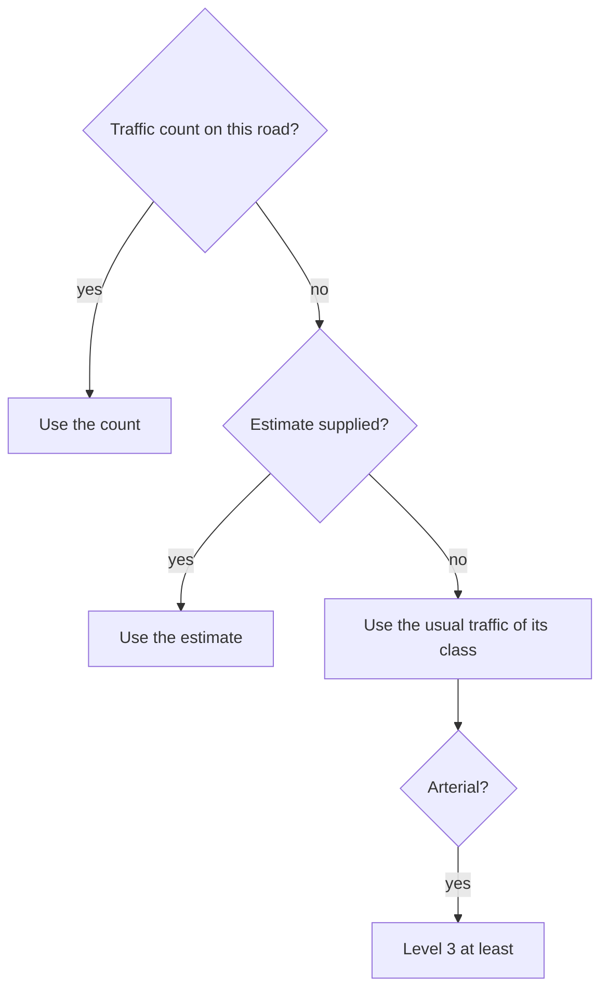

| Road class (OSM) | Read as, vehicles a day | Label |
|---|---|---|
| residential, living street, service, track; any unpaved road | 375 | literature (Oregon: "Local", 750 or fewer; the middle) |
| unclassified | 1,125 | literature (Oregon: "Local / Collector", 750 to 1,500) |
| tertiary | 2,250 | literature (Oregon: "Collector", 1,500 to 3,000) |
| secondary, primary, trunk | 4,500 | Oregon says "Arterial", over 3,000; the figure is our default |
| any road with 2 or more lanes each way | over 8,000 | measured on our data |

Full reasoning and citations (for review)

- **Literature.** Oregon DOT (2025), APM chapter 14, Exhibits 14-6 and 14-7: each count
  band of the mixed-traffic tables is paired with a functional class, and the text says the
  criteria use "the two-way average daily traffic (ADT) or functional class if ADT is not
  available"; section 14.5: "If ADTs are not readily available, the methodology allows a
  mid-range value to substitute." Code: `CLASS_AADT`, `ARTERIAL_CLASS_AADT`, `class_aadt`.
- **Measured on our data** (the region sweep of 2026-11, 730,000 ways): the median count
  of counted rural roads is 170 to 380 a day on residential, 170 to 570 on unclassified,
  1,100 to 1,600 on tertiary and 3,200 on secondary, the same order as Oregon's classes.
  Urban counted roads are busier (tertiary about 4,400 to 5,000), which does not change a
  cell: the centerline row has one band above 1,500. Counted roads are the busier ones of
  their class, so these medians are a check, not the source. Of counted urban secondary,
  primary and trunk miles with two or more lanes each way, 82 to 99% carry 8,000 or more,
  which is why an uncounted multi-lane road is read as busy (`MULTILANE_UNCOUNTED_AADT`).
- **The uncounted-arterial floor** (`ARTERIAL_UNCOUNTED_FLOOR`). The owner's choice
  (OWNER-DECISIONS 141: "Make arterials LTS 3 or greater unless there s bike
  infrastructure"). It now applies only where there is no count, and it decides only at
  20 mph or less: Furth 2.2 gives 2 there and Oregon's Exhibit 14-6 gives 3 for an
  arterial. A counted arterial is rated by its count alone (20 mph, 900 a day: 1).
- **Unpaved roads** are read in the lowest band whatever their class
  (`UNPAVED_CLASS_AADT`). The owner's choice in substance (2026-10-12: "We shouldn't
  overrate sparsely used rural roads"); before 2026-11-13 it was done by reading every rural
  gravel road at 30 mph, a speed nobody measured. Our default, unmeasured.
- **The hook.** `classify(estimated_aadt=...)` takes a better estimate for a way, from any
  source (homes and jobs nearby, a regional model). It has no caller yet. The idea of
  inferring a band from surroundings is the owner's (2026-11-09: "don't apply a uniform
  standard"); whether such an inference predicts real counts has not been tested.
- **Smoothing.** `pipeline.aadt_smoothing` still replaces a spike with the street's median
  before the classifier reads it; it tells a moved level from `VOLUME_GATES`, which is now
  every published break: 400, 751, 1,001, 1,501, 3,001, 7,001, 8,001 and 18,000.
- **Known limits.** A class is a coarse guide: uncounted rural tertiary roads come out 4
  (as before), and many are quiet lanes. Uncounted roads in the Agricultural Reserve are
  the clearest miss. What would change it: counts, or a tested estimate.

## Bike lanes

A painted bike lane is rated by Furth's two bike-lane tables: one for a lane with no
parking beside it, one for a lane beside parked cars. Speed, lanes each way and the lane's
width decide. A lane never makes a street worse than the same street without it. A track
separated from traffic by a curb or posts is level 1.

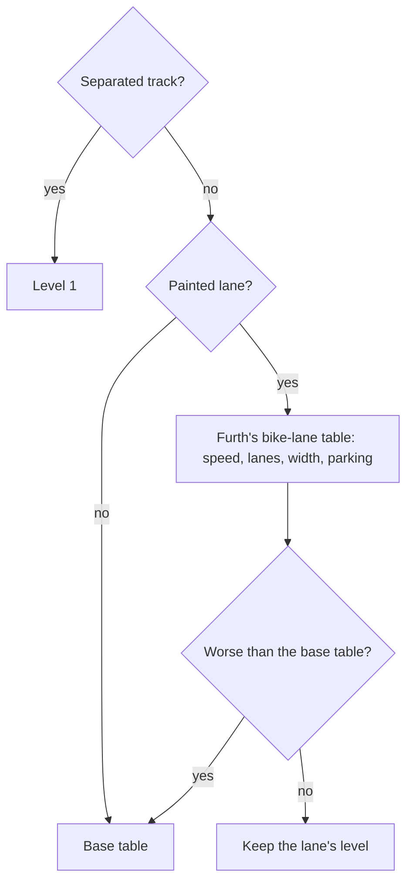

Levels with a lane and no parking beside it (wide is 6 ft [1.8 m] or more):

| Lanes each way | Width | 25 mph or less | 30 | 35 | 40 | 45 | 50+ |
|---|---|---|---|---|---|---|---|
| 1 | wide | 1 | 1 | 2 | 3 | 3 | 3 |
| 1 | narrower | 2 | 2 | 2 | 3 | 3 | 4 |
| 2 | wide | 2 | 2 | 2 | 3 | 3 | 3 |
| 2 | narrower | 2 | 2 | 2 | 3 | 4 | 4 |
| 3 or more | any | 3 | 3 | 3 | 4 | 4 | 4 |

Full reasoning and citations (for review)

- **Literature.** Furth (2022), "Conventional bike lanes, advisory bike lanes, and
  shoulders not adjacent to a parking lane" and "... alongside a parking lane" (reach, the
  lane plus the parking lane, of 15 ft or more against less; LTS 1, 2, 2, 3 by speed for
  one lane each way with the reach, 2, 2, 3, 3 without; 2 or 3 then 3 for two lanes; 3 for
  wider). Code: `LANE_LEVELS`, `LANE_BESIDE_PARKING_LEVELS`, `_bike_lane_tier`; typed a
  second time in the tests.
- **Note 4** under both tables: "Use mixed traffic criteria if it would result in lower
  LTS." Applied to lanes and shoulders (`NOTE_4_RULE`). Before 2026-11-13 a lane made a
  quiet street worse: 25 mph, 1,000 a day was 1 bare and 2 with a lane.
- **Width.** 6 ft is 1.83 m (`FURTH_LANE_ALONE_M`; it was 1.7 m). A parking lane's width
  comes from an agency record where there is one (`parking_width_m`).
- **What changed 2026-11-13.** The old table was the 2012 one (no credit from 35 mph).
  Four local rules gave some of it back or took more away, and are removed because the
  2.2 table covers them: the "decent lane" at 40 mph (now 3 by the table itself), the
  floor of 3 beside two or more lanes each way (Furth has 2 for two lanes, 3 for three),
  the 2.5 step for a lane on a street over 9,000 a day (no lane table has a count), and its
  exemption at 20 mph.
- **Our defaults, unmeasured.** Unknown width is read as narrow and unknown parking as
  present. Furth's notes 1 to 3 (a lane that is often blocked, minimum widths, buffers and
  centre turn lanes added to the width) are not modelled, except that a mapped buffer makes
  no difference to the level.
- **On-road tracks** (`cycleway=track`) are level 1 here. The road's own level is kept on
  the result (`StressResult.road_level`) so the side-path rule in the junction and side-path
  package can raise a track beside a busy road as it does a separately mapped path; that
  rule is not in this package.
- **Known limits.** Beck et al. (2019) measured closer passes where a painted lane exists;
  the table does not reflect it.

## One-way streets

A one-way street is rated on its own lanes: one lane is read like a two-way street with a
centerline, two lanes like a street with two lanes each way. There is no extra credit for
being one-way.

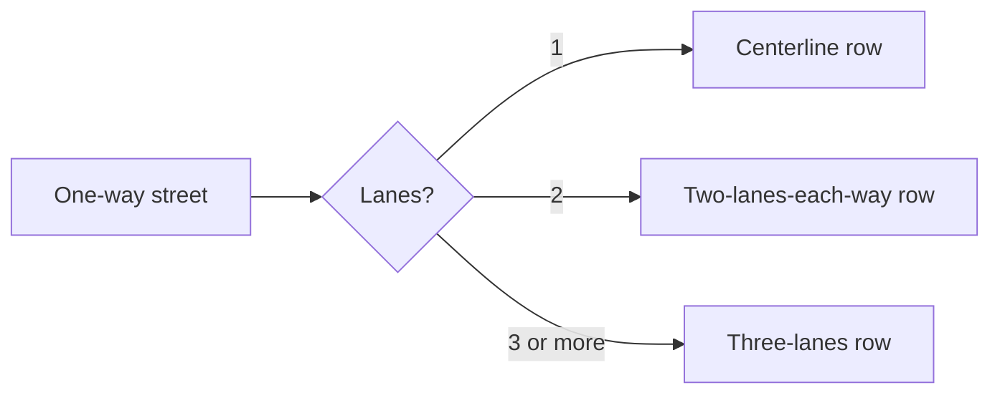

Full reasoning and citations (for review)

- **Literature.** Furth (2022) puts a "wide 1-way, 1-lane" street on the centerline row and
  counts lanes "per direction". No published table makes a one-way calmer than a two-way at
  the same lanes and count: Furth v2.0, Oregon (Exhibit 14-6, note 1) and MDOT read a
  one-way's count at 1.5 times.
- **The owner's observation** (OWNER-DECISIONS 109, 2026-09-30): "we shouldn't have the same
  criteria for 2 way traffic vs 1 way. 1 Way is typically lower stress at similar
  characteristics." What was wrong at the time was real and is fixed: `lanes=2` on a one-way
  was read as a two-way total. The extra relief built on it (two lanes read as one; count
  steps skipped) had no source and is removed. A two-lane one-way at 25 mph is now 3 where
  it was 1 to 2.5; that is the published reading and an open question against his
  observation.
- A carriageway of a divided road is not a one-way street (`routemaker.divided`).
- Code: `mixed_traffic_row`.

## Rural roads

Outside towns, a two-lane road at 45 mph or more is rated by Oregon's rural table: daily
traffic and the paved shoulder decide, not the speed limit. Under 400 vehicles a day it is
level 2. With real traffic and no shoulder it is level 4. A rural road is never below 2,
unless it is a town street posted 25 mph or less. A rural road posted under 45 mph is
rated like any street, but never worse than the rural table would rate it.

| Vehicles a day | Shoulder under 4 ft, none, or unknown | 4 to under 6 ft | 6 ft or more |
|---|---|---|---|
| Under 400 | 2 | 2 | 2 |
| 400 to 1,500 | 3 | 2 | 2 |
| 1,501 to 7,000 | 4 | 3 | 2 |
| Over 7,000 | 4 | 4 | 3 |

Full reasoning and citations (for review)

- **Literature.** Oregon DOT (2025), APM chapter 14, section 14.4.8, Exhibit 14-17, "BLTS
  Rural Segment Criteria with posted speeds 45 mph or greater". `RURAL_LEVELS` is the
  exhibit cell for cell. Oregon rates rural roads under 45 mph by its ordinary tables. R2
  is its lowest rural level (`RURAL_MIN_LEVEL`).
- **What changed 2026-11-13.** The rural rule lived in override rows, as a half-step
  reading picked on a decision card on 2026-11-09: 2, 2.5, 3, then 4 from 3,000 a day, and
  one level lower with a 4 ft shoulder. It was calmer than Oregon by half a level at 400 to
  1,500 a day and a whole level at 1,500 to 3,000, with no source for the difference, and a
  whole level harsher than Oregon at 3,000 to 7,000 with a 6 ft shoulder. The published
  cells are used now, in the classifier, for every rural road (rows still pin the roads
  they name). The owner, 2026-11-13, confirmed dropping the separate "rural floor" rule:
  "go with that"; the table's own minimum does the job on the roads it rates.
- **45 mph "or more" includes the law's default.** An unposted rural through road is 50 or
  55 mph by statute, in the same class as a sign.
- **Under 45 mph.** `_classify` takes the lower of the base table and the rural table, so a
  lower limit can never make the same road worse. Before, a rural road carrying 1,000 a day
  was 3 unposted and 4 posted 40. The two published tables do not meet at the seam (at 300
  a day Furth has 3 at 40 mph and Oregon R2 at 45), which is why the lower is taken.
- **Town streets.** `built_up`: outside the census urban areas the only built-up signals in
  OSM are that the way is a residential street or has a sidewalk mapped. A road posted
  25 mph or less with either is rated by the base table alone and may be 1
  (`BUILT_UP_MAX_MPH`). Our default, unmeasured.
- **Which roads.** `rural_table_applies`: primary to residential classes, one lane each
  way, two-way, not divided. Multi-lane and one-way rural roads use the base table.
- **The urban line.** With a posted speed and a count, the same road rates within one level
  inside and outside the urban layer (tested over a grid).
- **Uncounted roads** get their class's traffic (previous section): unclassified 3,
  tertiary and above 4, residential 2. "LTS 1 is something kids can go on" (the owner,
  2026-10-13) still holds: nothing open to cars at the statutory rural speed rates 1.
- **Known limits.** Oregon says an R level is not the same experience as the urban level of
  the same number, and that frequent sharp curves raise stress (footnote 2); neither is
  modelled. Jones (2004) found shoulder width and trucks, not volume, explained rural
  comfort ratings in Nebraska. A count of exactly 400 is read in the busier band.

## Shoulders

A paved shoulder wide enough to ride in works like a bike lane. On a rural road it moves
the road to a calmer column of the rural table: 4 ft [1.2 m] helps, 6 ft [1.8 m] helps
more. Almost no rural road has its shoulder mapped, so the reason says "shoulder unknown"
and the road is rated as if it had none.

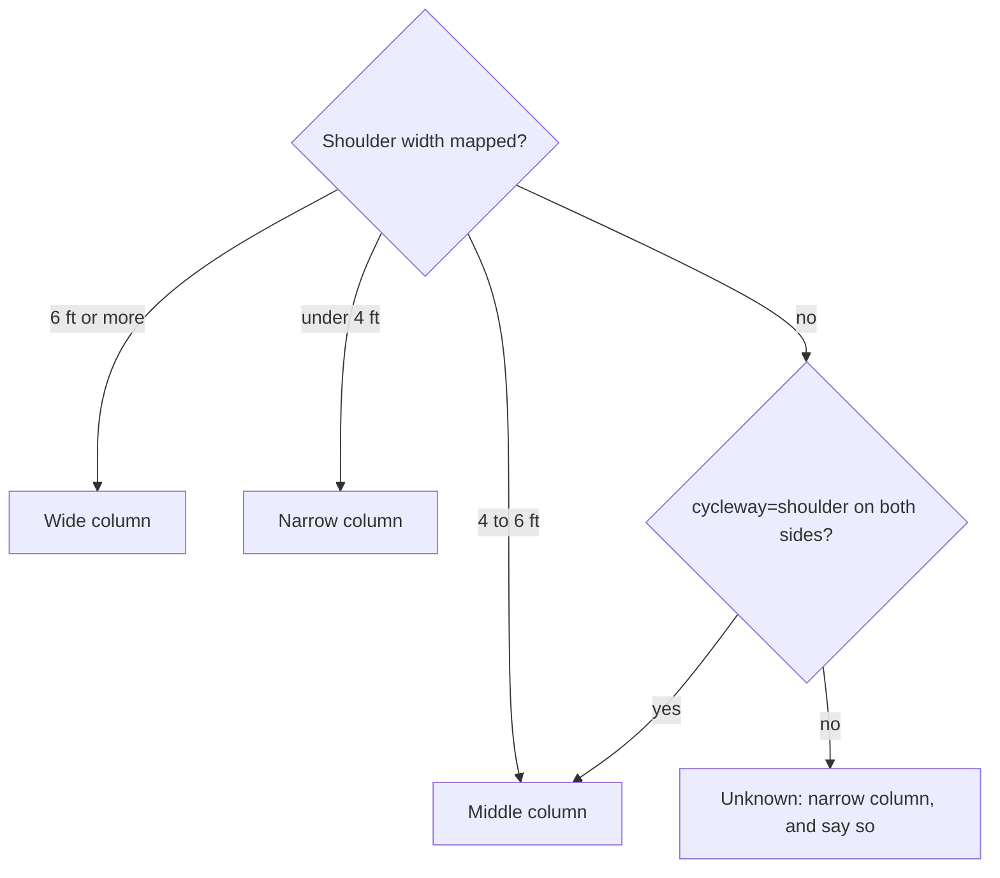

Full reasoning and citations (for review)

- **Literature.** Oregon (2025), Exhibit 14-17's three shoulder columns; a shoulder under
  4 ft "is not considered rideable". Furth (2022) scores "shoulders not adjacent to a
  parking lane" on the bike-lane table.
- Code: `rural_shoulder` reads `shoulder`, `shoulder:width` (worst side) and
  `cycleway=shoulder` (`tags.cycleway_shoulder`: both sides of a two-way road, either side
  of a one-way); `RIDEABLE_SHOULDER_M` 4 ft, `WIDE_SHOULDER_M` 6 ft. `cycleway=shoulder`
  with no width is read as 4 ft (our default).
- "Shoulder unknown" is never written as "no shoulder", and "shoulder" is added to
  `assumed`. Well under 1% of rural miles carry a shoulder tag.
- On any road, a surveyed shoulder of 4 ft or more is also read on Furth's bike-lane
  table, and the lower level is taken (note 4). Before 2026-11-13 a credited shoulder
  switched the traffic count off: at 30 mph and 8,000 a day a 1.6 m shoulder gave 4 and a
  1.7 m one gave 2.
- **What would change it.** A shoulder-width layer from a state road inventory, fed as
  evidence for this one fact.

## Narrow and winding rural roads

Some country lanes are so narrow or twisty that nobody drives the legal 50 mph on them.
Where the map shows that (no centerline, a surveyed width of 18 ft or less, or a line that
keeps bending), and the road has no posted limit and no count above 1,500 a day, it is read
at 25 mph. With the rural minimum that makes it level 2.

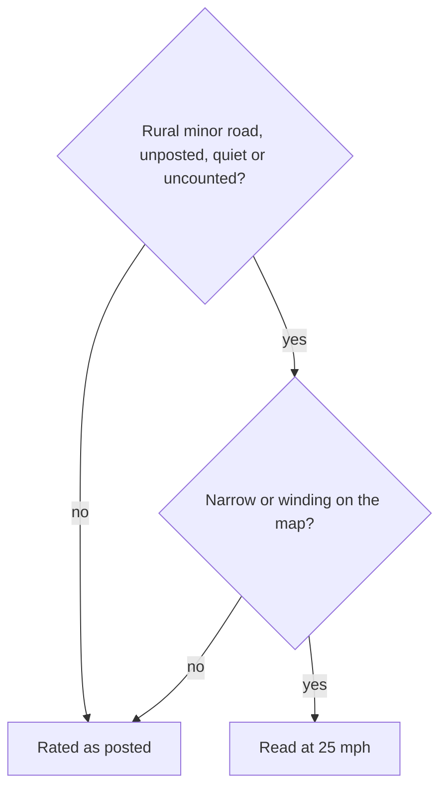

Full reasoning and citations (for review)

- **The owner's choice** (2026-10-13): "narrow windy roads that are unlikely to see people
  travelling at 35 on". An observation from roads he rides; the 25 mph figure and the
  geometry thresholds (`NARROW_RURAL_ROAD_MPH`, `NARROW_ROAD_MAX_WIDTH_M`,
  `WINDING_SINUOSITY`, `WINDING_MIN_LENGTH_M`, `TIGHT_BEND_RADIUS_M` and the rest) are our
  defaults, unmeasured. It is a stand-in for measured travel speed and should give way to
  it.
- **Known limits.** The audit of 2026-11-13 found the rule reaches 32 of 1,741 candidate
  miles and misses the three roads it was written for. It is kept because bend geometry is
  real evidence of speed, and because with the rural table a quiet counted lane no longer
  needs it (under 400 a day is 2 at any speed). Oregon's footnote says sharp curves raise
  stress; this rule says they lower speed. Both can be true; neither is measured here.
- Gravel: a rural gravel road with frequent tight bends counts as winding
  (`bends_slow_traffic`; the thresholds come from the project's gravel-speeds review of
  2026-10-30, cited in the code and not re-opened for this page).
  Straight gravel keeps its default speed and is read in the lowest traffic band (see
  Traffic counts). Maintained gravel itself moves no level.

## Floors and caps

A few rules sit after the tables. A road closed or nearly closed to cars is capped low. A
rough surface cannot be level 1. A rural road is not below 2. An uncounted arterial is not
below 3.

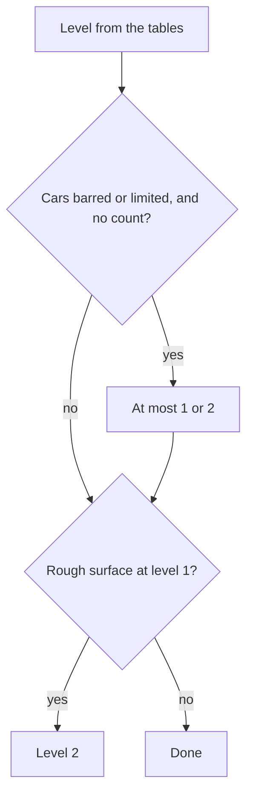

Full reasoning and citations (for review)

- **Motor traffic restricted** (`motor_restriction`; OWNER-DECISIONS 444): closed to motor
  vehicles or farm and forestry only, at most 1; private, destination, permit or delivery
  only, at most 2; one level higher where posted over 30 mph. Never where a count exists,
  never on a road open to buses. Our defaults.
- **Rough surface** (`is_rough`): dirt, grass, `tracktype` grade 4 or 5, very bad
  smoothness floor level 1 at 2. Our default.
- **Rural minimum 2**: literature, Oregon's R2 (see Rural roads). **Uncounted arterial 3**:
  the owner's choice (see Traffic counts).
- **Removed 2026-11-13**: the collector floor, the arterial floor on counted roads, the
  city two-way floor and "busy" step, the painted-lane floor beside multiple lanes, and the
  separate rural floor applied after agency ratings. `pipeline.lts_sentinels` now checks
  the built table against `stress.rural_minimum_applies`.

## Service roads

An alley, driveway or parking aisle that would be level 1 is level 1.5: few cars and low
speed, but delivery trucks, backing cars and blind exits.

Full reasoning and citations (for review)

- `service_road_step`, applied by the rebuild after the classifier. Agreed by the owner on
  a decision card (2026-11-01: "Yes, all service roads 1.5"). Our default, kept; no
  published source; about 307,000 ways, low stakes. No diagram: it is one constant.
- A rural service road was 2 under the old rural floor and is 1.5 now.

## Highways above level 4

The published tables stop at 4. Three rules mark the roads that are worse than an ordinary
level 4: a rural expressway, any multi-lane highway posted 55 mph or more, and a very busy
two-lane rural highway are 4.5. An expressway inside an urban area is "Avoid".

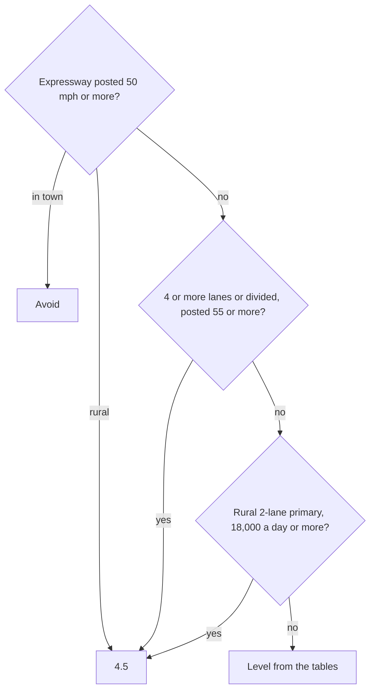

Full reasoning and citations (for review)

- **The owner's choices.** 2026-09-27: "Maybe make a 5th category for legal but to be
  avoided". 2026-10-17: "The rural road LTS 5s should be LTS4.5 they might be high stress,
  but there's often no way to avoid them." 2026-10-30: "Urban 55 mph are generally either
  avoid or 4.5 unless there's a specific reason to keep them". Code: `legal_but_avoid`,
  `rural_expressway`, `fast_multilane`, `busy_road_steps`.
- **Kept, with reasons.** No published table has a level above 4, so there is no better
  rule to replace these with; they are general (class, `expressway=yes`, posted speed,
  lanes) and name no road. Oregon rates freeways open to bicycles BLTS 4 whatever their
  shoulder, which supports treating them apart.
- **Flagged.** Three thresholds (tagged expressway from 50 mph, untagged multi-lane from
  55 mph, urban Avoid against rural 4.5) could be one rule; the owner's later words
  (2026-11-02: "4.5 and avoid aren't really all that different") point that way. Not done
  here: Avoid changes routing cost, which is another package. The 18,000 a day figure
  (`BUSY_RURAL_HIGHWAY_AADT`) was read off three roads, not measured: our default.
- A `bicycle=use_sidepath` road with its side path beside it is Avoid, and 4.5 where the
  path is on the road's own way (`USE_SIDEPATH_RULE`, `USE_SIDEPATH_ON_ROAD_RULE`;
  unchanged).

## Agency ratings are for comparison only

DDOT, Montgomery County and Maryland's state highway agency each publish their own stress
level for their roads. The map records them and shows them in the road panel beside ours,
but none of them sets the level any more. One thing an agency says is still used:
Maryland's "5" means bicycles are prohibited, which is a fact about access, not a stress
level.

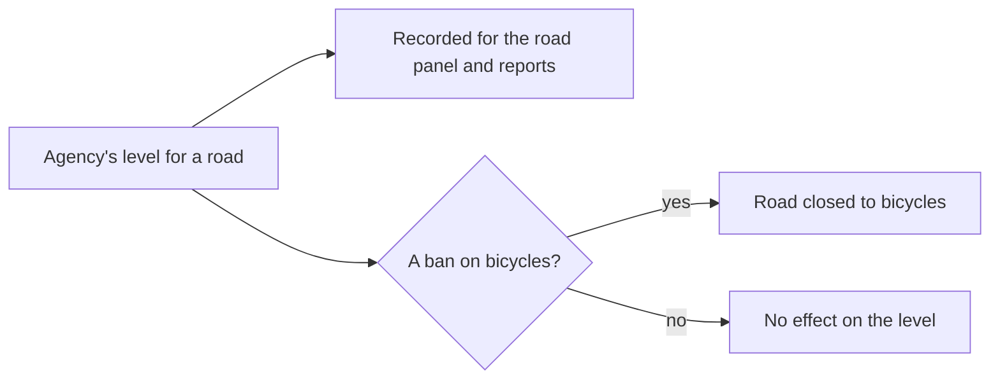

Full reasoning and citations (for review)

- Code: `agency_lts.COMPARISON_ONLY` now names every agency (`AGENCIES`); `chosen` skips
  them; `PROHIBITING_LEVELS` (MDOT SHA's 5) still closes the way.
- **History.** The owner, 2026-10-13: "Ratings from the local government win over a
  formula". 2026-10-30, of DDOT's 2020 layer: "6 year old data is too stale to rely on".
  2026-11-13: "If I say that a road is incorrectly rated that means that I feel the formula
  is wrong", and "The end goal is a proof of concept that can be made widely applicable."
  An agency layer exists in few places and each has its own method (Montgomery's scale runs
  0 to 5; MDOT's 5 is a ban), so a formula that leans on one is not portable.
- **Montgomery's 5.** It used to set 4.5 (`READ_AS`). It no longer sets anything; the road
  panel still explains the county's number in those words. Roads the county rates 5 get
  the formula's level, usually 4. Override rows written from the county's 5 are not touched
  here.
- **Not done here.** The machinery that read DDOT's and SHA's levels through the owner's
  earlier rules (`ddot_rules`, `mdot_sha_rules`) still runs, for the comparison columns
  only; removing it is follow-up.

## After `classify`, in `CLASSIFY_STRESS` and `APPLY_OVERRIDES`

1. **AADT smoothing** (`aadt_smoothing.py`; OWNER-DECISIONS 285, 296, 303) runs before
   `classify`. A way's count is replaced by the length-weighted median of the counts on
   the same street (name without quadrant, same state) within 1,312 ft [400 m], when the
   window holds at least 3 ways and 820 ft [250 m] of road (`aadt_smoothing.py:57-59`).
   It only ever lowers a count. The segment still publishes the agency's count. When the
   raw count gives a higher tier, that tier is kept as `stress_unsmoothed_tier`
   (`run.py:2054-2068`). The junction model and the calm-road breaks read the higher of
   the two, so the volume bunched at an intersection is charged there, not on the link
   (`src/core/junctions.py:765-773`; `src/pipeline/calm_roads.py:21-23`, `:98`). The
   rebuild can be told not to smooth (`RebuildContext.smooth_volume`, `run.py:671`).
2. **Curated bike lane, owner's tier** (`run.py:2069-2074`).
3. **Named corridors** (`run.py:2100-2109`): an entry sets the tier, up or down, for the
   ways of its role (through or side lanes) in its range along the axis. A way with a
   protected lane, a separate bikeway or a path facility is exempt, and so is any
   trail-class way (`corridors.py:27-33`). VALIDATE_SEGMENTS refuses a build whose sentinel
   stretches do not come out as the files say (`src/pipeline/lts_sentinels.py`).
4. **Stress override rows** (`run.py:2309`, `overrides.apply_stress`): they outrank
   everything above. See [overrides.md](overrides.md).
5. **Side paths beside busy roads** (`run.py`, `rate_side_paths`, `apply_beside_busy_road`;
   `stress.beside_busy_road_step`; the owner, 2026-11-12: protected lanes along roads like
   Old Georgetown Road "are fine for experienced cyclists, they might not be LTS 1"), once
   every street's level is final: after the rows, and after the car-free and ridden-sidewalk
   corrections in `classify_facilities` (so a road closed to cars for good, lowered to LTS 1
   there, never lifts the path beside it). An unnamed trail-class way the rebuild finds along a named street
   (`facility.side_streets`, the same match that names it "path beside ...") and rated a
   flat LTS 1 takes a level from that street: 1.5 beside LTS 3 or 3.5, 2 beside LTS 4 or
   above (the street's busiest way that runs along at least 30% of the path,
   `BESIDE_BUSY_ROAD_MIN_SHARE`). Then half a level more for every 20 points a mile of crossings along its run (its
   ways along one street joined end to end, at least 0.1 mi [160 m]; each street, driveway or
   service-road crossing scores the crossed way's own level, a slip lane 2 more, and a
   crossing mapped as its own way scores the worst road it crosses: "it's not
   always number of crossings, but also how bad they are"), and half a level more where the
   way crosses a slip lane (a `*_link`; `facility.side_path_crossings`), with no cap of its
   own but never past 4.5 ("no upper limit. There could be some really
   terrible bike paths"). Our defaults, not measured. A named trail, a way an owner row set
   and a way already above 1 are left alone; the junctions are still priced by the road's
   own traffic (`intersections.traffic_level`). It runs after step 6 and after the ridden
   sidewalks are raised (`raise_ridden_sidewalks`), so a way either of those already moved
   is not a flat LTS 1 and is left alone. Map,
   road panel and route stress only: the router does not yet price trail-class ways by
   their tier (`lua/routemaker_remap.lua`).
6. **Car-free for good** (`run.py:1484-`, called at `:2511`): a road closed to motor
   traffic outright, including by an approved `motor_vehicle=no` access row, becomes
   LTS 1 and a path, unless a curated stress row set its tier. A road closed to cars
   only at set times keeps its tier in the table. For a ride inside the closure it reads
   as tier 1 (`src/core/routing.py:377-382`; `stressStyle.js:664`) and is a path on the
   weekend graph (`run.py:1549-1550`).

## Closures are access, not stress

Whether a bicycle may use a way is decided by the access rules, never by the tier.

- OSM's `bicycle`/`access` tags, and the transform's own refusals (`lua/routemaker_remap.lua`).
- Military and secured areas (`src/pipeline/restricted_areas.py:1-40`): every road and
  path inside is closed (`rm:no_bicycle=military` / `secured`). The exceptions are an
  owner override, a numbered public route, a way signed `bicycle=designated` and, at the
  Pentagon, its listed ways (OWNER-DECISIONS 330, 437, 446-446c). Each closed way is
  listed in the rebuild's `military-closures.csv` / `secured-closures.csv`.
- Singletrack, natural-surface park trails and the other `rm:no_bicycle` reasons
  (`src/routemaker/trailaccess.py`, `singletrack.py`). Rated singletrack is closed on
  every graph. The mountain-bike class (`rm:no_bicycle=mtb`) is closed on every graph
  but the off-road one, which Gravel and Mountain Goat ride (`OFFROAD_PRESETS`,
  `src/core/presets.py`; `Variant`, `src/pipeline/variants.py`; OWNER-DECISIONS
  291(2)).
- The standing rule is to **err closed**: when it is unclear whether bikes are allowed,
  the way is closed, and the owner reopens it with evidence through an access override.

A closed way still has a tier in the segment table, but it is not routable. The stress
price is written only where the way is open to a bicycle: `use_sidepath` is never
written over a refusal (`may_penalise`, `routemaker_remap.lua:1195-1208`, `:551-562`).
The motor-restriction cap (step 9) is skipped on a way closed to bicycles
(`stress.motor_restriction`; OWNER-DECISIONS 444).

## What the tier leaves the rebuild as

- `segment.stress_tier` (1-5), `stress_rule`, `stress_assumed`, the volume source, count
  and year, `stress_unsmoothed_tier`, and the adjustment columns (`schema.py:484`,
  `:571-579`; `src/pipeline/writers.py`).
- `rm:stress_tier` on each way of each graph variant (`run.py:2681`), read by
  `lua/graph.lua:67`, which drives the costs in [routing-costs.md](routing-costs.md).
- The stress tiles' `tier` property (`src/core/stress_tiles.py`), which [drawing.md](drawing.md) covers.
