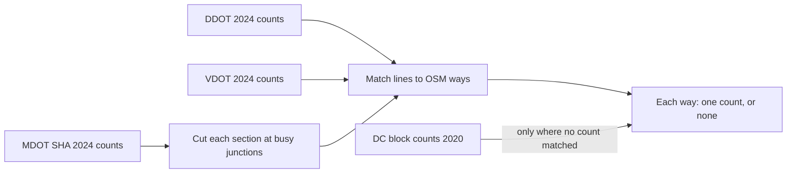
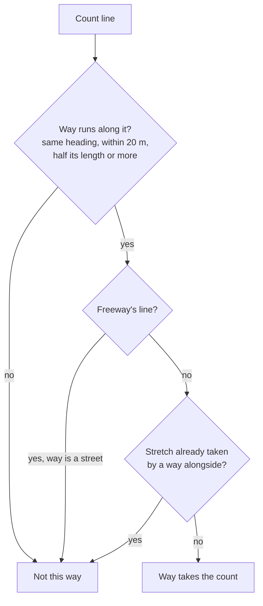
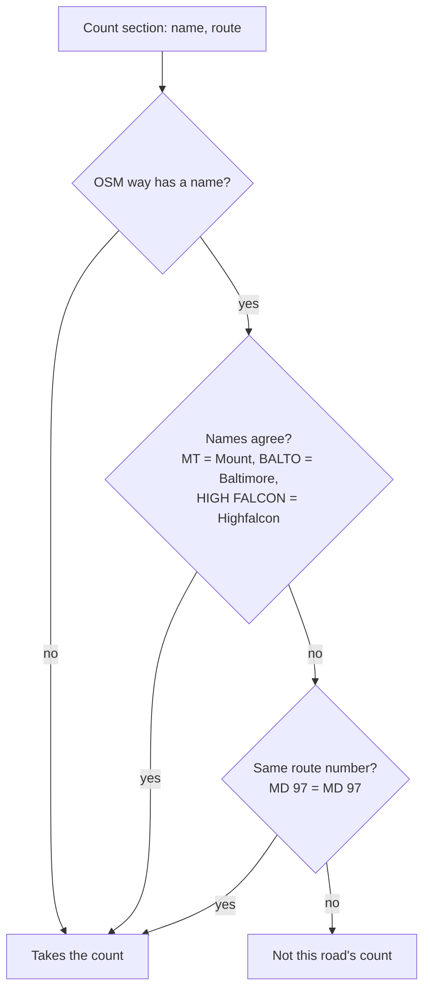
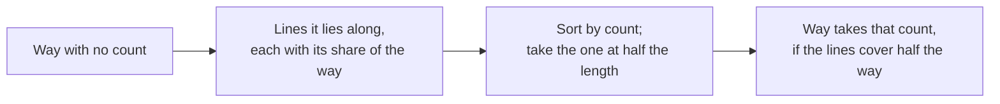
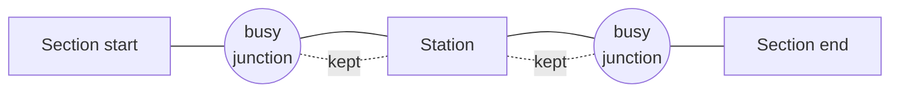
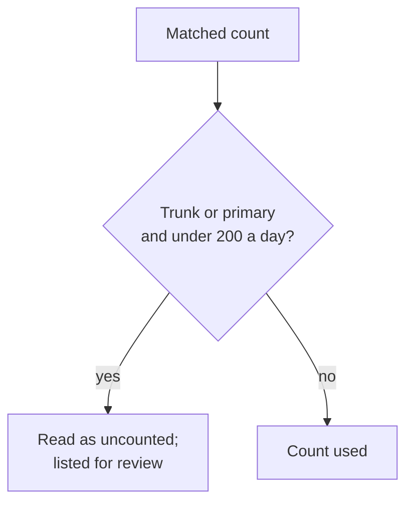

# Traffic counts: how a count reaches a road

A road's traffic count (AADT, the average number of cars a day, both directions together) is
one of the strongest facts behind its stress level: the classifier's gates read it
(`src/routemaker/stress.py`, and [classification.md](classification.md) for the rule order).
Agencies publish counts as lines on their own maps, not on OpenStreetMap's ways, so each count
line has to be matched to the OSM ways it describes. This page explains that matching, section
by section. The code is `src/pipeline/conflation.py` (matching) and
`src/routemaker/mdot_aadt.py` with `scripts/install_reference_data.py` (Maryland's counts as
they are installed).

The owner's rule for this page, 2026-11-13: "If I say that a road is incorrectly rated that
means that I feel the formula is wrong", "Or the raw data", "And that we should keep searching
for why", "There are far too many roads to hand count everything." So a road that took the
wrong count is fixed here, in the matching, and not with an override row.

Each section has a short plain explanation, a diagram, and a box with the full reasoning,
the code, the sources and the limits for anyone who wants to check the work.

## Which counts we use

We use the counts the three road agencies publish: the District's (DDOT), Virginia's (VDOT)
and Maryland's (MDOT SHA). Where two agencies count the same road, the more local one wins. In
the District, a street with no count can still take the older count DDOT published per block
in 2020. West Virginia publishes no count we read, so its roads are rated without one.

Full reasoning and citations (for review)

- Sources, with item ids, retrieval dates and licences: [docs/SOURCES.md](../SOURCES.md),
  "2024 Traffic Volume" (DDOT, CC BY 4.0), "VDOT traffic volume", and "MDOT SHA Annual
  Average Daily Traffic (AADT)" (ArcGIS item `77010abe7558425997b4fcdab02e2b64`, layer 1,
  <https://services.arcgis.com/njFNhDsUCentVYJW/arcgis/rest/services/MDOT_SHA_Annual_Average_Daily_Traffic/FeatureServer/1>).
- Share of the map each covers, on the 2026-11-01 map (reports/borrowed-counts/ALL-SOURCES.md,
  outside the repository): MDOT SHA 40,413 ways, 7,104 mi; VDOT 52,770 ways, 9,893 mi; DDOT
  7,894 ways, 507 mi; West Virginia none.
- Ranking between sources: `conflation.SOURCE_PRECEDENCE` (precedence tier) and
  `AgencyFeature.agency` (who published it); the block fallback is `conflation.block_count`.
- DDOT's 2025 count layer (ArcGIS item `09117b2464654e94b026b99160dc8f52`, MapServer layer 6,
  7,392 segments) was compared with the 2024 layer on 2026-11-13: 76% of segments unchanged,
  ratio 10th to 90th percentile 0.94 to 1.01. It replaces 2024 at the next map rebuild.
- Known limit: a count's year is stored (`volume_year`) but nothing reads it; see "What is not
  done yet".

## Matching a count line to a road

A count line is matched to the OSM ways that run along it: in the same direction, close to it
(within 20 m), and for at least half of the way's length. One stretch of a count line can only
go to one way, so a frontage road beside a main road does not also take the main road's count.
Service roads and tracks take no count line at all. A freeway's count goes to the freeway only,
even when a street runs right under or beside it.

Full reasoning and citations (for review)

- Code: `conflation.conflate`; separation `MAX_SEPARATION_M`, bearing `BEARING_TOLERANCE_DEG`,
  overlap `MIN_OVERLAP_FRACTION`; exclusivity `conflation._claim`; candidates rank by
  precedence, then the share of the way inside the line's ends (`_ranked_share`, hunt D3,
  2026-11-08), then mean distance, then ids so the result never depends on input order.
- Trails take no motor count (the Mount Vernon Trail runs 15 m from the GW Parkway):
  `variants.is_trail_class`, passed as the entry's third element.
- Service roads and tracks (`agency_roads.NAME_REQUIRED_HIGHWAYS`) take no count line: the
  block matcher's rule is that such a way takes an agency's line only where the names agree,
  and until 2026-11-13 count lines carried no name.
- Freeway lines (`FREEWAY_LINES_FREEWAY_ONLY`): a line whose nearest candidate is a motorway
  way is the freeway's; so is a line of at least `FREEWAY_STACKED_MIN_AADT` (20,000 a day, our
  default, unmeasured) that a motorway on another layer (`way_layer`) also reaches. A freeway
  line no freeway takes goes back to the streets (K Street NW's own 23,366 line). Case: Water
  Street NW took the Whitehurst Freeway's 37,593 a day and was rated 4; the owner, 2026-11-13,
  "water street is definitely not a high stress road". Checked on the live extract from the
  owner's PC: both Water Street ways take no count, K Street keeps its own lines, one
  trunk_link lost a count (196 ways gained a count in the DC test box, 7 lost, 13 changed).
- Limit: the 20,000 threshold is unmeasured; the methodology audit (area 04, suggestion 2)
  suggests the name rule below could replace it once DDOT and VDOT lines carry names too.

## Names must agree

Maryland's count sections carry the street name and route number they were counted on. A
section is not given to a named road whose name is different, unless the two share a route
number. This stops a count from one street being drawn on along the next street: MDOT SHA's
"Third Ave" section ran on along Obrecht Road and gave it Third Avenue's 6,152 cars a day. A
road with two names on one route (Georgia Avenue is "Roxbury Mills Rd" to MDOT SHA north of
Brookeville, both MD 97) keeps its count. A road with no name in OSM still takes the count.

Full reasoning and citations (for review)

- Code: `conflation.same_road`, applied in both passes of `conflation.conflate` through its
  `names` argument (each way's OSM `name` and `ref`, `src/pipeline/run.py`, the count stage);
  names compared by `agency_roads.names_agree` (identifying words, abbreviations expanded,
  street type and quadrant dropped; words run together also agree); route numbers from
  `mdot_aadt.route_ref` (`ID_PREFIX` IS, US, MD read as OSM's "I", "US", "MD"; county,
  municipal and ramp numbers are not OSM refs and are not compared).
- Installed fields: `name` (`ROADNAME`) and `ref` on each Maryland row of `volume.json`
  (`install_reference_data.volume_rows`). A `volume.json` installed before 2026-11-13 has
  neither, and then nothing changes: it takes effect when the next rebuild reinstalls it.
- Evidence: the borrowed-counts check (reports/borrowed-counts/flagged.json, 9,201 Maryland
  ways whose count was suspect): with the repo's name test, 8,422 ways agree, 609 (73.5 mi)
  disagree on a state or US route (kept where OSM's `ref` shares the route), and 170 (18.8 mi)
  disagree on a county or municipal section (no longer take that count). Examples: Obrecht
  Road (THIRD AVE, CO 675), Gas House Pike (MONOCACY BLVD, CO 413).
- Why a name test at all: the methodology audit, area 04, 2.3: "A count line carries no name"
  was a choice, not a fact; the block matcher already vetoed on names after 36th Place NE took
  New York Avenue's 53,745 (`conflation.conflate_blocks`).
- Limit: only Maryland's lines carry names so far; DDOT's and VDOT's could (the audit lists
  VDOT's `ROUTE_COMMON_NAME`), not yet installed.

## Roads past several count lines

Some OSM ways run past several short count lines, none covering half of the way, so the first
pass gives them nothing. A second pass reads every line the way lies along and gives the way
the count that most of its length carries (the middle value, weighted by length). It used to
take the highest one, which made a quiet stretch take its busiest neighbour's count.

Full reasoning and citations (for review)

- Code: `conflation._along_counts` and `conflation._typical_count` (weighted median by probes
  won, lower value at a tie, best-ranked source only). A stretch claimed by a way alongside is
  not taken twice.
- Owner decisions: the pass was approved for VDOT's counts (2026-10-31, "Let's go with all
  these"). Since 2026-11-13 it reads every agency's, our inference from the owner's rule of
  that day ("Don't use my calls as one-offs but guides to inference"; "Or the raw data"), not a
  decision of his on this change. The case was Kennedy Street NW east of Georgia Avenue: one
  way past several DDOT block lines, which took none and kept DDOT's 2020 LTS 4; it now takes
  6,272 a day.
- Median instead of highest: the methodology audit, area 04, 2.2 and suggestion 4. AADT
  smoothing (`pipeline/aadt_smoothing.py`) lowers a count above its street's median as
  "probably bunching by the intersection", so taking the highest here was the opposite
  reading. The audit counted about 30 mi taking a busier link's count this way
  (reports/borrowed-counts/multilink.json: Virginia 18.7 mi, Maryland 10.8 mi, DC 0.6 mi).

## Maryland sections stop at busy junctions

MDOT SHA counts traffic at one station and draws that count along a whole section, which can
run for miles and pass busy junctions. Past a junction where a busy road joins, the traffic is
not what the station counted. So each Maryland section is cut, when the data is installed, to
the stretch between the busy junctions on either side of its station. Roads beyond the cut get
no count from it and are rated the way any uncounted road is. Bucklodge Road was the case that
showed this: it took 5,641 cars a day from a station on the far side of its junction with
Barnesville Road.

Full reasoning and citations (for review)

- Code: `mdot_aadt.cut_at_junctions`, called from `install_reference_data.volume_rows`.
- A junction is another MDOT SHA section (a different route) whose end lies within
  `JUNCTION_REACH_M` (20 m) of this section's line, at least `JUNCTION_END_MARGIN_M` (250 m)
  from either end, carrying at least `JUNCTION_MIN_SHARE` (25%) of this section's count and
  at least `JUNCTION_MIN_AADT` (500 a day). Our defaults, unmeasured; they are the
  borrowed-counts check's test (reports/borrowed-counts/audit.py).
- The station is placed by its milepoint (`ID_MP` between `BEGIN_SECTION` and
  `END_SECTION`) only where the drawn line's length agrees with the milepoints within
  `LENGTH_AGREEMENT` (0.8 to 1.25); elsewhere the line is kept whole.
- Size, on the layer as read 2026-11-13 (10,013 sections, 10,692 mi): 1,572 sections cut,
  1,822 mi of line no longer carrying a count. At a 50% share it would be 1,199 mi; at 100%,
  555 mi. Bucklodge Road's section (BARNESVILLE RD, MD 117, 5.19 mi) keeps 1.08 mi; Gas House
  Pike's (MONOCACY BLVD, CO 413, 5.41 mi) keeps 0.48 mi.
- Why: the borrowed-counts check (REVIEW-LIST.md, 76 stretches, 40.6 mi rated 3.5 or higher
  on two-lane roads) and the methodology audit, area 04, suggestion 1. The owner's Bucklodge
  call, 2026-11-13 ("Don't use my calls as one-offs but guides to inference").
- Limit: a road whose level is pinned by an override row keeps that level whatever its count
  (the audit, area 04, 2.1); the 50 Maryland urban rows that rested on such counts are
  withdrawn by a draft file (fixtures/overrides/README.md). How the 1,822 mi rate without a
  count has not been measured yet; it shows at the next rebuild.

## Counts that cannot be right

A trunk or primary road counted at under 200 cars a day is read as uncounted: the road's own
class says it carries far more, so the count belongs to something else or was keyed wrong.
Piscataway Road, a primary road, took 40 a day from MDOT SHA's Floral Park Road section and was
rated on it.

Full reasoning and citations (for review)

- Code: `conflation.drop_implausible`, `IMPLAUSIBLE_AADT` (200), `IMPLAUSIBLE_CLASSES`
  (trunk, primary); applied in the count stage before a divided road's other carriageway
  shares the count, and the dropped matches are added to `rejected`.
- 200 is our default, unmeasured. MDOT SHA's lowest Maryland-route sections are 32 to 45 a
  day (Magnolia Rd MD 152, Floral Park Rd MD 223, Gilpin Rd MD 144, Caleb Rd MD 992), short
  spurs that OSM mostly classes below primary.
- Source: the methodology audit, area 04 (an implausibly low count is not checked).

## What is not done yet

Two of the audit's count suggestions need a decision from the owner before they are built: how
old a count may be before it counts for less, and how to treat VDOT counts that VDOT itself
marks as estimates. Until then every count counts the same, whatever its year or quality.

Full reasoning and citations (for review)

- Count year: stored as `volume_year`, never compared (the methodology audit, area 04, 1.7;
  skeptic s2 row 18).
- Count quality: VDOT's `ADT_QUALITY` is not installed (audit area 04, suggestion 6).
- A report of `rejected` and `unmatched_features` is not written yet (audit area 04,
  suggestion 8).

