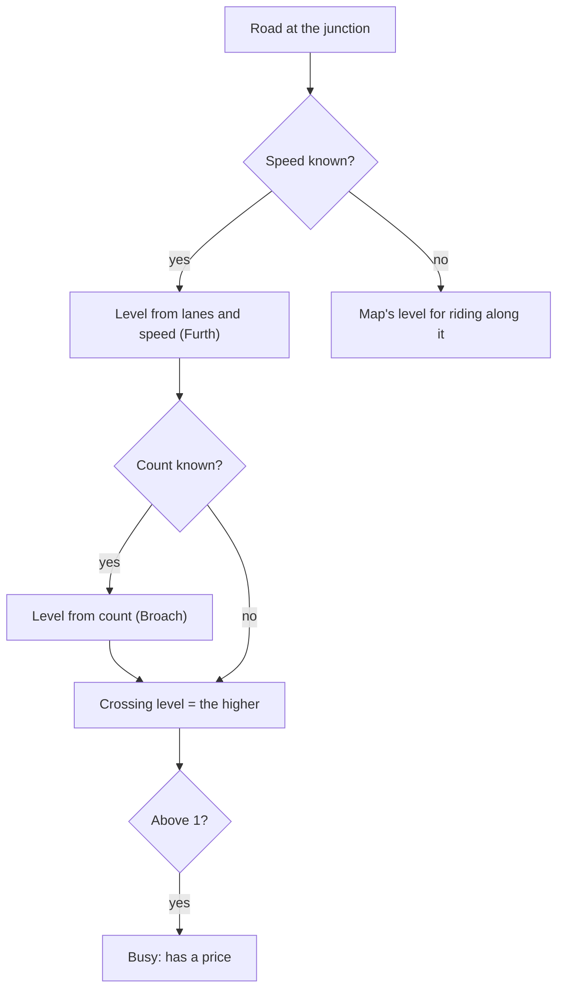
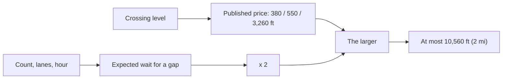
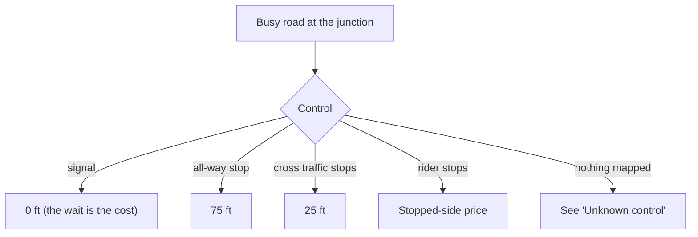
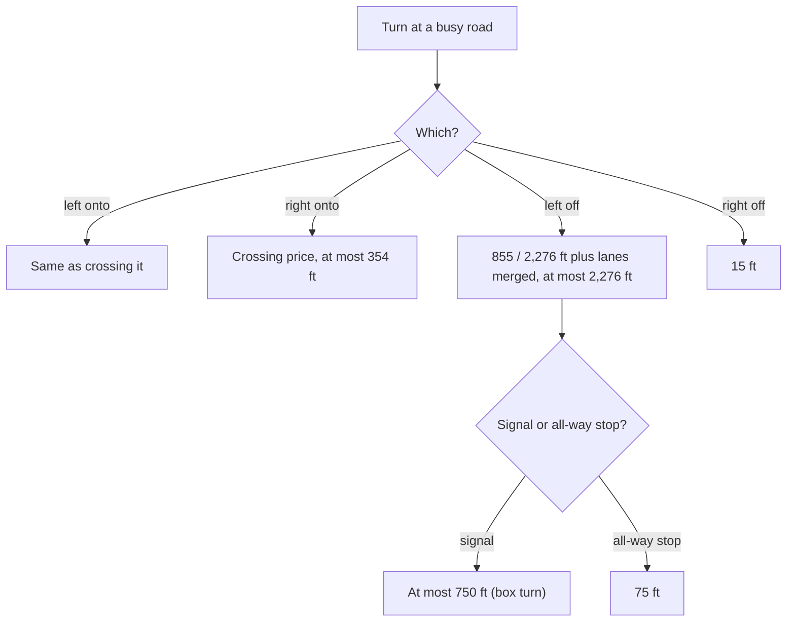
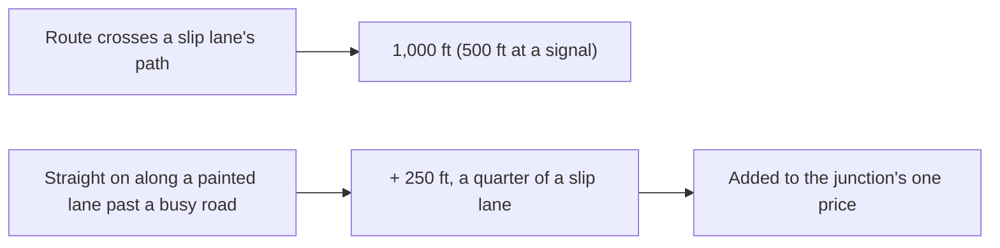
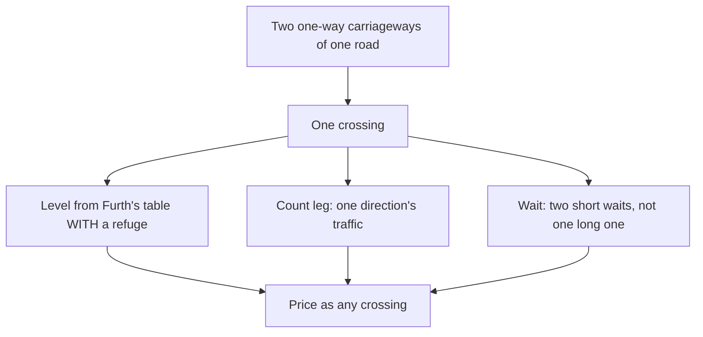
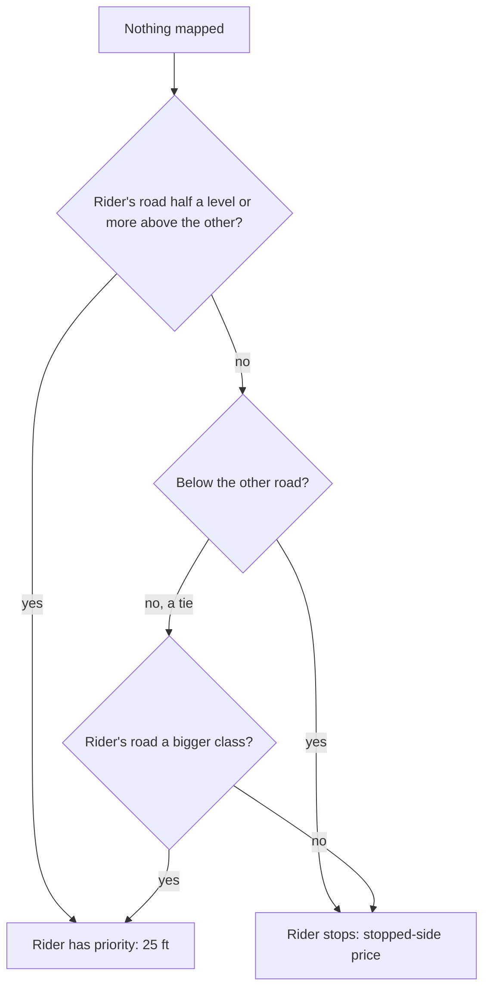
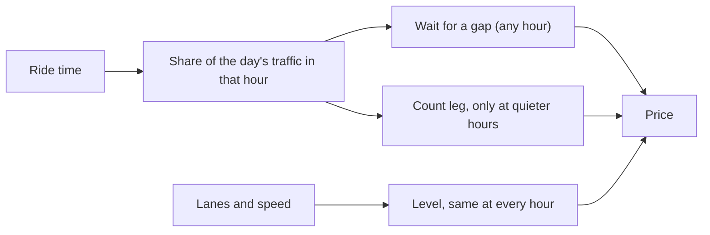
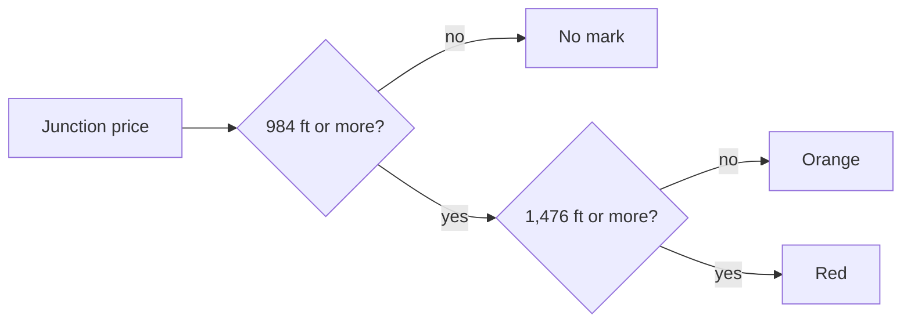
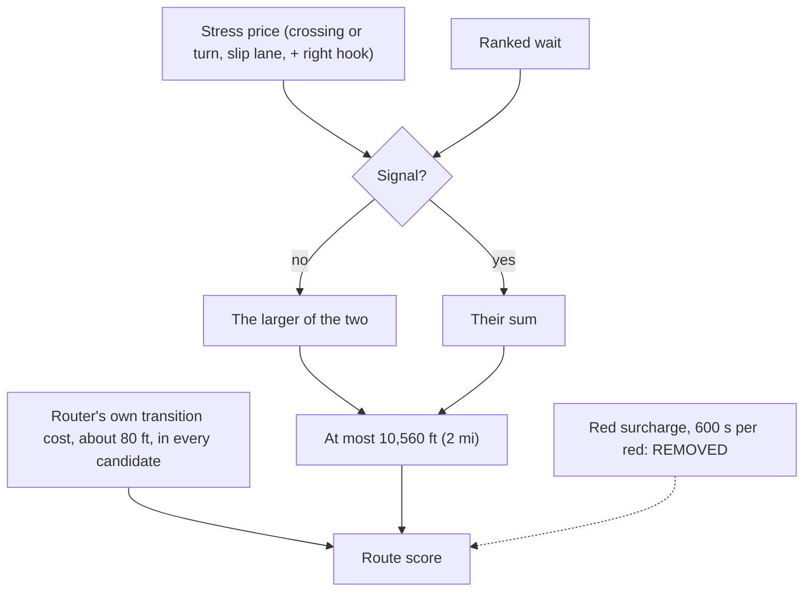

# The intersection model

What a junction on a route costs a rider, and which junctions get an orange or red mark.
The code is `src/routemaker/intersections.py`; the score that uses it is
`src/core/refine.py`. Costs are in **feet of quiet-street riding** ("calm feet"; 5,280 of
them are a calm mile): a junction that costs 550 ft is worth riding 550 ft further on a
quiet street to avoid.

The model was rebuilt on 2026-11-13 after a methodology audit. It is now **one crossing
function**: a road is read by its lanes, speed and daily traffic count, and the price of
crossing it with no signal is the larger of what riders are seen to pay to avoid such a
crossing and twice the expected wait for a gap. It replaced a stack of factors (speed,
lanes, volume, rural, a "severe tier", time-of-day bands, a rush-hour floor, a surcharge
on every red junction) in which the same thing was often charged two or three times.

Every number below carries one of five labels: **law** (a statute), **literature** (a
published source, listed in [literature.md](literature.md)), **measured on our data**,
**the owner's choice** (with the date), or **our default, unmeasured**.

Nothing in the logic names a road, a place or an agency. The statutory speeds and the
traffic counts arrive as data on the segment table; another region supplies its own.

## Why it is not in the router's graph

The router (Valhalla) charges about the same few seconds at every junction, whatever road
is crossed and whether or not there is a signal. So the junction model runs on the
finished route: it looks at each junction the route passes, prices it, and the planner
uses the total to choose between candidate routes and to look for a way round the worst
ones.

Full reasoning and citations (for review)

Valhalla's bicycle costing has no hook that knows which road is crossed or which way the
rider turns. Measured on the live standard router (docs/DEVELOPMENT.md, "Intersection
costs"): every node costs 0 to 6 s of transition time whatever the crossed road is (3.7 s
median for crossing a primary or secondary road from a residential street, signalled or
not), and a right turn costs more than a left. The tag transform sees one way or one node,
never the roads that meet at a node. The model therefore works on the traced route
(`core.junctions.events_of`, `intersections.assess_route`), where the roads, the movement
and the control flags at each junction are known.

Known limit: because the cost is outside the router's search, it can only choose among
routes the search or the calm search (`core.refine`) proposes. About 80 ft of the router's
own transition cost is in every candidate as well; it is small and nearly the same on
every candidate, so it is left in (see the stacking diagram at the end).

## Which roads count

A junction costs something only when a **busy road** is involved: one the rider crosses,
turns onto, or turns off. A road is busy when its **crossing level** is above 1. The
crossing level runs from 1 (nothing to wait for) to 4 (a barrier), and it is about
crossing the road, not riding along it: a bike lane on the road does not make it easier
to cross. Quiet street meeting quiet street costs nearly nothing.

| Lanes crossed in all | up to 25 mph | 30 mph | 35 mph | 40 mph or more |
|---|---|---|---|---|
| up to 3 | 1 | 1 | 2 | 3 |
| 4 to 5 | 2 | 2 | 3 | 4 |
| 6 or more | 4 | 4 | 4 | 4 |

| Vehicles a day | 5,000 or fewer | 7,500 | 15,000 | 20,000 or more |
|---|---|---|---|---|
| Level | 1 | 2 | 3 | 4 |

Full reasoning and citations (for review)

- **Lanes and speed (literature).** Mekuria, Furth and Nixon (2012), MTI Report 11-19,
  Table 7, "Unsignalized Crossings Without a Median Refuge", copied cell for cell into
  `intersections.CROSSING_LTS`; straight lines between the speed columns
  (`CROSSING_SPEEDS_MPH`), so an odd posted speed is not a step. Lanes are counted across
  the whole road (`lanes_crossed`).
- **Count (literature).** Broach, Dill and Gliebe (2012), Table 3: nothing measurable
  below 5,000 a day, then bins of 5,000-10,000, 10,000-20,000 and 20,000 or more.
  `COUNT_LEVELS` puts each closed bin at its middle and the top bin at its lower edge,
  with straight lines between. The straight lines are our default; the audit found
  whole-level cliffs in the old model (a crossing went from 1,368 to 3,420 ft between
  7,999 and 8,000 vehicles a day) and a count must not do that.
- **The higher of the two** (`traffic_level`). Pairing Furth's level n with Broach's nth
  bin is our default: Furth's levels are barriers by rider type, Broach's are prices.
- **Speed where none is posted (law).** A road of two or more lanes each way is read at
  the statutory default: the District's 20 mph default (in force since 2020-06-01, DDOT);
  Maryland Transportation Article 21-801.1; Code of Virginia 46.2-870 to 46.2-878. The
  values are data on the segment table (`road_default_speed_mph`), not constants here
  (`crossing_speed`). A narrower road with no posted speed keeps the map's level, because
  the statutory default would rate a quiet street busy.
- **The owner's rule this implements.** 2026-10-26, of a street crossing a four-lane road
  with a bike lane: "It's only LTS2 because it also has a bike lane ... this intersection
  should be weighted much more highly." 2026-10-31: "a protected bike lane on a busy road
  is just as hard to cross. Would it make more sense to just switch to something like:
  traffic volume, speed, number of lanes to cross, and intersection type?" Until
  2026-11-13 the code answered with the table for riding ALONG a road, which calls a
  four-lane 30 mph street LTS 4; to cross, Furth rates it 2.
- **"Busy is 2.5", corrected.** Earlier text said a road is busy from tier 3; the code
  counted from 2.5. Now: a road read by its traffic is busy above crossing level 1
  (`Road.busy`); a road that cannot be read by its traffic (no speed) is busy from 2.5 on
  the map's scale, as before.
- **Limits.** A count on one carriageway of a divided road is read as the whole road's.
  Furth's tables have no volume column, so a wide or fast road with very few cars still
  takes its lanes-and-speed level (a 50 mph two-lane road with 1,800 cars a day: level 3,
  550 ft; it was 10,560 ft at rush hour).

## Crossing a busy road from the stopped side

When the rider has the stop sign and the busy road does not, the price is the larger of
two things: the published price for a road of that crossing level, and twice the time a
rider can expect to wait for a gap at that hour. On most roads the first is larger. On a
wide road with heavy traffic at rush hour the wait runs to minutes, and the price rises
to the most any junction can cost, 2 calm miles.

| Road crossed, stop sign | Off-peak | Weekday rush |
|---|---|---|
| 2 lanes, 30 mph, 8,000 a day | 391 ft | 391 ft |
| 2 lanes, 30 mph, 15,000 a day | 550 ft | 550 ft |
| 4 lanes, 30 mph, no count | 380 ft | 380 ft |
| 4 lanes, 30 mph, 25,000 a day | 3,260 ft | 3,260 ft |
| 6 lanes, 35 mph, 38,000 a day | 3,825 ft | 10,560 ft |

Full reasoning and citations (for review)

- **Published prices (literature).** `STOPPED_CROSSING_FT` = 380, 550 and 3,260 ft at
  levels 2, 3 and 4: Broach, Dill and Gliebe (2012), Table 3, non-commute trips: an
  unsignalised crossing of, or left onto, a road of 5,000-10,000 a day is worth 7.2% of a
  mile, of 10,000-20,000 a day 10.4%, of 20,000 or more 61.7%. Straight lines between
  levels (`_at_level`). The non-commute column is used because the default ride is
  stress-averse; the commute column is about half.
- **The wait for a gap (literature).** `gap_delay_s`: the Highway Capacity Manual 2000
  formula as printed in Fitzpatrick et al. (2006), NCHRP Report 562, Appendix A: critical
  gap tc = L / S + ts, delay d = (e^(v tc) - v tc - 1) / v. 12 ft lanes and 3 s start-up
  are the report's; above 35 mph the flow is divided by 0.7 (its worksheet 2). The
  crossing speed is the Default ride's 11.2 mph (16.4 ft/s) in place of a walker's: our
  choice of input. The same formula and figures time the wait shown to the rider
  (`routemaker.junction_delay`).
- **Twice the wait (the owner's choice).** `WAIT_PAIN` = 2. The owner, 2026-10-23, of two
  stop-sign crossings of six-lane commuter roads at rush hour: "essentially impassable";
  "Most people would rather bike 10 minutes than wait 5 minutes at a busy crossing for an
  opening. There are rarely openings." Ten for five is 2. Until 2026-11-13 that one
  sentence was charged three times: x2 on every unsignalised LTS 4 junction at rush hour,
  a floor of 9,840 ft under it, and 600 s more for every red junction in the score. The
  floor ignored the count. Now the formula says which crossings have "rarely openings".
- **Owner-decided numbers changed.** The level 3 price was 1,600 ft and the level 4
  price 4,000 ft (decision 468, "option C", a card pick among three offered). The audit
  found no published source for 1,600 ft; the figure it leaned on (818 ft, Eugene) is a
  left across a road of over 20,000 a day. For 5,000-20,000 a day the old model charged
  1,088 to 3,900 ft, 3 to 11 times Broach. The owner, 2026-11-13: "Skeptically review
  every one of my calls ... If there's a better call go with that."
- **Removed, with nothing in their place:** the speed, lane and volume factors, the rural
  x1.25, the "severe tier", the 45 mph stopgap for an unposted LTS 4 road.
- **Limits.** The formula takes random arrivals and no driver yielding, so it overstates
  where signals upstream bunch the traffic. Broach's riders are Portland's.
- **What would change it:** hourly counts; a revealed-preference study in this region.

## Signals, all-way stops and the priority side

A crossing at a traffic signal has no stress price at all: what a signal costs is the
wait, and the wait is charged once, by the junction waits. An all-way stop costs a
little, because everyone stops. Riding along the main road past a side street that has
the stop sign costs almost nothing. A stop sign where two quiet streets meet costs
almost nothing and is never marked.

Full reasoning and citations (for review)

- **Signal: 0 ft (literature).** Mekuria, Furth and Nixon (2012): signalised crossings "do
  not usually present a barrier". Broach's signal (2.1-3.6% of a mile) is the delay, which
  `routemaker.junction_delay` charges. Until 2026-11-13 a signalised crossing also paid
  150 ft (LTS 3) or 600 ft (LTS 4) of stress on top of its wait (decision 468, a
  suggestion the owner did not object to). The owner's rule, decision 303: "our routing
  is a sum of intersection stress and route stress, we don't want to double count." The
  event is still made, at 0 ft, because the waits find the signal by it
  (`intersections.signal_points`). A LEFT at a signal keeps a price (next section).
- **All-way stop: 75 ft** (`ALL_WAY_STOP_FT`). Our default, unmeasured; Broach's stop
  sign is 26-48 ft.
- **Priority side: 25 ft** (`PRIORITY_SIDE_FT`). Our default, unmeasured. The owner,
  2026-10-01 (decision 169, typed): "if you're on the free-flowing route of traffic and
  there's a stoplight or sign for cross traffic, the penalty is much less than being on
  the cross side."
- **Neighbourhood stop: 10 ft** (`NEIGHBOURHOOD_STOP_FT`). Our default. The owner
  (decision 171, typed): "Don't overpenalize neighborhood roads with stop signs though.
  They rarely cause issue." **Law** in the District: a rider may treat a stop sign as a
  yield (Safer Streets Amendment Act of 2022, D.C. bill B24-0673). Not law in Maryland or
  Virginia; the price is the same everywhere.
- These fixed charges fade in between crossing level 1 and 2 (`_fade`), so none appears
  whole at one count.
- **Flashing beacons** mapped as signals are priced by their signs, not as signals
  (`with_beacons`, `beacon_control`; unchanged).

## Left turns and right turns

Turning left **onto** a busy road costs what crossing it costs, since the rider waits
for the same gap. Turning right onto it costs much less. Turning left **off** a busy
road means crossing its oncoming traffic, and on a road with several lanes also moving
across them to the turning position. At a signal a left never costs more than a
two-stage "box turn", which is always available.

Full reasoning and citations (for review)

- **Left onto = crossing (literature).** Broach's Table 3 has one variable for "left
  turns and through movements at unsignalized intersections". It was x1.5 (our default).
  With x1.5, a signalised left ONTO an LTS 4 road (900 ft) cost more than the 750 ft cap
  on a left OFF it; that inversion is gone (`onto_ft`).
- **Right onto: at most 354 ft (literature).** `RIGHT_ONTO_MAX_FT`: Broach, "right turns
  at unsignalized intersections with cross traffic volume 10,000+ per day", 6.7% of a
  mile. It was x0.1 of the crossing. The owner's direction (decision 166, typed) is kept:
  "For most roads, a right turn might be close to 0."
- **Left off (literature).** `LEFT_ACROSS_ONCOMING_FT` = 855 ft at level 3, 2,276 ft at
  level 4: Broach, "left turn without traffic signal", 16.2% and 43.1% of a mile. They
  were 800 and 4,000 ft. None on a one-way road. Never less than twice the wait for a gap
  in the oncoming direction (`gap_ft` with that direction's lanes and half the flow).
- **Lanes merged across (our default, unmeasured).** `MERGE_FT_PER_LANE`: 792 ft a lane
  at level 3, 1,584 ft at level 4. The owner asked for it (decisions 167 and 468, typed:
  "What about having to change lanes to make a left? That's very stressful too"); no
  source gives a figure. Because Broach's figures are for the WHOLE left, the table price
  and the merge together stop at his 2,276 ft (`left_from_ft`); they had summed to 1.8 to
  2.5 times it.
- **At a signal:** the oncoming part x0.4 (`SIGNALISED_LEFT_FACTOR`, our default) and the
  whole left at most 750 ft (`BOX_TURN_CAP_FT`; the owner, decision 167: "box turns are an
  option"; the figure is our default, about one more signal wait).
- **At an all-way stop:** 75 ft. The audit found a left off a busy road at an all-way
  stop priced as if nobody stopped (1,920 to 6,584 ft). Fixed.
- **Right off: 15 ft** (`RIGHT_FROM_BUSY_FT`), our default.
- **Roundabouts** (`ROUNDABOUT_FACTOR_ONTO`: 0.1 / 0.55 / 1.0 of the ring's crossing
  price for the first exit / straight on / a left or more): our default, unmeasured,
  unchanged. Furth has a draft table by circulating lanes and entering volume; the map
  has no entering volume.

## Slip lanes and right hooks

Crossing the path of a free-flowing turn lane (a slip lane) costs a fixed amount,
because drivers there are looking the other way. Riding straight on along a painted
bike lane past a busy road costs a quarter of that, at signals too: it is where a
turning car cuts across the lane (a right hook).

Full reasoning and citations (for review)

- **Slip lane: 1,000 ft** (`SLIP_LANE_FT`; x0.5 at a signal, `SIGNALISED_SLIP_FACTOR`).
  **Our default, unmeasured.** The rule is the owner's (decision 169, typed: "Sliplanes
  should get a penalty too"; 195: only where the route crosses it). No source we opened
  prices a slip lane. A commute of his crosses six by choice, so the figure may be high.
- **Right hook: SLIP_LANE_FT / 4** (`RIGHT_HOOK_FT`). Not a number of its own. The owner,
  2026-11-13, typed, of a painted lane: "Right hook chances"; "Add the risks to the
  junctions, rather than the road"; "It's not as bad as a slip lane, but it's still a
  cost". The placing is his; the quarter is unmeasured. It fades in with the crossed
  road's level and is added to the junction's price inside `cost_of`, so it is part of
  the one price and of the 2 mile cap.
- **Painted lanes only, and why that is a known limit.** A side path's and a protected
  lane's side-street mouths are already counted in that way's own level
  (`stress.beside_busy_road_step`), so charging them here would count them twice. The
  2024 National Academies crash model (audit areas/14, section 2g) does not find painted
  lanes worse than separated ones at junctions, so the charge belongs on every
  right-edge bike facility once the level step is gone. Listed for the side-path work.

## A median refuge

A divided road is crossed one half at a time, with somewhere to wait in the middle. Its
two carriageways count as **one** crossing. How much the refuge helps depends on the
road: nothing on a road of up to three lanes or at 35 mph and above on four or five
lanes, and a lot on a slow, wide road. The wait is for one direction's traffic at a time.

| Lanes in all, with a refuge | up to 25 mph | 30 mph | 35 mph | 40 mph or more |
|---|---|---|---|---|
| up to 3 | 1 | 1 | 2 | 3 |
| 4 to 5 | 1 | 2 | 3 | 4 |
| 6 or more | 2 | 3 | 4 | 4 |

Full reasoning and citations (for review)

- **Literature.** Mekuria, Furth and Nixon (2012), Table 8, "Unsignalized Crossings With
  a Median Refuge at Least Six Feet Wide", cell for cell (`REFUGE_LTS`). NCHRP Report 562:
  with a refuge the conflicting flow is one direction's and each half is crossed
  separately (`gap_delay_s`, `Road.divided`).
- **An owner-decided number changed.** It was a flat x0.75 on the dearer carriageway
  (decision 196, a card pick: "x0.75 (Recommended)"), which gave a credit on fast roads
  where Furth gives none and too little on slow wide ones. The real fix in that decision,
  counting a divided road once (185: "Divided-road crossings count once"), is kept
  (`merge_nearby`, `_one_road`).
- 196's stated aim was to keep an unsignalised crossing of one six-lane divided road
  red. No floor is kept for it: at 35 mph or more the table gives no credit and such a
  crossing is red; at 30 mph with no count it is level 3, 550 ft, unmarked. See "Owner
  calls the formula does not reproduce" below.
- A carriageway that costs nothing alone can still be half of a divided road that costs
  something (four lanes at 30 mph); its event is kept at 0 ft so the two halves can be
  priced together (`assess`).
- **Not read:** an island on an undivided road (`crossing:island`); needs a tag-transform
  change.

## Unknown control

Often the map has no signal and no stop sign at a junction. The model then asks which
road is clearly the bigger one. If the rider's road is clearly bigger, the rider is
treated as having the right of way. Only on a true tie is the rider treated as the one
who stops, which is the cautious reading. A rider on a path beside a main road has that
road's right of way where the path crosses a side street.

Full reasoning and citations (for review)

- `has_priority`: priority at `PRIORITY_MARGIN` = 0.5 crossing levels or more (our
  default, the smallest step the map makes); on a tie in traffic, a bigger road class
  (`Junction.class_edge`, from the router's classes, `CLASS_RANK`) decides.
- **What was wrong.** The audit found the rider priced as the stopped side on every tie:
  a rural main road paid about 4,080 ft at each unmapped crossroad of an equal road. The
  owner's rule (decision 169) is that the free-flowing side pays little.
- **Side paths.** `Junction.beside` is the road a path or protected lane runs beside,
  found at run time by `core.junctions.beside_roads` (the busiest non-trail segment
  within 20 m and within 30 degrees of parallel). The rider's level for priority is then
  that road's. Before, a rider on a side path paid the stopped-side price at every side
  street.
- **Limits.** Class is OpenStreetMap's and varies by mapper. A true tie stays cautious,
  so two equal roads with a missing all-way stop are over-priced.

## Time of day

There are no time-of-day multipliers. The hour matters only through traffic. At rush
hour the wait for a gap on a busy wide road becomes long, and the price follows it. At
the weekend and at night the road's count is read in proportion to the hour's traffic,
so a busy two-lane street is cheap to cross at 11 PM. The lanes and the speed do not
change with the hour, so a six-lane road stays a level 4 crossing at 5 AM.

| Ride time | Share of the day's traffic in one hour |
|---|---|
| Weekday rush (7-10 AM, 4-7 PM) | 8% |
| Weekday off-peak, and unknown | 5.5% |
| Weekend daytime | 5% |
| Night (9 PM-7 AM) | 1.5% |

Full reasoning and citations (for review)

- `HOUR_SHARE` is **our default, unmeasured**: a typical urban day. Hourly counts would
  replace it; the junction waits use the same shares.
- **Replaced:** x1.25 at rush hour, x0.85 at the weekend, x0.5 (urban) or x0.85 (rural)
  at night, and x2 with a 9,840 ft floor at unsignalised LTS 4 junctions at rush hour
  (decisions 468a, 469c-469e and 2026-10-23). The owner typed the direction ("Put some
  more intersection stress during rush hour too and a little less on weekends and off
  hours"; "Evenings are probably 1x till about 9. Then reduced to about half to 7"); the
  values were suggested to him. The direction is kept in every band.
- **Why the count leg is not raised at rush hour:** Broach's prices already average a
  rider's day, rush hour included; raising the count by the rush share would price a
  two-lane 14,000-a-day street as a 20,000-a-day one, where the formula gives a wait of a
  few seconds. So at rush hour only the wait acts (`traffic_level`, `gap_ft`).
- **A difference from the owner's "about half" at night.** A count-driven crossing now
  falls by more than half at night (a two-lane 30 mph street with 20,000 a day: 3,260 ft
  by day, 69 ft at night), while a crossing held by its lanes and speed does not fall at
  all. Whether a commuter road at 5 to 7 AM is "night" is an open question; with this
  rule a six-lane road stays red then, which the old x0.5 did not ensure.
- `Event.time_band` still names the hour where it moved the cost by a foot or more;
  `Event.time_factor` is the cost over the cost with no ride time.
- `intersections.is_urban` (the Census urban area flag) is no longer used by this model.
  It stays as the one definition of "urban at a junction" for the junction waits.

## Orange and red marks

A junction is marked orange when its price is like a wait of 30 seconds or more, and red
when it is like a wait of 45 seconds or more. Those are the waits at which people start
taking risks rather than keep waiting. Red junctions are also the ones the planner looks
for a way round.

Full reasoning and citations (for review)

- **Literature for the waits.** NCHRP Report 562 (its table from the Highway Capacity
  Manual): above 30 s of delay the likelihood of risk-taking is "high", above 45 s "very
  high". `ORANGE_MIN_FT` and `RED_MIN_FT` are those waits at `WAIT_PAIN` and 16.4 ft/s:
  984 ft and 1,476 ft. Reading a price as a wait is our default.
- **Owner-decided numbers changed.** They were 800 ft and 3,100 ft (decision 468; red
  raised from 2,900 on 2026-10-10, a card pick, "Raise red slightly", to hold a mix of
  markers on a sample of routes under prices that have all since moved).
- **Effect.** A crossing of a 10,000-20,000 a day road from a stop (550 ft) is no longer
  marked; of a 20,000-a-day road (3,260 ft) red. A slip lane (1,000 ft) is orange. The
  116-route sample was not re-run (no live router in this work), so the mix of marks on
  real routes is unmeasured.
- **Trail crossings** with no signal mapped are no longer capped at orange (decision 185,
  a card pick). Their price is the stopped-side price times the share of drivers who do
  not yield at a marked crossing, 39% at 25 mph and 83% at 35 mph or more
  (`MARKED_YIELD_SHARE`; NCHRP Report 562: 61% and 17% yield). It was a flat x0.5, which
  hid real reds.
- **Riders' ratings** of a junction (`RATING_COST_FT`) take the orange line for "takes
  patience" and the level 4 crossing price for "hard"; "easy" is the all-way stop's.
- **Mass Ride** colours by the map's level of the road (`assess(group=True)`): unchanged.
- `core.refine.REFINE_MIN_EVENT_FT` (what the calm search tries to route round) is
  `RED_MIN_FT`.

## How a junction's cost enters the score, and the cap

A route's score adds up its junction prices, weighted by the ride type. One junction is
charged **once**: with no signal, its price already contains the wait, so the larger of
the price and the ranked wait counts, not both. At a signal the price is only what the
wait does not cover (a left's box turn), so the two add. And no junction, everything
included, counts for more than 2 calm miles.

Full reasoning and citations (for review)

- `core.refine.Analysis.score` adds `ctx.weight` x the events' cost (the intersection
  weight of the ride type) and the ranked waits, then subtracts
  `core.refine.junction_over_cap_m`: for each event, the waits within
  `intersections.MERGE_WITHIN_M` (148 ft) of it are the same junction; with no signal the
  junction counts max(stress, wait), at a signal stress + wait; never more than
  `JUNCTION_CAP_FT` = `intersections.MAX_CROSSING_FT`.
- **The owner's rule.** Decision 303 (typed): "our routing is a sum of intersection
  stress and route stress, we don't want to double count." Decision 467 (typed): "There's
  definitely intersections that I'd detour 2 miles to avoid, though rare."
- **What the audit measured before** (its section 3.4): one stop-sign crossing of a
  four-lane 35 mph road at rush hour came to 16,330 ft, 3.1 miles (stress + give-way wait
  + 9,840 ft for being red); the mildest red, 3,100 ft, scored 12,940 ft. About one red a
  trip on the scorecard, so "rare" it was not.
- **`RED_DETOUR_S` (600 s per red) is deleted.** An owner-linked number removed: it came
  from the same 2026-10-23 sentence as the rush-hour x2 and floor.
- **Whether "2 miles" meant the whole junction or its stress part** is read here as the
  whole (the audit's question 5 to the owner).
- **Stacking that remains, on purpose:** the router's own transition cost (it is in the
  router's cost for every candidate and cannot be taken out per junction); a left at a
  signal plus that signal's wait; the right hook on top of a crossing at the same
  junction (a second conflict, inside the one price and the cap); events within 148 ft
  merged at half price after the dearest (`merge_nearby`, `MERGED_SHARE`).
- The search itself: `REFINE_MIN_EVENT_FT`, `core.red_crossings`, `core.avoid_junctions`
  (a listed "avoid" junction is 30 minutes a pass, decisions 307-309; the list ships
  empty).

## How it fits the owner's observations

The owner's statements about particular junctions are data the function is checked
against, not rules inside it (2026-11-13: "Own calls were mainly to help tune the
formula not override it"). No road is named in the code. Costs are for the stopped side,
from running the code on a road of the stated class.

| His observation (typed) | Road class | Before | After | Reproduced? |
|---|---|---|---|---|
| "essentially impassable" at rush hour; "rather bike 10 minutes than wait 5" | 6 lanes, 35 mph, 38,000 a day, stop sign | 10,560 ft + 9,840 ft for the red + the wait, at rush hour | 10,560 ft at rush, 3,825 ft off-peak, 3,260 ft at night, charged once | yes |
| "a busy 2 lane each way road ... this intersection should be weighted much more highly" | 4 lanes, 30 mph, bike lane | 4,500 ft, red (9,840 ft at rush) | by its count: 380 ft uncounted, 550 ft at 15,000 a day, 3,260 ft from 20,000 | yes if its count is 20,000 or more; not known to us |
| "2 one way lanes aren't nearly as bad as 2 two way lanes each direction" | one-way, 2 lanes, 30 mph against 4 lanes two-way | lower | level 1 (0 ft) against level 2 (380 ft) | yes |
| "Much lower penalty for traffic signals" | any, at a signal | 150 / 600 ft + wait | 0 ft + wait | yes |
| "a right turn might be close to 0" | right onto a busy road | 160 / 400 ft | at most 354 ft | yes |
| "Don't overpenalize neighborhood roads with stop signs" | quiet meets quiet | 10 ft | 10 ft | yes |
| "intersections that I'd detour 2 miles to avoid, though rare" | the worst | every red 2.4 mi or more | only where the wait runs to minutes | yes |

**Owner calls the formula does not reproduce**

| His call | Road's facts | Rule gives | He said | Best guess at the missing input |
|---|---|---|---|---|
| A divided six-lane road crossed with no signal "stays red" (decision 196) | 6 lanes divided, 30 mph, no count | level 3, 550 ft, no mark | red | the count (red from about 33,000 a day on the whole road) or a prevailing speed above the posted 30 |
| Night "reduced to about half" (469c) | count-driven crossings | far below half | about half | hourly counts; whether 5-7 AM is night |
| A four-lane 30 mph road crossed from a stop is hard, whatever its count | 4 lanes, 30 mph, no count on the segment | 380 ft, no mark | "weighted much more highly" | a count for the road; Furth rates it LTS 2 to cross |
