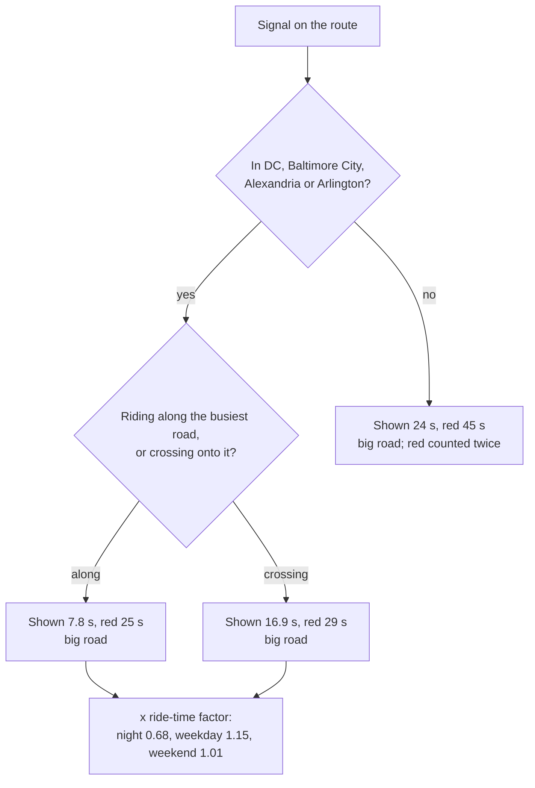
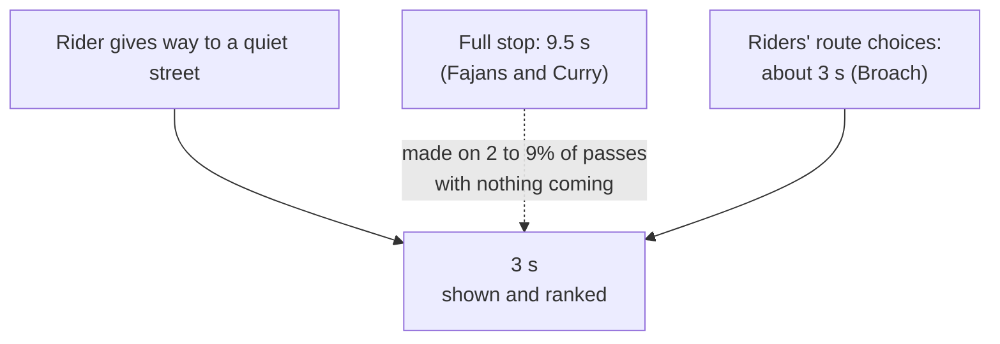
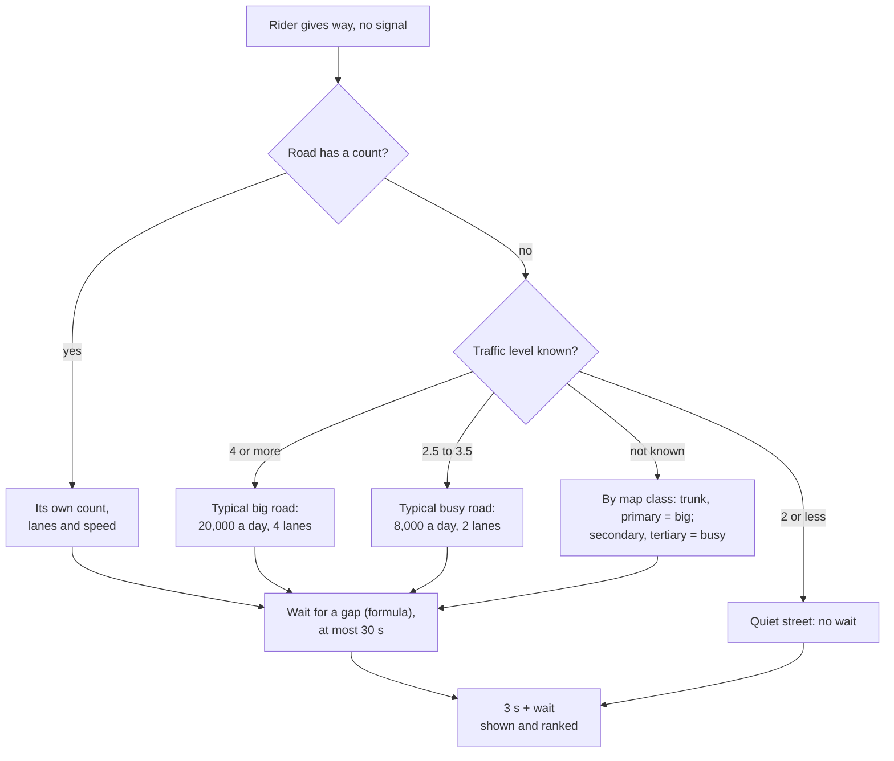
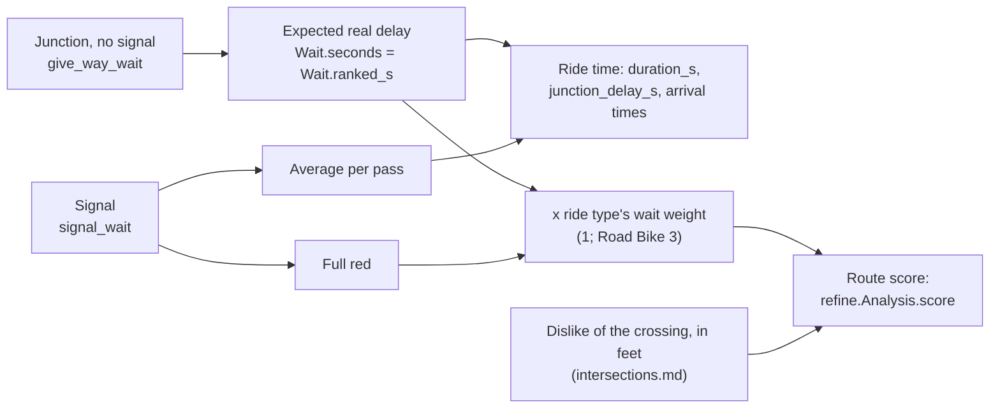
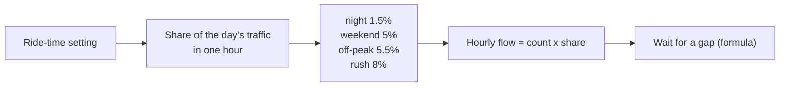

# Junction waits

How much time a ride loses at junctions, and what a junction costs when routes are
compared. The router's own time leaves almost all of it out (about a second a junction),
so `src/routemaker/junction_delay.py` adds it. This is separate from the junction's
**stress** cost in feet, which is on [intersections.md](intersections.md).

Every junction on a route has two figures here:

- the **time shown**: seconds added to the ride time (`duration_s`) and the arrival times;
- the **ranking price**: seconds of riding the route search counts against the junction.

At a junction without a signal the two are now the same number, the expected real delay.
At a signal they still differ (see "Signals").

The model is meant to work in any US city: one published delay formula, fed the map's
data about each road. Each number below carries one of five labels: **law** (the statute
is cited), **literature** (the source is cited), **measured on our data** (it says on
what), **the owner's choice** (with the date), or **our default, unmeasured**.

This page describes `release/v0.26.0` plus the junction-wait changes of 2026-11-13 (the
methodology audit, section 3.5). Draft PR #1240 changes the signal rules; see "Signals".

## Signals

Written by the thread that owns PR #1240 (the signal split and the measured ride-time
factor). It describes the signal code as that PR leaves it; until it merges, this branch
still runs the release's signal figures.

At a traffic light we keep two numbers. The first is the time a route shows you: the average wait per pass, counting the times the light was green. The second is what the route planner weighs when it compares routes: the wait at a red. In the cities both come from the owner's own rides through the District's signals. Crossing a big road from a side street, he stopped at about 4 passes in 10, and a stop lasted about half a minute. Riding along the big road, he stopped at about 2 in 10, and a stop lasted about 25 seconds. So a route that rides along a main road through its lights shows less waiting than one that crosses it at every light. The waits are shorter at night, about two thirds of the usual. Outside the cities, lights are longer (45 seconds across a big road, 30 at others), and the planner counts those reds twice, because long suburban lights are a real pain.



<details><summary>Full reasoning and citations (for review)</summary>

- Code: `routemaker.junction_delay.signal_wait`, `city_red_s`, `city_pass_s`; constants `CITY_RED_S`, `CITY_PASS_S`, `CITY_HOUR_FACTOR`, `SUBURBAN_BIG_SIGNAL_S`, `SUBURBAN_SIGNAL_S`, `SUBURBAN_PASS_S`, `SUBURBAN_SIGNAL_WEIGHT`, `STOP_DELAY_S`.
- Evidence (city): the owner's rides, pulled 2026-11-13 from his Garmin account (2,330 rides; GPS tracks deleted after; only aggregates kept). 92,843 junction passes; 34,156 straight through a DC signal. A pass "stopped" if the rider stood still more than 3 s within 40 m of the junction; stops over 4 minutes left out as breaks. "Busiest road": OSM class at the junction (trunk/primary, secondary, other). Table by ride-time setting: reports/ride-check/junction-test/junction-waits-by-band.csv (project files); scripts: reports/ride-check/code/junction_nodes.py, junction_passes.py, junction_waits_table.py, pull_with_band.py.

| City signal | Passes | Signals | Stopped | Median stop (IQR) | Time shown |
|---|---|---|---|---|---|
| Crossing a big road | 9,191 | 474 | 42% | 29 s (17-44) | 16.9 s |
| Along a big road | 9,752 | 914 | 21% | 25 s (13-39) | 7.8 s |
| Crossing a secondary road | 2,019 | 156 | 39% | 21 s (12-36) | 13.3 s |
| Along a secondary road | 9,086 | 422 | 19% | 20 s (12-33) | 6.4 s |
| Crossing another road | 118 | 31 | 28% | 20 s (14-33) | 8.6 s |
| Along another road | 3,990 | 233 | 28% | 20 s (12-35) | 9.4 s |

- Time shown = mean stopped time per pass + `STOP_DELAY_S` (8 s, one full stop and the speed built up again, from Fajans and Curry's stop-frequency measurements, see the module docstring) x the share that stopped.
- Ride-time factor: the same signals' time per pass by setting over the average of all settings, the mix held fixed: night (21:00-07:00) 0.68, weekday rush 1.14, weekday off-peak 1.15, weekend 1.01. One factor for every city signal and for both numbers.
- Owner decisions: "Averages for time, reds for choice" (2026-11-08); suburban reds 45 s and 30 s, counted twice ("There's a 'pain' factor to waiting at busy roads", 2026-11-08); "Split signals, keep give-way" and "make sure to add a time of day penalty like we had earlier" (2026-11-13).
- Changed 2026-11-13 after the methodology audit (area 07): the red is no longer multiplied by the stop-rate split (it had given 41.4 s and 19.2 s, which no red measured); the hour factor is the measured one, not the stress model's 0.5 / 1.25 / 0.85; the pass count is stated from the table (the earlier "about 85,000" was wrong; the first table summed to 66,511 before ride times were added).
- Known limits: one rider, mostly early-morning commutes; DC's signals only, applied to Baltimore City, Alexandria and Arlington too; straight-through passes only, so a left turn at a signal is priced as a crossing or riding along by road rank; the suburban figures are from the 2026-11-08 study (718 passes) and take no ride-time factor; the class of a road, not its traffic, decides "busiest" (the audit, area 07, 2.10, is with the junction work).

</details>

## Stop signs

A stop sign on a quiet street costs 3 seconds, everywhere, for both the ride time and the
ranking. That is what riders act as if a stop sign costs when they choose routes. A full
stop and getting back up to speed takes about 9.5 seconds, but field counts find that
riders rarely make one when nothing is coming. It used to be 8 seconds, and 4 in DC.



| | Before | Now |
|---|---|---|
| Outside DC | 8 s | 3 s |
| In DC | 4 s | 3 s |

<details>
<summary>Full reasoning and citations (for review)</summary>

Code: `src/routemaker/junction_delay.py`, constant `STOP_SIGN_S`; function
`give_way_wait`. Tests: `tests/test_junction_delay.py`,
`test_the_stop_figure_follows_from_its_sources`.

**3 s (literature).** Broach, Dill and Gliebe (2012), Table 3: riders in Portland chose
routes as if a stop sign cost 0.9% of a mile (0.5% when commuting). That is 47.5 ft, or
2.9 s at the Default ride's 11.2 mph. Their data are from 2007, when Oregon law asked for
a full stop. This is a revealed cost from route choice, so it is strictly a **dislike**
expressed as distance. We use it as the **time** too, because three independent readings
agree with it:

- Field counts (Jackson et al. 2024, NHTSA DOT HS 813 641, Table 2): riders made a full
  stop at 2% and 3% of stop signs with nothing coming, and 9% and 57% with cross traffic,
  in the two studies that split it. Most passes are a roll.
- A roll by kinematics: slowing from about 12 to 5 mph and back loses about 1.7 s
  (1.5 m/s/s braking, 0.8 m/s/s pick-up; our arithmetic).
- **Measured on our data:** on the owner's DC rides the stopped time at quiet junctions
  was 0.7 to 1.3 s a pass (29,473 passes; slowing without stopping was not counted). Add
  the 1.7 s roll and it is 2.4 to 3.0 s.

**The time of a full stop: 9.5 s (literature), and the old 8 s.** Fajans and Curry (2001)
rode two parallel San Francisco streets at one steady effort: 10.9 mph with a stop every
530 ft, 14.2 mph with one every 2,800 ft. That is 9.96 and 1.89 stops a mile, and 330.3 s
and 253.5 s a mile: 76.8 s more for 8.07 more stops, **9.5 s per extra stop**. The code
used to derive "7.6 s a stop, rounded" to 8 s, by dividing the 76.8 s by all ten stops on
the slower street. So the old figure was a slip, and it was also the wrong thing to
count: it is the time of a stop that riders mostly do not make.

**DC (law).** Safer Streets Amendment Act of 2022, D.C. bill B24-0673: a rider may treat a
stop sign as a yield sign. Maryland and Virginia have no such law (Jackson et al. 2024).
The model used to charge 4 s in DC and 8 s elsewhere. It now charges the same everywhere,
because the 3 s already describes a roll and the field counts show riders roll under both
kinds of law. The law is still a fact; it no longer changes a number. The 4 s was our
default, unmeasured.

**Owner's calls reviewed.** 2026-10-20, typed: a grid route "took 11 minutes longer" than
the router said, and stops should count in "Both" the time shown and the route chosen.
Kept: they count in both. His example was one ride over a hilly grid; it does not size a
stop. The same day, typed: "in low stress neighborhood roads in DC, bikes aren't required
to stop at stop signs if there's no cross traffic". True (law), and now the model's
reading everywhere.

**Which junctions.** The model cannot see stop signs on the route's trace. It reads who
gives way from the roads' classes: going straight across a street as busy as the rider's
own, turning onto one, or leaving a path (`delay_at`). Where the junction model has read
the junction and says the rider goes straight across with the right of way (the cross
traffic has the stop sign, or nothing is mapped and the rider's road is clearly the bigger
by its traffic; a side path takes the road it runs beside), that answer stands and no
stop is timed (`has_right_of_way`), so the time and the junction's price agree. An all-way
stop on a bigger street is still misread.

**What would change it.** A count of stopped and slowed time at stop signs for more than
one rider; hours on the ride data.

</details>

## Give-way and uncontrolled crossings

Where the rider must wait for a gap in a busier road's traffic and no signal helps, the
cost is the stop sign's 3 seconds plus the expected wait for a gap. The wait comes from a
standard traffic-engineering formula and three facts about the road: how many cars it
carries at that hour, how many lanes there are to cross, and how fast it is. A two-lane
street with 8,000 cars a day costs about 4 to 5 seconds. A four-lane road with 20,000
costs 14 seconds off-peak and 26 at rush hour. Before, every such crossing cost 12, 20 or
30 seconds by the road's map class alone, whatever its traffic.



Seconds at the junction (3 s plus the wait):

| Road crossed | Night | Weekend | Weekday off-peak | Rush | Before |
|---|---|---|---|---|---|
| 2 lanes, 25 mph, 4,000 a day | 3.2 | 3.6 | 3.7 | 4.0 | 12 or 20 |
| 2 lanes, 25 mph, 8,000 a day | 3.3 | 4.3 | 4.5 | 5.3 | 12 or 20 |
| 2 lanes, 30 mph, 15,000 a day | 3.7 | 5.9 | 6.3 | 8.8 | 20 or 30 |
| 4 lanes, 25 mph, 20,000 a day | 4.7 | 12.1 | 13.8 | 26.2 | 30 |
| 4 lanes, 40 mph, 30,000 a day | 7.6 | 33 | 33 | 33 | 30 |
| 6 lanes, 45 mph, 45,000 a day | 18.9 | 33 | 33 | 33 | 30 |

<details>
<summary>Full reasoning and citations (for review)</summary>

Code: the one formula is `intersections.gap_delay_s` in
`src/routemaker/intersections.py` (constants `GAP_LANE_FT`, `GAP_STARTUP_S`,
`GAP_SPEED_FTS`, `GAP_HIGH_SPEED_MPH`, `GAP_HIGH_SPEED_FLOW`, `HOUR_SHARE`; lanes by
`lanes_crossed`), which also prices the junction's stress. In
`src/routemaker/junction_delay.py`: `gap_wait_s` (that wait capped at `GAP_WAIT_MAX_S`),
`give_way_wait`, `road_given_way`; constants `BIG_ROAD_LEVEL`, `TYPICAL_BIG_ROAD`,
`TYPICAL_BUSY_ROAD`. Across a divided road the wait is two waits, one for each
direction's traffic.

**The formula (literature).** Fitzpatrick et al. (2006), TCRP Report 112 / NCHRP Report
562, Appendix A, worksheets 1 and 2, step 4, which reprints the Highway Capacity Manual
2000's pedestrian method (its equations 18-17 and 18-21):

```
flow v  = count x hour's share / 3600        vehicles a second, both directions
                                             (divided by 0.7 above 35 mph: worksheet 2)
gap tc  = lanes crossed x 12 ft / S + 3 s    critical gap
wait d  = (e^(v tc) - v tc - 1) / v          average delay, capped at 30 s
```

| Input | Value | Label |
|---|---|---|
| Lane width | 12 ft | literature: the report's Table 11 assumes it |
| Start-up and clearance | 3 s | literature: the report's worksheets ("3 s is suggested in the Highway Capacity Manual") |
| High-speed adjustment | flow / 0.7 above 35 mph | literature: worksheet 2 |
| Crossing speed `S` | 16.4 ft/s (11.2 mph, 18 km/h) | the Default ride's own speed, in place of the report's 3.5 ft/s walk. The one input that is a rider's. Our default, unmeasured |
| Cap on the wait | 30 s | literature for the threshold (the report's Table 8, from the HCM: above 30 s the likelihood of risk-taking is "high"); using it as a cap is our default |
| Share of the day's traffic in one hour | night 1.5%, weekend 5%, off-peak 5.5% (also with no ride time), rush 8% | our default, unmeasured. A region's hourly counts should replace it |
| Lanes crossed | one-way: its lanes; two-way: both directions' (one each where the map has none) | data: the segment table |
| Count, speed | the road's own | data: the segment table (agency counts; posted speed, else the statutory default, which is law) |

With the report's own walking speed of 4 ft/s the function returns the report's own
critical gaps (9 s for two lanes, 15 s for four; its Table 11). A test checks that.

**Checked against the owner's rides, not fitted to them (measured on our data).** 2,882
passes straight across a busier road with no signal, all in DC
(`/mnt/project-files/reports/ride-check/junction-test/junction-waits-from-rides.csv`,
rows "no signal: crossing a busier road"). The file gives passes, the share that stopped
and the mean wait per pass, by road class. It has no hour and no road facts, so the check
assumes the night hour (the rides are mostly early) and a road for each class. Those
assumptions are ours and are used only for this table.

| Crossing, no signal | Passes | Measured, s a pass | Old model | New model | Road assumed for the check |
|---|---|---|---|---|---|
| Trunk or primary | 955 | 7.4 | 30 | 4.9 | 4 lanes, 20,000 a day |
| Secondary | 759 | 1.7 | 20 | 1.8 | 2 lanes, 10,000 a day |
| Tertiary and below | 1,168 | 0.7 | 12 | 0.7 | 2 lanes, 4,000 a day |

"Seconds a pass" is the file's own measure: the mean wait plus 8 s for the share of
passes that stopped. The new model column is the same measure from the formula: its wait
(1.7 / 0.4 / 0.2 s) plus 8 s for the share of arrivals that find no gap (39% / 17% / 7%,
which is `1 - e^(-v tc)` under the formula's own random-arrival assumption; our
derivation). The parts differ from the measured parts: he stopped less often (21% / 6% /
2%) and waited longer when he did (about 26 s a stop). Signals up the road release cars
in bunches, which gives fewer, longer waits than random arrivals do; the totals agree.
What the model actually charges at those three, with the 3 s, is 4.7 / 3.4 / 3.2 s.

The primary-road miss (4.9 against 7.4 s) is left as it is. Fitting the crossing speed or
adding a measured wait-per-stop would match one rider on a few dozen DC junctions and
would not travel to another city.

**How busy the road is: one reading.** Before, the wait model ranked roads by Valhalla's
road class and the junction stress model by traffic, and they disagreed. A primary-class
street with one lane each way at 25 mph was a 30 s give-way here and no cost there. A
35 mph four-lane road of residential class was an 8 s stop here (4 s in DC) and a level-4
crossing there. Now:

1. Where the road has a count, its own count, lanes and speed go into the formula. No
   class and no level is needed: a quiet street's traffic gives a wait near zero.
2. Where it has no count but the junction model has read it
   (`core.junctions.events_of` fills `given_way`), its traffic level as that model reads
   it (`intersections.by_traffic`, `crossing_level`) picks a typical road: crossing
   level 4 (`BIG_ROAD_LEVEL`) is the typical big road, any other road with a price to
   cross (`Road.busy`) the typical busy road, and anything calmer has no wait.
3. Otherwise the map class picks it: trunk and primary big, secondary and tertiary busy.
   This is the case for junctions the model did not read, and for the transit ride types'
   candidate rides.

The two typical roads (20,000 a day on 4 lanes; 8,000 on 2) are our default, unmeasured.
They stand in for missing data and should shrink as counts or a volume estimate reach
more roads (audit improvement 11).

**Owner's call reviewed: the high give-way prices.** 2026-10-20, typed: "a stop sign
against a busy street without one probably costs more". Kept: it does, through the wait
for a gap. 2026-11-13, a pick between offered options in the thread of draft PR #1240:
keep 30 / 20 / 12 s, "people very much don't like them". Replaced. What it was fixing:
the planner sending riders across busy roads at stop signs. Why the general rule is
better founded: (1) the dislike of such a crossing is already charged by the junction
stress model, in feet (a stopped crossing of a level-4 road is about 4,000 ft before
multipliers, against 490 ft for the 30 s), and Broach's revealed costs for unsignalled
crossings by cross-traffic volume are what that model is being fitted to; charging it
here too counted it twice; (2) his own rides show 7.4 / 1.7 / 0.7 s; (3) Broach's riders
weighed a stop sign and a signal at about their clock time, so there is no evidence for a
general multiplier on waiting. A survey in Enschede found riders feel a signal wait as
about five times its length (Fioreze et al. 2019); that is stated feeling, not route
choice, so no weight rests on it.

**Known limits.**

- Whether the rider gives way is read from road classes (`delay_at`), except where the
  junction model says the rider crosses straight over with the right of way
  (`has_right_of_way`, since 2026-11-13). The other direction is not joined: a stop sign
  the junction model sees on the rider's side, at a road the classes call no busier, is
  still timed as no stop, and turns are read by class alone.
- The formula assumes random arrivals and no driver yielding. Near signals it gets the
  split between stopping and waiting wrong (above). The report measured driver yielding
  of 7 to 75% at refuge islands and 17 to 61% at marked crosswalks.
- A median refuge is not read. The report says to count only the direction being crossed
  where one exists.
- A divided road's two carriageways are one stop, at the dearer of the two; each is timed
  with its own lanes and the count on its row, which may be the whole road's.
- Heavy vehicles are not an input.
- The check is one rider, DC only, perhaps a few dozen junctions, mostly early hours.

**What would change it.** The hour and the junction of each pass in the ride file;
daytime passes; a second rider; hourly counts; a published critical gap for cyclists.

</details>

## Time shown and ranking price

At a junction without a signal there is now one number: the expected real delay. It is
added to the ride time, and it is what the route search counts. Until 2026-11-13 the
number was a deliberately high "dislike" price, which made ride times too long. How much
riders dislike crossing a busy road is still counted, once, by the junction stress model.
Signals still have two numbers: an average for the time and a full red for the ranking.



| Junction | Time shown | Ranking |
|---|---|---|
| Quiet-street stop | 3 s | 3 s |
| Give way to a busier road | 3 s + wait for a gap | the same |
| Signal (release/v0.26.0) | average per pass | a full red; x2 in the suburbs |

<details>
<summary>Full reasoning and citations (for review)</summary>

Code: `junction_delay.give_way_wait` returns the one figure; `junction_delay.waits` puts
it in both `Wait.seconds` and `Wait.ranked_s`. The time goes to `duration_s` in
`src/core/routing.py` (`plan`: `route_s + delay`) and to `src/routemaker/time_marks.py`.
The ranking reads `refine.Analysis.junction_ranked_s` through `junction_delay.ranked_s`,
and `refine.Analysis.score` adds it at the ride type's wait weight
(`presets.wait_weight_for`).

**Why one number.** The audit (section 3.5) found 30 / 20 / 12 s shown against 7.4 /
1.7 / 0.7 s measured per pass. Ten unsignalled crossings of secondary roads added 3.3
minutes of ride time where the owner's rides showed 17 seconds. The first fix was to
split the two figures and keep the high prices in the ranking only. The owner then asked
(2026-11-13) for each of his calls to be reviewed and replaced where the evidence gave a
better rule, and for rules that would carry to other cities. The review is under
"Give-way and uncontrolled crossings". Result: the ranking counts real time, and the
stress model alone carries the dislike.

**No multiplier on waiting.** If one were justified it would be a single stated weight
on real time. Route-choice evidence does not support one above 1: Broach's riders weighed
a signal at 3.6% of a mile (about 11 s; the measured average wait at signals is about 11 s
in Fioreze et al. 2019 and 6 to 14 s on the owner's rides) and a stop sign at about 3 s.
The ride types keep their own weights (Road Bike 3: the owner, 2026-11-08, typed, "People
prefer free flow on road bikes"); those are a ride type's preference, not a claim about
all riders, and are our default, unmeasured, in size.

**Effect on routes.** Ranking costs fall at stop signs (8 or 4 s to 3 s) and at most
give-ways (12 to 30 s down to 3 to 14 s off-peak), and rise slightly at wide, fast roads
at rush hour (30 s to 33 s). Calm streets that cross modest collectors rank better
against the busy street. The junction stress cost in feet is unchanged by this work and
is much larger at big roads (thousands of feet against about 16 ft a second here).

**Not yet the same at signals.** A signal is still ranked at a full red (and twice that
in the suburbs: the owner's choice, 2026-11-08), 2.5 to 8 times its expected wait. By the
same reasoning a signal should rank at its expected wait. That belongs with draft PR
#1240, which rewrites the signal figures.

**Leftovers in the code.** `STOP_DELAY_S`, `YIELD_DELAY_S` and `GIVE_WAY_DELAY_S` remain
as `delay_at`'s reading of who gives way to what class of road, and the signal code still
reads them for "the stop sign across the same road". They are no longer shown or ranked
at a junction without a signal. They can go when the signal code is next rewritten.

</details>

## Time of day

Traffic changes with the hour, so the wait for a gap does too. The formula is given the
share of the day's cars that pass in one hour of the ride's time setting: night, weekend,
weekday off-peak or rush hour. Nothing else changes with the hour. Small streets barely
move; a four-lane road with 20,000 cars a day goes from 5 seconds at night to 26 at rush
hour. Stop signs on quiet streets do not change.



<details>
<summary>Full reasoning and citations (for review)</summary>

Code: `intersections.HOUR_SHARE`, read by `intersections.gap_delay_s`. The settings and
their hours are in `src/routemaker/ridetime.py` (night 9 PM to 7 AM; rush Monday to
Friday 7 to 10 AM and 4 to 7 PM).

**The shares are our default, unmeasured.** They describe a typical urban day. No hourly
counts were read. They are the one table here that local data should replace.

**No separate factor.** On `release/v0.26.0` a give-way did not change with the hour.
Draft PR #1240 added a factor to its ranking price (`_give_way_ranked`: rush x1.25,
weekend x0.85, night x0.5 in the four cities and x0.85 outside), after the owner asked on
2026-11-13 to "add a time of day penalty like we had earlier". Those figures are his
choices about junction **stress** (decisions 468a, 469c to 469e), reused; they are not
measured waits. With the formula the request is met by the traffic itself, and the effect
is larger where it should be: x1.1 at a 4,000-a-day street and x1.9 at a 20,000-a-day
four-lane road from off-peak to rush. So that factor is not needed for junctions without
a signal. #1240's `hour_factor` is by now used only by `_give_way_ranked`; both should be
deleted when the two branches meet.

**One definition of urban.** The stress model halves a busy junction's cost at night
where the crossed road lies in a Census urban area (`intersections.Road.urban`, the
segment table's `road_urban`). #1240's wait factor used the limits of four cities
instead, so a crossing in Silver Spring took x0.5 from one model and x0.85 from the
other. `intersections.is_urban(road)` is the one definition: the Census flag of the
road. Nothing calls it for a wait today: junctions without a signal take the hour through
traffic, and #1240 settled on one measured factor for city signals and none for suburban
ones.

**Signals**: see "Signals" above for #1240's measured ride-time factor.

**What would change it.** Hourly counts for the region; hours on the ride data.

</details>

## Sources for the literature page: junction waits

For `literature.md` to absorb. Each was opened and read for this work unless it says
"audit": those were opened and checked by the 2026-11-13 audit (areas/14, skeptic s3).

| Source | What we took | Where we differ |
|---|---|---|
| Fitzpatrick, K., Turner, S., Brewer, M., et al. (2006). *Improving Pedestrian Safety at Unsignalized Crossings.* TCRP Report 112 / NCHRP Report 562. Transportation Research Board. Appendix A, worksheets 1 and 2, step 4; Tables 8 and 11. https://nacto.org/wp-content/uploads/2010/08/NCHRP-562-Improving-Pedestrian-Safety-at-Unsignalized-Crossings.pdf | The gap-delay formula `tc = L/S + ts`, `d = (e^(v tc) - v tc - 1)/v` (from HCM 2000, eqs. 18-17, 18-21); 12 ft lanes; 3 s start-up; flow divided by 0.7 above 35 mph; "high" risk-taking above 30 s of delay | Crossing speed is a rider's (16.4 ft/s), not a walker's; the 30 s is used as a cap; no refuge, no driver yielding |
| Broach, J., Dill, J., and Gliebe, J. (2012). "Where do cyclists ride? A route choice model developed with revealed preference GPS data." *Transportation Research Part A* 46(10), 1730-1740. doi:10.1016/j.tra.2012.07.005. Table 3 (audit; authors' preprint https://ppms.trec.pdx.edu/media/1307553839HIVYEAW.pdf) | A stop sign is worth 0.9% of a mile (0.5% commuting): our 3 s. A signal 3.6% (2.1%). Both are close to clock time, so no multiplier on waiting | We use the non-commute figure for all trips |
| Fajans, J., and Curry, M. (2001). "Why Bicyclists Hate Stop Signs." *ACCESS* 18, 28-31. https://www.accessmagazine.org/spring-2001/bicyclists-hate-stop-signs (read in full at https://bikepgh.org/2006/01/24/why-bicyclists-hate-stop-signs/) | 10.9 mph at a stop every 530 ft against 14.2 mph at one every 2,800 ft: 9.5 s per extra full stop | Not used as the stop-sign figure: riders mostly do not make a full stop. The code said 7.6 s until 2026-11-13 (an arithmetic slip) |
| Jackson, S., Barlow, A., Kryschtal, P., and Benson, A. (2024). *Bicyclist Stop-as-Yield Law Analysis.* NHTSA Report DOT HS 813 641. https://www.pedbikeinfo.org/downloads/dot_78925_DS1.pdf | DC's law (Safer Streets Amendment Act of 2022, B24-0673) and the absence of one in Maryland and Virginia; full stops by riders 2% to 57% (Table 2: 2% and 3% with nothing coming) | None |
| Fioreze, T., Groenewolt, B., Koolwaaij, J., and Geurs, K. (2019). "Perceived Versus Actual Waiting Time: A Case Study Among Cyclists in Enschede, the Netherlands." *Findings.* doi:10.32866/9636 (audit) | About 31,000 signal passes: 42% waited, 26 s on average; perceived wait about five times the measured | Stated feeling, not route choice: no constant rests on it |
| The owner's rides (measured on our data): `/mnt/project-files/reports/ride-check/junction-test/junction-waits-from-rides.csv`, 66,511 straight-through passes at DC junctions | A check on the formula: per-pass waits by road class with no signal | No hour, no junction count, no spread; the script that made it is not in the reports folder. Nothing is fitted to it |
