# What a stress level costs a route

[Index](README.md). Sources: [literature.md](literature.md). Junctions:
[intersections.md](intersections.md). The level itself: [stress-number.md](stress-number.md).

Every number on this page carries one of these labels: **law**, **literature** (cited),
**measured on our data** (says on what), **the owner's choice** (dated), or **our default,
unmeasured**. What is logic and what is local data is said at the end ("Portability").

## The two stages

A route is chosen in two steps. First the router (Valhalla) searches the whole map for the
cheapest way, where a busier road costs more per mile than a quiet one. Then RouteMaker reads
that route and a handful of other candidates block by block, adds what the router cannot see
(above all the junctions), and keeps the one with the lowest total. A rider should care because
the two steps do not see the same things: the router knows a road's class and speed but not
its crossings, and the ranking can only choose among the routes it is handed.

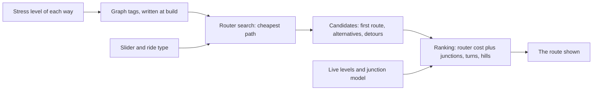

Full reasoning and citations (for review)

- **Stage 1, the search.** Valhalla 3.9.1 bicycle costing: an edge costs
  `time x (1 + grade + accommodation x roadway stress)` plus fixed charges at some
  transitions. RouteMaker steers it three ways only: tags written per way when the graph is
  built (`lua/routemaker_remap.lua`), the request's `use_roads` (the slider,
  `presets.use_roads_for`), and three fixed charges sent with every request (a turn, entering
  an Avoid road, gates; `presets._preset`). There is no per-level knob in a request.
- **Stage 2, the ranking.** `core.refine`: `Analysis.score` below the top of the slider,
  `Analysis.key` with `better`, `calmer` and `worth_it` at the top. It reads the live level of
  every way (`segments` table) and the junction model (`routemaker.intersections`,
  [intersections.md](intersections.md)).
- **Where the candidates come from** (`refine.refine`): the router's first route; up to 3 of
  its own alternatives (`ROUTER_ALTERNATES`, asked with turns free, see "Turns"); routes found
  by excluding the worst of the last candidate (`_search`: LTS 4 and Avoid stretches first, then
  LTS 3, and red junctions each round); on Trailmaxxing the trail seek (`_seek`).
- **Known limit (audit 2026-11-13, areas/09 3.1).** Junction cost is not in the search at all.
  A calm street with bad crossings can only lose to a busier through street if that street is
  among the candidates. The owner's "junctions are why I ride busier streets" depends on this.
- **What a rebuild changes.** A level edited in the road panel changes the map and the ranking
  at once and the graph at the next build; see "After a rating edit".

## What a mile of each level costs in the search

The router charges more for a mile of busy road than for a mile of quiet street, and how much
more depends on the slider. At Default a mile of LTS 3 counts as about 3 to 6 quiet miles and a
mile of LTS 4 as about 16 to 19, so the router will go a long way round to stay off LTS 4. The
price is not one number per level: it also rises with the road's class, speed and lanes, because
that is how the router's own formula works.

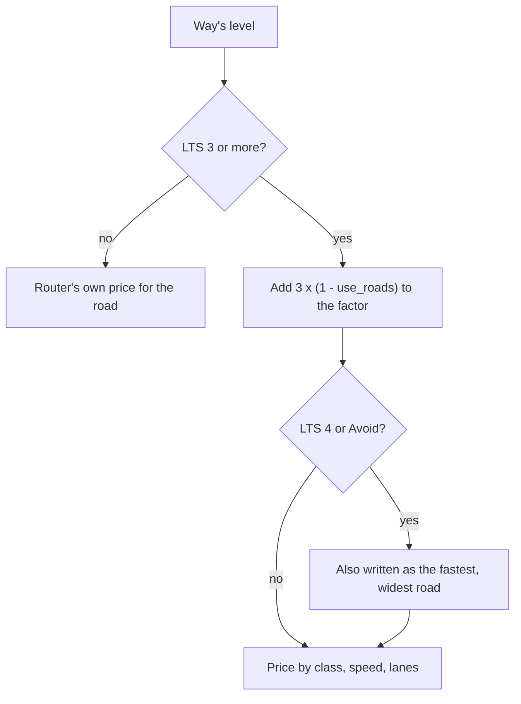

Quiet miles per mile, from `calm.edge_factor` over `calm.quiet_factor` (run 2026-11-13; an urban
road with no bike lane):

| Road | Slider | LTS 2 | 2.5 | 3 | 3.5 | 4 |
|---|---|---|---|---|---|---|
| Residential, 25 mph | 25 | 1.07 | 1.26 | 1.58 | 3.09 | 4.20 |
| Tertiary, 30 mph | 25 | 1.17 | 1.40 | 1.79 | 3.17 | 4.29 |
| Secondary, 35 mph, 2 lanes each way | 25 | 1.32 | 1.55 | 2.08 | 3.24 | 4.39 |
| Primary, 40 mph, 2 lanes each way | 25 | 1.48 | 1.73 | 2.39 | 3.39 | 4.58 |
| Residential, 25 mph | 70 (Default) | 1.13 | 1.59 | 2.66 | 10.05 | 16.23 |
| Tertiary, 30 mph | 70 | 1.36 | 1.96 | 3.52 | 10.50 | 16.85 |
| Secondary, 35 mph, 2 lanes each way | 70 | 1.71 | 2.36 | 4.79 | 10.95 | 17.47 |
| Primary, 40 mph, 2 lanes each way | 70 | 2.11 | 2.88 | 6.29 | 11.85 | 18.72 |
| Residential, 25 mph | 80 and up | 1.14 | 1.66 | 2.86 | 12.00 | 19.77 |
| Primary, 40 mph, 2 lanes each way | 80 and up | 2.25 | 3.15 | 7.29 | 14.29 | 22.97 |

Full reasoning and citations (for review)

- **The three writes** (`lua/routemaker_remap.lua`; restated in `routemaker.calm`):
  `bicycle=use_sidepath` from LTS 3 (`calm.SIDEPATH_TIER`), which adds `3 x (1 - use_roads)`
  to Valhalla's accommodation factor; "graded" from LTS 4 (`calm.GRADED_SPEED_KPH` 140,
  `calm.GRADED_LANES` 15), the graph's top speed and lane count; `service=alley` on Avoid, which
  makes Valhalla charge `alley_penalty` on entry ("Entering an Avoid road"). Never on a
  trail-class way. The no-trail graph (Mass Ride) carries no grading and no facility classes.
- **Not one multiplier per level** (audit areas/09 2.1). At Default LTS 3 runs from 2.66 on a
  residential street to 6.29 on a 40 mph primary. The level sets the marks; Valhalla's own
  class, speed and lane terms still multiply. A price by level alone needs Lua ("Needs Lua" in
  the audit notes).
- **LTS 1 and LTS 2 cost the same** in the search except through the road's own class and
  speed; the ranking weighs LTS 2 only on the ride types that ask (`presets.LTS2_WEIGHT`).
- **The owner's choices.** "I'd probably want LTS 4 to be twice the stress level of LTS 3 at
  least" (2026-09-28, typed). The search gives 2.5 to 6 times. Measured on our data: on his
  logged rides LTS 3 is ridden at 0.81 of its share of the roads available and LTS 4 at 0.34
  (the 2026-11-13 audit's review of the owner's routing calls, P1 and P2), a ratio of 2.4. So the ratio
  between the two is supported; Default's absolute LTS 3 price (3 to 6 quiet miles a mile)
  looks high against the same rides and is an open question, not changed here.
- **Our default, unmeasured:** the 3 in `3 x (1 - use_roads)` is Valhalla's; the graded marks
  were chosen so that LTS 4 is at least twice LTS 3 on roads posted up to 50 mph.
- **Literature.** Broach, Dill and Gliebe (2012) report distance-equivalents per mile by
  facility and traffic volume; the audit could not verify a per-mile figure against the opened
  preprint, so none is quoted here.
- **What would change it:** a scorecard run of paired corridors (busy line against the calm
  detour) showing how far Default rides round LTS 3.

## Half steps in the search

A half step (2.5, 3.5) is a true midpoint on the map and in the ranking. In the search it is
not: the router has no "level" to interpolate, so a half step is written as a different set of
marks and lands wherever Valhalla's formula puts it. At Default 2.5 sits about a third of the
way from 2 to 3 and 3.5 a little past halfway from 3 to 4. This is a limit of pricing through
graph tags, not a choice.

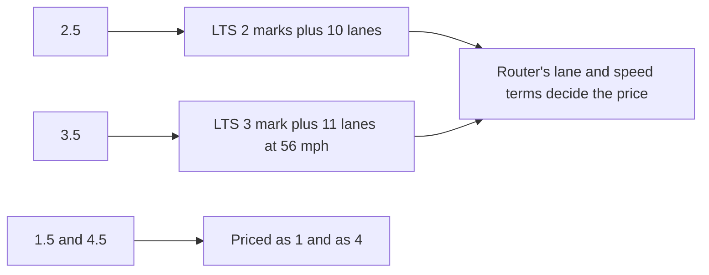

| Default, quiet miles per mile | 2 | 2.5 | midpoint would be | 3 | 3.5 | midpoint would be | 4 |
|---|---|---|---|---|---|---|---|
| Residential, 25 mph | 1.13 | 1.59 | 1.90 | 2.66 | 10.05 | 9.45 | 16.23 |
| Primary, 40 mph | 2.11 | 2.88 | 4.20 | 6.29 | 11.85 | 12.51 | 18.72 |

Full reasoning and citations (for review)

- Marks: `calm.HALF_LOW_LANES` 10 (2.5), `calm.HALF_GRADED_LANES` 11 and
  `calm.HALF_GRADED_SPEED_KPH` 90 (3.5); written by the Lua's `half_step_marks`.
- **At slider 0 the order breaks** (audit areas/09 2.3): 2.5 costs 1.15 and LTS 3 costs 1.03
  on a residential street, because at `use_roads` 1 the LTS 3 mark weighs nothing and the lane
  count still does.
- The owner, 2026-10-09 (typed): "Then just have the half steps be midpoints." That holds in
  `calm.multiplier` (the chart and the ranking's rate term) and on the map. Measured on our
  data: his rides use 3.5 like 4 (0.37 against 0.34 of its share) and 2.5 between 2 and 3
  (0.91), so the search's 3.5 (nearer 4 than 3 in cost) is not contradicted by them.
- **What a true midpoint would take:** a per-edge price the Lua writes from the level alone
  (for example one synthetic attribute Valhalla multiplies by), instead of the lane and speed
  marks. Any Lua change is a hand ship, so it is written up, not done.

## The slider

The slider says how far out of the way to go for calmer roads. From 0 to 80 it moves one
router setting, so the router itself prefers calmer roads more and more. From 80 to 100 the
router is already at its calmest, and RouteMaker searches for detours and charges each
remaining busy mile more. At 100 the order becomes strict: least LTS 4 first, then least LTS 3,
then distance.

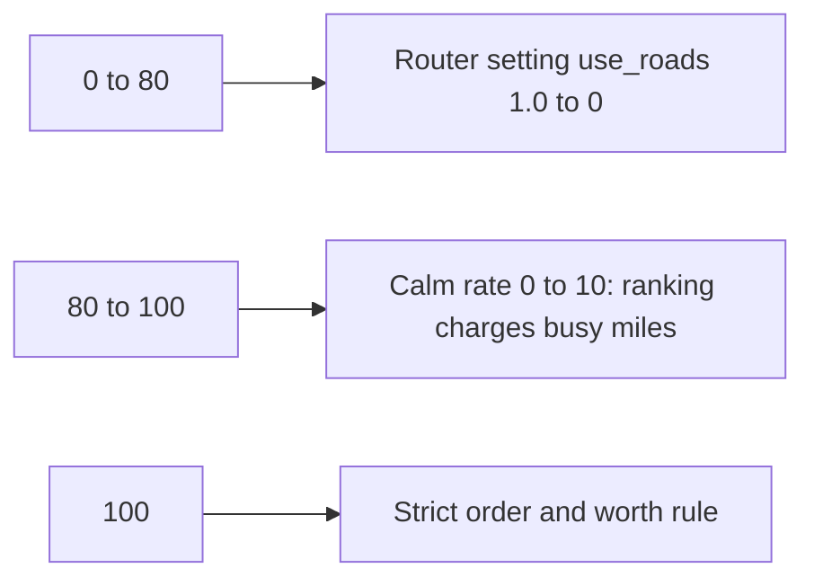

| Position | `use_roads` | Calm rate | Junction weight | Ranking |
|---|---|---|---|---|
| 0 | 1.000 | 0 | 0.25 | Score |
| 25 | 0.679 | 0 | 0.52 | Score |
| 40 | 0.486 | 0 | 0.68 | Score |
| 70 (Default) | 0.100 | 0 | 1.0 | Score |
| 80 | 0 | 0 | 1.0 | Score |
| 90 | 0 | 1.8 | 1.0 | Score, longer routes must be worth it |
| 100 | 0 | 10 | 1.0 | Strict order and worth rule |

Full reasoning and citations (for review)

- `presets.use_roads_for`, `presets.calm_rate_for` (`10 x (e^(3t) - 1) / (e^3 - 1)`,
  `t = (s - 80) / 20`), `presets.maxcalm_for`, `refine.intersection_weight`. Mirrored in
  `frontend/src/lib/dials.ts`.
- **The owner's choices:** Default at 70 (card pick, 2026-09-27, after "almost a quarter are
  LTS4" on his commute); the top twenty points added 2026-10-01 ("willing to add 10 or 20
  miles to my trip just so it's more relaxing", typed).
- **Our default, unmeasured:** the shape of the calm rate, its top of 10, and the junction
  weight's 0.25 at 0 rising to 1.0 at 70. Literature: Broach, Dill and Gliebe (2012), Table 3:
  commute values of the junction terms are 52 to 57% of the non-commute values, which supports
  a floor near 0.55, not 0.25. The weight belongs to the junction terms
  ([intersections.md](intersections.md)); the change is handed to that package.
- **Not monotonic at the top** (audit areas/09 2.10): the worth rule at 100 pays 10 quiet
  metres for a metre of LTS 4 where the router at 80 pays 16.5. See "Why Trailmaxxing can be
  busier than Default".

## Ride types

A ride type sets where the two sliders start, which bike and speed the router plans for, and a
few flags. It does not carry its own stress formula. The list below is every ride type in the
code today.

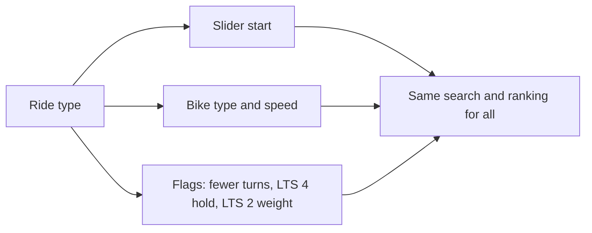

| Ride type | Slider start | Speed | Fewer turns | Stress-averse (LTS 4 hold) |
|---|---|---|---|---|
| Default, Bike + transit | 70 | 11.2 mph | no | no |
| Novice | 100 | 11.2 mph | no | yes; LTS 2 at 0.25 |
| Trailmaxxing | 100 | 12.4 mph | no | yes; LTS 2 at 0.25 |
| Group Ride | 40 | 12.4 mph | yes | no |
| Mass Ride | 0, locked | 6.0 mph | yes | no; no calm search |
| Mountain Goat, Gravel | 40 | 12.4 mph | no | no |
| Fast | 10 | 11.2 mph | yes | no |
| Cargo Bike | 70 (80 with passengers) | 8.7 mph | no | with passengers |
| E-bike | 70 | 14.9 mph | no | no |
| Bikeshare, Rebalance, Bikeshare + transit | 80 | 8.1 mph | no | yes |
| Mountain Bike | 80 | 9.9 mph | no | yes |
| Road Bike | 40 | 15.5 mph | yes | no; waits weigh 3x |
| Tandem | 80 | 13.0 mph | yes | yes; LTS 2 at 0.25 |
| Walk, Walk + transit, Run | planned on foot | - | - | - |

Full reasoning and citations (for review)

- `presets.PRESETS`, built by `presets._preset`; speeds are `cycling_speed` or
  `presets.VALHALLA_DEFAULT_SPEED_KMH` for the bike type. "Riding with kids" is not a ride
  type in the code and has been removed from this page.
- **Deliberate differences between ride types**, and why: speed (the bike); the turn price on
  the five "fewer turns" types (a group or a fast or long bike loses more at each turn; see
  "Turns"); the stress-averse exposure weights 1 / 8 / 16 and the LTS 4 hold (the owner,
  2026-10-03, typed: "It's putting me on dangerous roads just for a little more trails"); LTS 2
  weighed at a quarter of LTS 3 on Trailmaxxing, Novice, Tandem and Cargo with passengers; Road Bike's 3x on
  waits; gate charges on Cargo and Tandem.
- **Everything else is the same distance on every ride type** since 2026-11-13: the turn price
  and the Avoid entry are set in feet and sent at the ride's own speed (`presets.turn_cost_s`,
  `presets.avoid_entry_cost_s`, `presets.set_speed`). Before, 15 cost seconds a turn was 81 ft
  on Bikeshare and 149 ft on E-bike.
- **Still in seconds, so still speed-dependent:** junction waits (real time, rightly). The
  red surcharge (`refine.RED_DETOUR_S`, 600 s of riding for each red junction) is deleted
  since 2026-11-13: a red junction costs its own price in feet, capped at two calm miles
  ([intersections.md](intersections.md)).
- **Our default, unmeasured:** every slider start but Default's; 8 / 16; the 0.25 for LTS 2;
  Mountain Bike's 6 mph on dirt trails (measurable from logged rides, not yet measured).

## Turns

The purpose, in the owner's words: "to remove a large amount of cognitive load on a cyclist for
meaningless differences in time and comfort." So a route never gains a turn for a gain too
small to matter, and a turn saved never puts the rider on a meaningfully busier road. A turn is
a decision point: a place where the rider must act on a cue, not a bend in the road. Each one
costs 222 ft of quiet riding, the same in the search and the ranking, on every ride type and at
every slider setting.

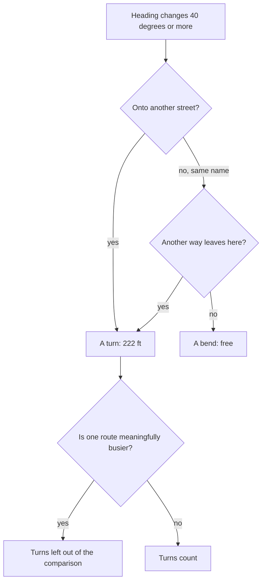

| | Before 2026-11-13 | Now |
|---|---|---|
| Search, Default | 15 cost seconds = 112 ft | 222 ft (29.8 cost seconds) |
| Ranking, Default | 15 s of riding = 246 ft, only at the top and in the dodge pass | 222 ft, in the score too |
| Same-name turn (a trail's zig-zag) | free in the search, uncounted in the score | 222 ft in the ranking |
| Bikeshare / E-bike | 81 ft / 149 ft | 222 ft / 222 ft |
| Fewer-turns ride types and the rider's "Fewer turns" | 30 cost seconds = 224 ft at Default | 391 ft |

Full reasoning and citations (for review)

- **One definition:** `refine.turns_in`, `refine.TURN_DEGREES` (40; our default, unmeasured).
  Read from the traced pieces; `routing.Piece.choice` says whether another rideable way leaves
  the node. The dodge pass uses the same function (`dedodge.turn_count`).
- **One price:** `presets.TURN_FT` 222 ft. **Literature:** Broach, Dill and Gliebe (2012),
  "Where do cyclists ride? A route choice model developed with revealed preference GPS data",
  Transportation Research Part A 46(10), 1730-1740, doi:10.1016/j.tra.2012.07.005, Table 3: a
  turn is worth 4.2% of a mile on a commute (222 ft) and 7.4% on other trips (391 ft). Other
  opened studies are higher: Hood, Sall and Charlton (2011), Transportation Letters 3(1),
  63-75, doi:10.3328/TL.2011.03.01.63-75: 558 ft; Zimmermann, Mai and Frejinger (2017),
  Transportation Research Part C 75, 183-196, doi:10.1016/j.trc.2016.12.009: 484 to 609 ft.
  `presets.FEWER_TURNS_FT` 391 ft is Broach's non-commute value; which ride types take it is
  our default.
- **How it reaches the router:** `maneuver_penalty` = the feet as cost seconds at the ride's
  speed (`presets.cost_s_of_quiet_ft`; a quiet metre costs the router 2.2 times its time,
  `QUIET_COST_FACTOR`, measured on our data: median of the live standard router, range 1.8 to
  2.9). Valhalla charges it where the street name changes, at any angle; that is its definition
  and cannot be changed from here, so the two stages agree on the price and on most turns, not
  on every one. The ranking reads the request's own number back (`refine.turn_price_s`) and
  adds it for the turns the router missed (`Analysis.unpriced_turns`).
- **What a turn may never buy:** `refine.turns_count_between`, used by `refine.better`. Two
  candidates are compared with their turns left out (`refine.turn_free_score`) when one is
  busier than the other by more than the Traffic-wins margin (2% and 164 ft of weighted
  exposure, with red and Avoid-rated junctions at their cost; our default, unmeasured). And
  the search's ask for alternatives is made with no turn charge (`refine._alternates_request`),
  so the route the router would give with turns free is among the candidates at no extra ask.
  Why: the router prices a road by class, not level, so a turn charge can buy LTS 4 it cannot
  see. Measured on our data (scorecard, 2026-11-12, 38 Default trips): raising the charge from
  5 to 15 cost seconds at slider 25 cut turns 7% and added 1.7 mi of LTS 4, on two trips; at
  70, turns fell 4% with LTS 4 flat.
- **The owner's choices:** decision 254 (2026-10-03, typed): "Turns should also carry a penalty
  as they do add some cognitive load"; 2026-11-10 (typed, of a commute): "Trailmaxxing seems to
  cause a lot of fiddly turns when there's an easy road nearby"; 2026-11-12 card pick "Every
  setting"; 2026-11-13 the purpose quoted above. The 15 seconds was our default; the rule (a
  price at every setting) is kept and the number is now the published one.
- **The dodge pass** (`core.dedodge`): a weave onto side streets is kept only where it avoids
  more than 164 ft (50 m, `TIE_STEP_M`; card pick 2026-10-04) of LTS 3 plus each turn it adds
  at the same price (`dedodge.turn_lts3_m`). The older quarter-mile rule and its fixed 80 m
  turn charge were dead and are removed.
- **Not yet checked on routes.** The router's charge at Default doubles. The scorecard rerun
  in the audit notes (both slider 25 and 70, rush and off-peak) must be read before this
  ships: turns per mile should fall and LTS 4 miles must not rise.
- **What would change it:** the owner's logged rides give turns per mile ridden against turns
  per mile on the shortest path; that is a direct local measurement of the same quantity.

## Entering an Avoid road

An Avoid road is never closed to a route, but entering one costs as much as 2.5 miles of quiet
riding, on top of its per-mile price as LTS 4. So a route uses one only where the way round is
longer than that.

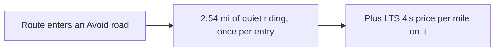

Full reasoning and citations (for review)

- `presets.AVOID_ENTRY_FT` 13,422 ft, sent as `alley_penalty` at the ride's speed
  (`presets.avoid_entry_cost_s`): 1,800 cost seconds on Default, as before. Before 2026-11-13
  every ride type sent 1,800, which was 1.4 mi on Mass Ride, 1.8 mi on Bikeshare and 3.5 mi on
  Road Bike.
- **The owner's choice:** 30 minutes (2026-09-27; decision 308, "Probably a 30 minute
  penalty"). **Our default, unmeasured:** there is no published value for an "avoid" road.
- **Known limit** (audit areas/09 3.4): the charge is per entry, not per mile, so a 100 ft
  Avoid bridge and a 2 mi Avoid highway pay the same entry.
- Avoid-rated junctions (`avoid_junctions.AVOID_JUNCTION_PENALTY_S`, 1,800 cost seconds a
  pass) are a junction term; the approved list is empty as shipped.

## Hills

Hills are priced apart from traffic. The router avoids climbs according to the Hills slider;
the ranking then replaces the router's climbing charge with RouteMaker's own, which grows with
both steepness and length. A busy climb counts as worse than a busy flat.

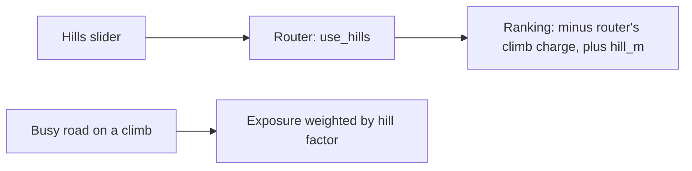

Full reasoning and citations (for review)

- `presets.use_hills_for`; `Analysis.hill_m`, `Analysis.router_climb_m`,
  `Analysis.hill_exposure_m`; the model in `routemaker.hill_cost`.
- **The owner's choices** (typed, 2026-09-28 and 2026-10-23): "an increasing penalty for
  steeper hills"; "Below LT1 you can basically downshift and chill, so it's essentially the
  same as a slightly longer flat piece".
- **Known limit** (audit areas/09 3.8): the search uses Valhalla's grade penalty and the
  ranking its own, so the two can disagree about a climb. Same cure as for turns (one price in
  both), not done: it needs the hill model expressed as a Valhalla setting.
- **Our default, unmeasured:** the model's constants (65% of threshold power, the e-fold per
  20% of grade).

## Surface

Rough or unpaved surface is priced by the router alone, through each ride type's
`avoid_bad_surfaces`. Pavement condition surveys are shown on the map but are not sent to the
router, because the only way to send them made a rough street cheaper than a smooth one.

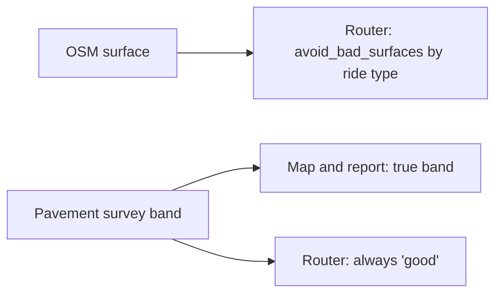

Full reasoning and citations (for review)

- `pavement.graph_band` (2026-11-13). Before: fair reached the graph as paved-rough and poor
  as compacted. Valhalla charges a surface only from the bike type's worst-allowed surface up
  and through a speed factor (1.0 for paved-rough on all but Road), while its graph builder
  cuts the road's speed on such a surface, and a slower road is a calmer one to the bicycle
  costing. From `calm.edge_factor` at Default: an untagged-speed residential street went from
  1.77 (good) to 1.42 (fair), 20% cheaper (audit areas/09 3.3).
- The survey is local data (one city's Pavement Condition Index) behind an adapter
  (`routemaker.pavement`); the rule "a rougher band is never cheaper" is the logic.
- **Needs Lua:** a rough-pavement penalty that is a penalty (a surface price written apart
  from the road's speed). A reviewer's surface penalty uses the same mechanism and has the
  same flaw; not changed here.
- The owner, 2026-10-04 (typed): a surface-quality penalty "kept distinct from traffic
  stress". Kept distinct; currently zero for surveyed pavement.

## What the router adds on its own

Three of the router's built-in terms change a bike route without RouteMaker asking. A route
pays a little for turning onto a bigger class of road, gets a 5% discount on a signed bike
route, and pays more on a designated truck route.

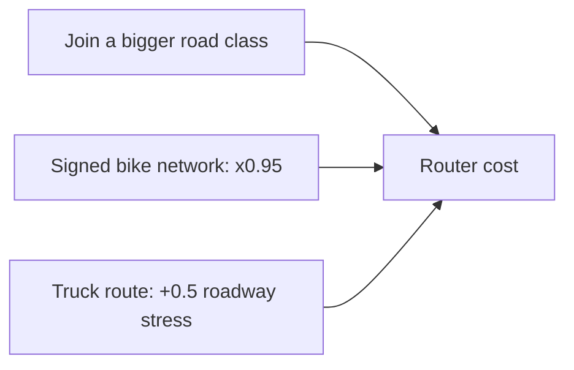

Full reasoning and citations (for review)

- Valhalla `sif/bicyclecost.cc` (3.9.1): "Penalize transition to higher class road",
  `10 x class steps x (accommodation x (1 - use_roads) + use_roads)` cost seconds; bicycle
  network (lcn / rcn / ncn) multiplies accommodation by 0.95 (`calm.BICYCLE_NETWORK_FACTOR`);
  a truck route adds 0.5 to roadway stress (`calm.TRUCK_STRESS`); a shoulder scales
  accommodation by `0.7 + 0.2 x use_roads`.
- All three are keyed to OSM class and tags, not to the level (audit areas/09 3.2), and none
  can be switched off in a request. They are upstream defaults: not ours, not measured by us.

## The ranking

Below the top of the slider every candidate gets one number, in feet of quiet riding, and the
lowest wins. The number is the router's own cost plus what the router could not see: the
junctions, the waits, the turns it missed, the hill model, and (above 80) a charge for each
busy mile. At the top of the slider the order is strict instead: least LTS 4, then least
LTS 3, then distance, and a longer route must save enough stress to be worth its miles.

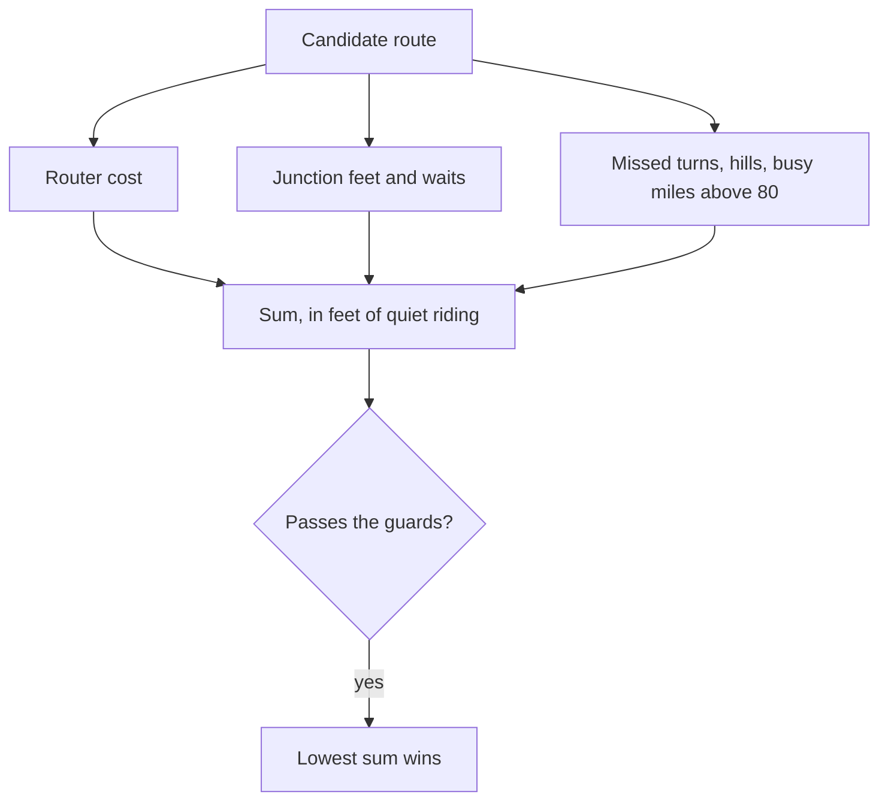

| Term (`Analysis.terms_ft`) | Unit it is set in | Same distance on every ride type? |
|---|---|---|
| `router` | router cost seconds | n/a (the router's own) |
| `stress` (calm rate x weighted busy metres) | distance | yes |
| `junctions` | feet | yes |
| `junction_cap` (negative) | feet | yes: what one junction's stress and wait together would take past its dearer one, or past two calm miles ([intersections.md](intersections.md)) |
| `hills`, `lts2`, `graph_gap` | distance | yes |
| `turns` | feet (222) | yes, since 2026-11-13 |
| `waits` | seconds of real waiting | no, and rightly: time |
| `avoid_junctions` | 1,800 cost seconds a pass | no (list empty as shipped) |

Full reasoning and citations (for review)

- **One unit:** `refine.quiet_ft` is the one conversion (feet, metres, seconds of riding,
  router cost seconds, at a stated speed; reference `REFERENCE_SPEED_KMH` 18 km/h, 11.2 mph,
  our choice of reference). `Analysis.terms_ft` returns every term of `Analysis.score` in feet
  and they sum to the score.
- **The score as coded** (`Analysis.score`, router cost seconds):
  `cost_s + quiet_cost x (rate x (exposure - hill share) + max(rate, 1) x hill share +
  weight x junction metres + hill_m - router_climb_m + LTS 2 term + graph_gap_m) +
  avoid-junction penalties + 2.2 x wait_weight x ranked waits + 2.2 x 600 x weight x reds +
  turn price x unpriced turns`.
- **Replacing the best** (`refine.better`): by more than `IMPROVEMENT_EPS_S` (10 cost seconds,
  our default); a longer route must also pass `worth_it` where the calm rate is above 0.
- **The top of the slider:** `Analysis.key` = (LTS 4 and Avoid metres plus red junction cost,
  LTS 3 metres plus orange junction cost plus weighted LTS 2, `level3` distance with delay and
  turns), tie steps `MAXCALM_STEPS` 15 / 50 / 50 m (our default). The owner, 2026-10-03
  (typed): "The priority should actually be LTS4+>Very Stressful Crossings>LTS3>Stressful
  Crossings". Worth rule: `WORTH_DEFAULT` 5 m added per metre of LTS 3 saved, 10 up to a
  target, 2.5 past it, weights 1 / 2 / 3 (five card picks, 2026-10-03 to 2026-10-10; our
  defaults kept by the owner).
- **Guards that remain, and the general purpose of each:** Traffic wins (`_busier`: no
  candidate is more than 2% and 164 ft busier than the router's first route; keeps hill and
  junction savings from buying traffic); the LTS 4 hold (`more_lts4`, stress-averse rides: no
  more LTS 4 than the first route; keeps trail seeking from buying LTS 4); no doubling back
  (`doubles_back`); the ceiling on length (`too_long`).
- **Removed 2026-11-13:** the wide search (never switched on), the dodge pass's quarter-mile
  rule and fixed turn charge (dead), two of the three turn definitions and the second turn
  price.

## After a rating edit

When someone corrects a road's level in the road panel, the map and the ranking use the new
level at once, but the router's graph keeps the old one until the next build. Until then the
ranking charges the difference itself, and the search steers round a road that was raised.

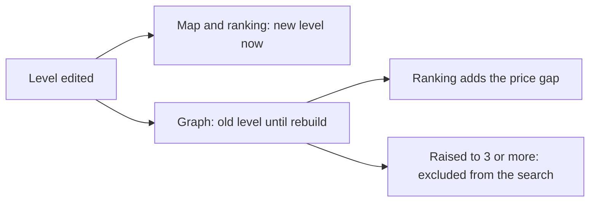

Full reasoning and citations (for review)

- `stress_edits.pending_levels` (edits since the live graph was built; cached 60 s, at most
  2,000 edits, both operational limits), `calm.level_gap`, `refine.graph_gap_m` (in the score
  as `graph_gap`), `refine.pending_targets` (exclusion points on ways raised to LTS 3 or more).
- **Known limit:** a road that was lowered cannot be offered by the router until the rebuild;
  the ranking only stops over-charging it when it is ridden. The answer says how much of the
  route rides an edited way (`calm_search.pending_edit_m`).
- Audit areas/09 3.5.

## Why Trailmaxxing can be busier than Default

On the scorecard of 2026-11-12 Trailmaxxing had more LTS 3 than Default on 7 of 20 trips. The
cause is not settled. The ranking itself, on one set of candidates, never prefers the busier
route when the trade is LTS 3 against distance; the candidates below are what remain.

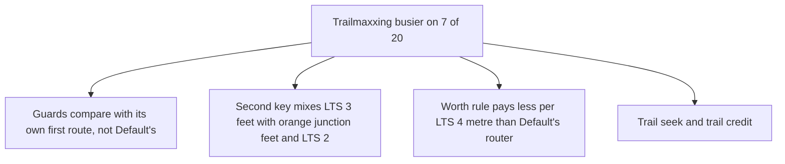

Full reasoning and citations (for review)

- Measured on our data: scorecard run v0.26.0, 20 trips planned both ways; for example one
  11 to 12 mi suburban trip, Trailmaxxing 1.22 mi of LTS 3 against Default's 0.49, both with
  no red junction. The scorecard has no LTS 2 column and no record of which candidate won, so
  the cause cannot be read from it.
- **Tested** (`tests/test_refine.py`, `TestACalmerSettingIsNeverBusierOnTheSameCandidates`):
  for LTS 3 against distance, wherever Default's rule takes the calmer route the top of the
  slider does too. For LTS 4 against distance it does not (strict xfail): the worth rule pays
  5 x 2 = 10 quiet metres a metre of LTS 4, Default's router 13.3.
- **Not changed, and why:** each candidate cause is a card-picked number; changing one without
  the scorecard would be a guess. The smallest general fix is to make Default's route for the
  same trip the Traffic-wins reference at the top of the slider (one more router ask per
  plan); it needs a scorecard run to confirm and is written up in the audit notes.
- Columns the scorecard needs to settle it: LTS 2 miles, the first route's exposure, which
  candidate was taken (first, alternative, exclusion round, seek).

## Junctions

Junction costs, waits, the intersection weight and Avoid-rated junctions are
described in [intersections.md](intersections.md). On this page they appear only as terms of
the ranking.

## Portability

- **Logic (would run unchanged in another US metro):** everything on this page. Levels in,
  feet of quiet riding out; no road, place, county or agency is named in `core.refine`,
  `core.presets`, `core.dedodge` or `routemaker.calm`.
- **Local data behind an adapter:** the pavement survey (`routemaker.pavement`, one city's
  index); the level of each way (the rating packages); junction ratings and counts.
- **Local calibration, labelled as such:** `QUIET_COST_FACTOR` 2.2 was measured on this
  region's router build; the scorecard trips; the owner's rides.
