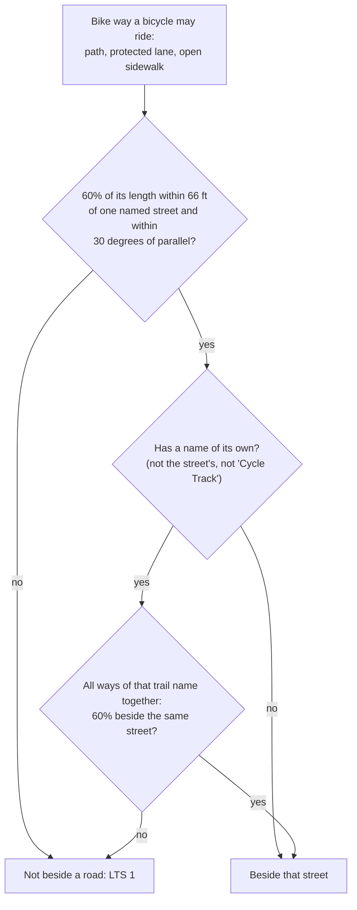
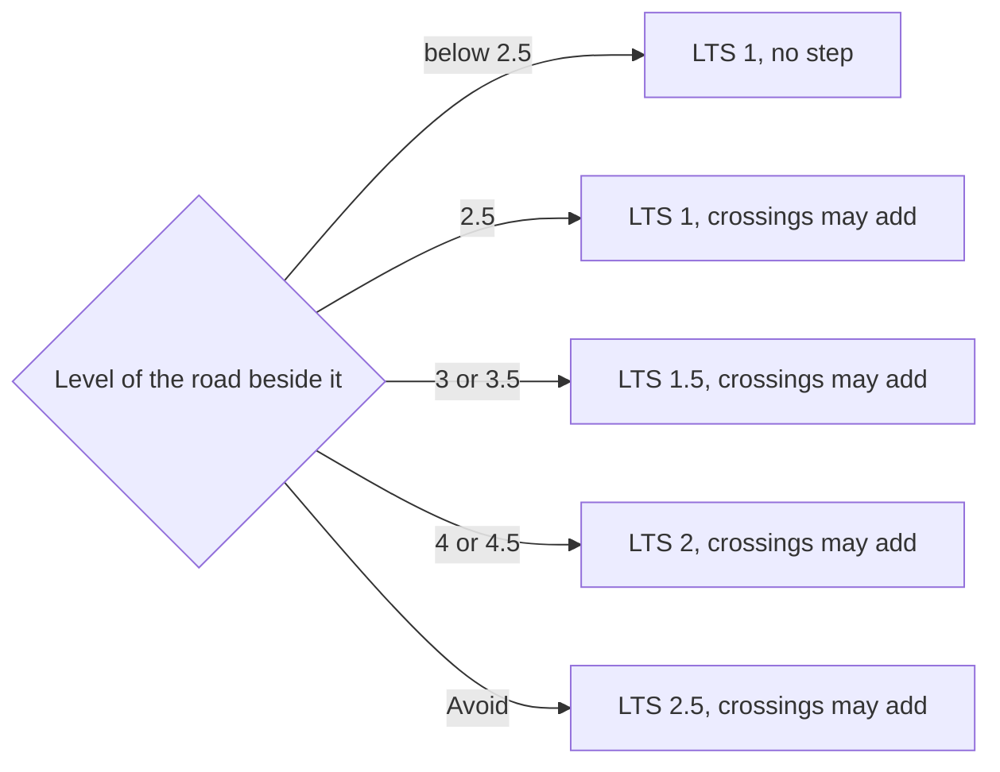
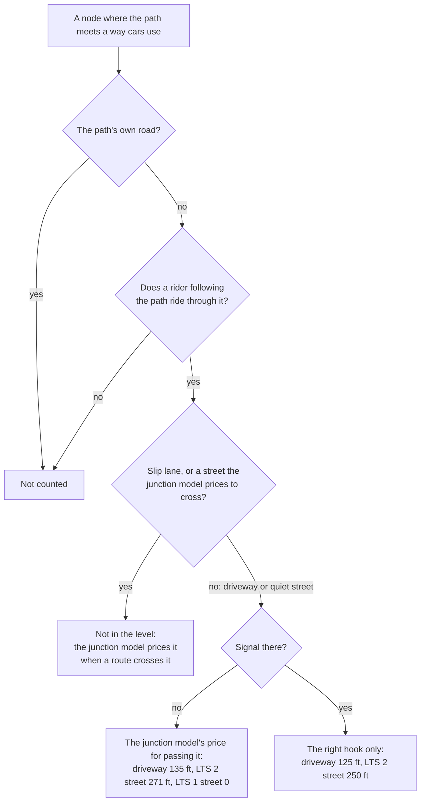
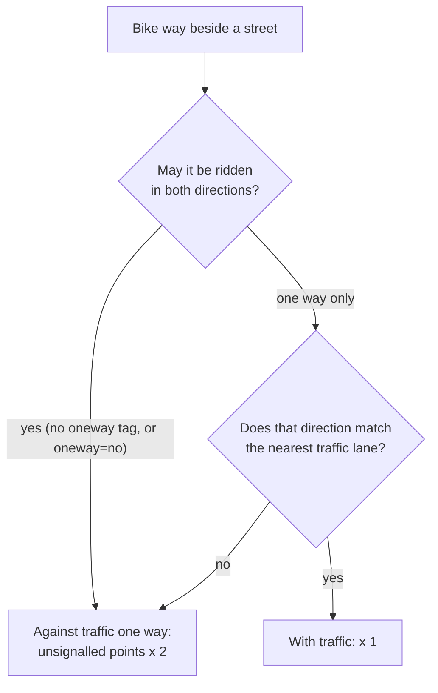
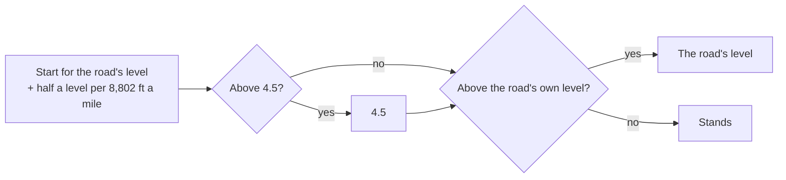
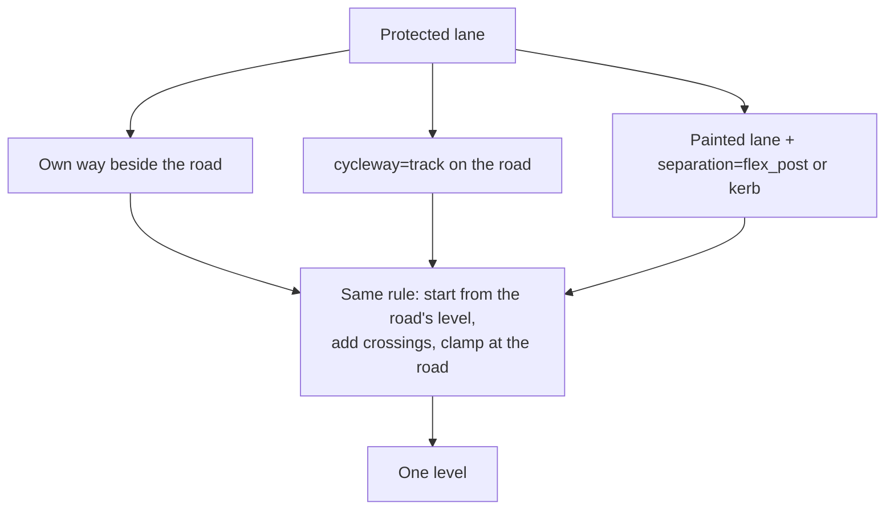
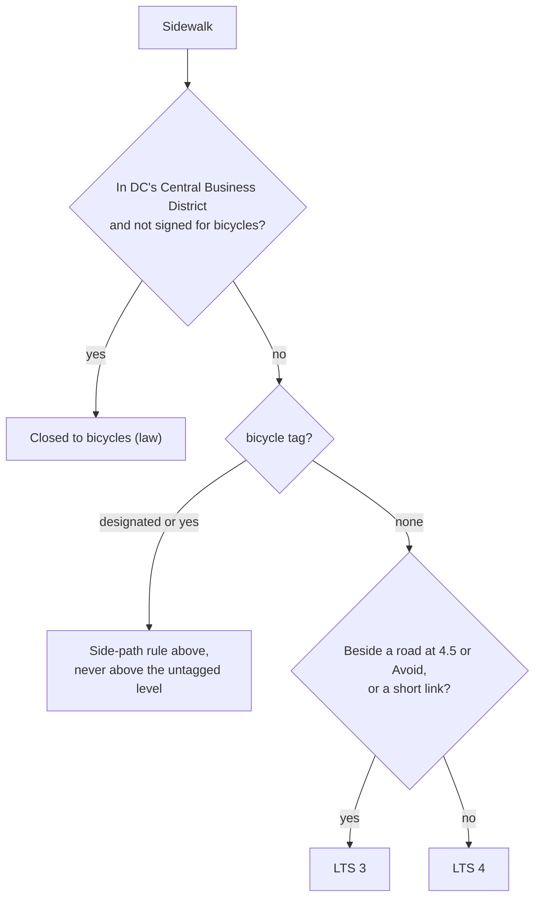
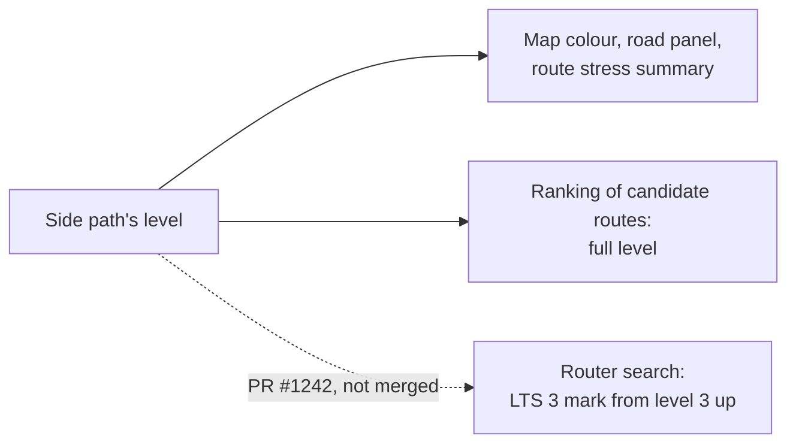

# Side paths, protected lanes and sidewalks

How RouteMaker rates a bike way that runs beside a road: a side path, a protected bike
lane (mapped as its own way, tagged on the road as a track, or painted behind posts) and a
sidewalk a bicycle may ride. A trail away from roads is LTS 1 and is not on this page.

The rule here is a formula. It reaches only ways that no owner override row pins
([overrides.md](overrides.md)): a row on the path itself stands, and a row on the street
sets the street level the path reads.

Every number is labelled with where it comes from: **law**, **literature** (cited),
**measured** on our data, **the owner's choice** (dated), or **our default, unmeasured**.
Most of this page's numbers are our defaults. They were chosen to sit inside the range
that Maryland's and Montgomery County's published scales give separated lanes and side
paths, and to be on one scale with the junction model ([intersections.md](intersections.md)).

**Logic and local data.** The rule reads only OpenStreetMap tags and geometry and the
levels of the streets around the path, so it works unchanged in any US metro; no road,
trail, county or agency is named in the logic (the long trails named in the tests are test
cases). Local data, kept apart: the boundary inside which a city bans sidewalk riding
(`routemaker.cbd`, DC's Central Business District, an access rule and not a level) and the
override rows. Two conventions are regional and would need a setting elsewhere: traffic
keeps right, and street names are compared with US abbreviations and quadrant suffixes
(`facility._name_key`).

In code: `routemaker.facility` (`side_streets`, `on_road_tracks`, `side_path_crossings`,
`crossing_point_ft`), `routemaker.stress` (`beside_busy_road_step`), `pipeline.run`
(`rate_side_paths`, `apply_beside_busy_road`). Tests: tests/test_beside_busy_road.py.

## What counts as beside a road

A bike way is "beside a road" when it runs close to a named street and parallel to it for
most of its length. What the way is called does not matter: a lane named "Old Georgetown
Road (MDBR 187)" is beside Old Georgetown Road just as an unnamed one is. A long trail with
a name of its own, such as the W&OD or the Capital Crescent Trail, is judged as a whole, so
it does not become a side path on the blocks where it happens to pass along a street, and
passing over, under or across a road never counts.

| Threshold | Value | Source |
|---|---|---|
| Reach from the street's centreline | 66 ft [20 m] | our default, unmeasured |
| Parallel within | 30 degrees | our default, unmeasured |
| Share of the way's length | 60% | our default, unmeasured |
| Sampling step along the way | 16 ft [5 m] | our default |

Full reasoning and citations (for review)

- Code: `facility.side_streets`, with `SIDE_STREET_M`, `SIDE_STREET_ANGLE`,
  `SIDE_STREET_FRACTION`, `SIDE_STREET_STEP_M`; which ways are asked is
  `facility.asked_beside`. A street is a way of class `SIDE_STREET_HIGHWAY` (trunk to
  residential and their links, unclassified, living street) with a `name`. A motorway and a
  service road are never the street, so a trail beside I-66 is beside nothing.
- **What changed (2026-11-13).** The test used to ask only ways with no `name`. The lanes
  the rule was written for, along Old Georgetown Road, are `highway=cycleway` named "Old
  Georgetown Road (MDBR 187)" (140 ways, 6.0 mi [9.7 km] in OSM read that day), so they were
  never asked and stayed at LTS 1. So did the named pieces of the 15th Street NW cycle
  track, while its unnamed pieces were rated. The test is now geometry alone.
- **Named trails.** `facility.named_for_itself` says whether a name is the trail's own: it
  is not when it starts with the street's name ("15th St NW", "Old Georgetown Road (MDBR
  187)") or is a generic facility name ("Cycle Track", "1st Street Northeast Cycletrack";
  `GENERIC_FACILITY_NAMES`, `GENERIC_FACILITY_ENDINGS`). A way whose name is its own must
  pass the 60% test twice: by itself, and with every way of the same name in the build
  taken together against the same street. Read on OSM tiles of 2026-11-13, 1.4 mi of the
  W&OD lies beside Four Mile Run Drive in Shirlington; with 3.3 mi of the trail read the
  share is 41% and the whole trail stays LTS 1; a full build reads the whole trail, which is
  far longer.
  Our default, unmeasured. The owner, 2026-10-12, on the older protected-lane match: "parts
  of rock creek trail are now marked as a protected bike lane rather than an off road
  trail, which it is"; the same reading is kept here.
- **Known limits.**
  - A trail whose whole named length is a side path is rated as one (for example a short
    named path that is beside one road from end to end). That is the intent.
  - A named trail is judged over the ways in the build. A build clipped to a small area
    could see only the roadside part of a long trail and rate it as a side path.
  - A side path further than 66 ft from the centreline (behind a wide verge or a service
    road) is not found. The `bicycle=use_sidepath` rule and the sidewalk rule use 98 ft
    [30 m] (`facility.USE_SIDEPATH_M`, `sidewalks.BESIDE_M`); the names of unnamed lanes
    come from the 66 ft match, so widening it would rename ways. Not changed here.
  - The street's level is the busiest among its ways that carry at least 30% of the path's
    matched length (`stress.BESIDE_BUSY_ROAD_MIN_SHARE`, our default), so a few yards along
    a busier carriageway's end do not set the whole path.
- **What would change it.** A count, from a rebuild, of ways found between 66 and 98 ft,
  and of named trails that pass or fail the whole-trail test, checked against the map.

## The step for the road beside it

A separated lane or path beside a busy road is calmer than riding in that road, but it is
not as calm as a trail in a park: traffic is a few feet away and every driveway and side
street brings a turning car across it. So a bike way beside a busy road starts above
LTS 1, by half of what the road itself is above a quiet street (LTS 2).

| Road beside it | Path starts at | Source |
|---|---|---|
| LTS 1 to 2 | 1 | nothing to add beside a quiet street |
| LTS 2.5 | 1 (crossings still count) | one line: 1 + half of (road's level - 2), to the half step below |
| LTS 3, 3.5 | 1.5 | the same line |
| LTS 4, 4.5 | 2 | the same line |
| Avoid | 2.5 | the same line |

The "half" and the "2" are our defaults, unmeasured; the results sit inside the published
range in the box below.

Full reasoning and citations (for review)

- Code: `stress.beside_busy_road_base` (`BESIDE_CALM_ROAD_LEVEL` = 2, `BESIDE_BUSY_ROAD_SHARE`
  = 0.5), applied by `stress.beside_busy_road_step` to a way at a flat LTS 1 with no owner
  row. It replaces a two-row table (1.5 beside 3 and 3.5; 2 beside 4 and above) with one
  line that gives the same levels, except beside an Avoid road, where it gives 2.5 (was 2). A way already above LTS 1 (an agency rating, a ridden
  sidewalk) is left alone.
- **The owner's choice of the idea, 2026-11-12**, about the protected lanes along Old
  Georgetown Road: "While they are fine for experienced cyclists, they might not be LTS 1."
  and "Bike paths besides busy roads should get a bump." The size of the step is ours.
- **Published levels for the same facilities (literature).**
  - Maryland DOT (2022), *Maryland Bicycle Level of Traffic Stress (LTS)*, methodology,
    https://www.mdot.maryland.gov/OPCP/MDOT_LTS_Metadata_Methodology_Full.pdf: a protected
    lane (vertical separation) is LTS 1 through 40 mph on a road with one lane each way, 2
    at 45, 3 at 50 and above; with two lanes each way 1 through 35 mph, 2 at 40, 3 at 45 and
    above; with three or more lanes 1 through 30, 2 at 35 to 40, 3 at 45, 4 at 50 and above.
    Side paths are outside its scale today (LTS 0), to become 1.
  - Montgomery County Planning (2017), *Bicycle Master Plan*, Appendix D,
    https://montgomeryplanning.org/wp-content/uploads/2017/11/Appendix-D.pdf: a side path is
    LTS 1 with a buffer of 5 ft or more, few driveways and 35 mph or less; 2 with a narrow
    buffer or many driveways; 2.5 on faster roads with a narrow buffer. A lane behind flex
    posts is 2.5 beside traffic over 35 mph.
- **Where we differ and why.** Those tables are keyed to the road's speed, lanes, the
  buffer's width and the driveways. We key the starting level to the road's own level,
  which already folds in its speed, lanes and traffic, because buffer width is rarely
  mapped; and we count the driveways and side streets one by one (next section) where the
  county has two classes, "few" and "many". Our 1.5 to 2.5 before crossings, and up to the
  road's level with them, cover the published 1 to 2.5 (county) and 1 to 3 (state; 4 only at
  50 mph on six lanes). Beside a 40 mph four-lane road the state says 2, the county 2.5
  behind posts, and we say 2 plus crossings.
- **LTS 2.5 roads.** No step for the road, but crossings count, so a lane does not drop
  from 3 to 1 at the point where its street's level dips from 3 to 2.5 (17th Street NW in
  the 2026-11-13 read), and a two-way track with driveways on a collector street can come
  out at 1.5, which is what the owner's reviewed row gives the Woodglen Drive track
  ("driveways and two-way crossings keep it off 1", row of 2026-11-10).
- **Known limits.** Buffer width, the kind of separation (kerb, posts, parked cars) and
  the path's own width are not read. A road with a side path mapped beside it is itself
  rated a little lower by the busy-road count step (`stress.busy_road_steps` skips it where
  `separate_facility` is true), which can lower the path's own start by half a level.
- **What would change it.** Buffer and separation tags becoming common enough to use the
  county's table directly; rider ratings of side paths beside roads at known levels.

## Crossing points and what each costs

What makes one side path worse than another is how often cars cross it. RouteMaker counts
every driveway and quiet side street a rider following the path rides across, prices each
in feet of quiet riding on the junction model's scale, adds them up along the path and
divides by its length. When the mouths along a mile cost as much as riding that mile half
a level higher would (8,802 ft, from the costing), the path is half a level higher. Cross
streets the junction model prices and slip lanes are not in the level: that model already
charges for each one when a route rides across it. One test decides which side charges a
mouth, so each is charged in exactly one place.

| Crossing point | Feet of quiet riding in the level | Source |
|---|---|---|
| Driveway or service road (LTS 1.5), no signal | 135 | the junction model's own price for riding straight on along a path beside a road past that mouth (`intersections.cost_of`): half of the LTS 2 figure, by its fade between levels 1 and 2 |
| Quiet street (LTS 2), no signal | 271 | the same: the priority side's pass (25 ft) times the 83% of drivers who do not yield at a marked crossing, plus the right hook (250 ft) |
| Quiet street at LTS 1 | 0 | the same: the junction model's fixed charges are nothing at level 1 |
| Driveway or quiet street at a signal | 125, 250 | the same: at a signal the pass costs nothing and the right hook stays |
| Street the junction model reads as busy to cross (its crossing level above 1 by lanes, speed and count; with no speed on the table, LTS 2.5 or more on the map) | 0 | priced by the junction model at route time |
| Slip lane | 0 | priced by the junction model at route time |
| Half a level for every | 8,802 ft of crossings per mile of path | derived: what a mile at LTS 2.5 costs the ranking over a mile at LTS 2 (`calm.multiplier` at the Default setting) |

Full reasoning and citations (for review)

- Code: `facility.side_path_crossings` finds the points; `facility.crossed_road` (and
  `junction_priced`) says which are the junction model's, and at what crossing level;
  `facility.crossing_point_ft` prices the rest;
  `stress.CROSSING_FT_PER_HALF_STEP` turns feet per mile into half steps. A mouth's
  price is not a number of this rule's: `crossing_point_ft` asks the junction model
  (`intersections.cost_of`) what passing it costs. Until 2026-11-13 two frozen copies of
  that model's old figures (800 ft and 150 ft at LTS 3) stood here; they are gone, and
  side-path levels moved with them (below). The
  busy line is `intersections.BUSY_TIER` ([intersections.md](intersections.md)).
- **The owner's choice, 2026-11-12:** "If there are lots of intersections, especially
  sliplanes it could get an even larger bump", and "it's not always number of crossings,
  but also how bad they are." The points in the level are weighted by the crossed way's
  level, and the bad ones (busy streets, slip lanes) are priced where they are ridden.
- **Each crossing is priced once (changed 2026-11-13).** The owner, decision 303: "we
  don't want to double count". Before, a busy cross street was in the path's level (a
  point per level of the street) and was charged again by the junction model as an event
  on every route across it, and a slip lane was charged three times: 2 extra points in
  the run's score, a separate half level on the one way that touched it, and 1,000 ft in
  the junction model. Now the split follows the junction model's own line: it prices a
  crossing of a road it reads as busy (`intersections.Road.busy`) and any slip lane
  (`intersections.SLIP_LANE_FT`), so those are left out of the level; every other mouth
  is in the level and nowhere else.
- **One level for the mouth, the crossing level (changed 2026-11-13, the independent
  review's finding 3).** The level-side test read the crossed way's MAP level (for riding
  along it) and the route-side test its CROSSING level (lanes, speed, count), so the two
  disagreed. A two-lane 35 mph street the map rates 2 for its bike lane was charged
  twice: in the path's level, and at route time. A two-lane 30 mph street the map rates
  3 with no count was charged nowhere. Now the rebuild hands each crossed way to
  `facility.crossed_road` as the same `intersections.Road` the route is given
  (`pipeline.run.junction_road`: the tier, speed, lanes, direction and count the segment
  table keeps), and one reading (`intersections.by_traffic`) says both whether the route
  pays and what the level counts. The first street is now route time only; the second is
  level 1 to cross by Furth's table and free in both, the model's one answer. Only a way
  with no speed on the table still falls back to its map level (a driveway at 1.5,
  135 ft). Tests: `test_a_mouth_is_charged_in_exactly_one_place`.
- **Which points count (changed 2026-11-13).**
  - Never the path's own road. The earlier rule scored any crossing way that touched a
    path node by the worst road that crossing way touched. At a corner, the crosswalk over
    the main road starts at the path's corner node, so the road the path runs beside was
    counted as crossed. That was 18% of the Old Georgetown Road score and 38 to 45% on 17th
    Street NW, 15th Street NW and Florida Avenue NE; one such crosswalk over an LTS 4 road
    added a whole half level to a 0.2 mi path with no real crossing. The own road is every
    way with the street's name (`facility._name_key`, quadrants dropped). A path that ends
    by joining its own road does not cross it either.
  - Only what the rider rides through. A node the path shares with a street counts where
    the run goes on past it, not where the run ends on it. A crossing mapped as its own way
    (`footway=crossing` and the like) counts when side paths of the same street touch it at
    two places, that is, the path carries on beyond it; pieces joined over a median island
    are one crossing (`CROSSING_CHAIN_PIECES`). The two carriageways of one named street
    are one point.
  - A run is the side paths along one street joined end to end or through a crossing they
    ride (a busy street or slip lane still joins the run; it only adds no feet), so a path
    split at every driveway is read as one. A run under 525 ft [160 m]
    (`CROSSING_RUN_MIN_M`, our default) is too short to read a rate from and gets no
    crossing steps.
- **What each costs.** The junction model's price for the movement: straight on along a
  path beside a road, past a mouth, holding the road's right of way
  (`intersections.has_priority`). That is the priority side's pass (`PRIORITY_SIDE_FT`,
  25 ft) times the share of drivers who do not yield at a marked crossing
  (`MARKED_YIELD_SHARE`; no speed is known at a mouth, so the 35 mph figure, 83%), plus the
  right hook (`RIGHT_HOOK_FT`, 250 ft). Both fade in from nothing at level 1 to whole at
  level 2, as every fixed charge in that model does: 271 ft at an LTS 2 street, 135 ft at a
  driveway (1.5 by the service-road step), nothing at an LTS 1 street. At a signal the pass
  costs nothing and the hook stays (turning on green): 250 and 125 ft. No constant of ours
  is added. A way the rebuild gave no level is read as 2 (`UNRATED_CROSSING_LEVEL`, our
  default).
- **8,802 ft a mile (derived, not chosen; changed 2026-11-13).** The step asks: when
  are the mouths along a mile as bad as riding that mile half a level higher? The
  costing already says what a mile half a level higher costs, in the same feet of quiet
  riding: at the Default setting a metre at LTS 2 counts 1.0 calm metres and a metre at
  LTS 2.5 counts 2.667 (`routemaker.calm.multiplier`;
  [routing-costs.md](routing-costs.md), "One unit"), so the half step is 1.667 calm
  miles a mile, 8,802 ft (`stress.CROSSING_FT_PER_HALF_STEP`, computed from the costing,
  not typed). The costing prices the level pairs differently: 1 to 1.5 and 1.5 to 2 cost
  nothing more, 2.5 to 3 the same 1.667, 3 to 3.5 5.0 miles a mile. One value is used for
  every step, the 2 to 2.5 one: the first step that costs anything, and the level most
  side paths stand at. It replaces 5,280 ft ("a calm mile of crossings for every mile of
  path"), an unfitted leftover of a retired points rule.
- **What that does.** A half step now takes 33 unread LTS 2 mouths a mile or 65
  driveways, so the crossing step is rare. Simulated on OpenStreetMap data (not a build,
  no agency counts; 785 side-path ways, 37 miles, in eleven areas), against the same
  code with the 5,280 ft step: 28 ways and 0.7 miles change, all downward by half a
  level or one (short driveway-dense runs on River Road, Shreve Road, North Boundary
  Drive and K Street NW). Old Georgetown Road's separately mapped lanes stay LTS 2
  (about 1,050 ft of mouths a mile); 17th St NW stays 1 to 1.5 and 15th St NW 1 to 2.
  The highest rate left is 19,086 ft a mile, on a 0.1 mile run.
- **Known consequence, the owner's to settle.** Mouths below a step are charged
  nowhere: a path with 8,000 ft of driveway mouths a mile ranks as one with none. The
  general fix is to drop the step and charge every mouth where it is ridden, at route
  time, by the same function (`intersections.cost_of` already prices the mouth of any
  road it reads as busy; a quiet mouth would take `crossing_point_ft`). Then nothing is
  rounded to half levels and no step is needed. Not done here: it moves cost from the
  map's levels into routes and needs a build to measure.
- **A run, not a way.** The rate is read over the continuous run beside one street
  (`side_path_crossings` joins the side paths along a street end to end and through the
  crossings they ride), never per way, and a run under 525 ft [160 m] reads no rate. So
  two mouths on a short piece do not step it.
- **Control data.** A signal is read from the crossing way's own tags
  (`crossing=traffic_signals`), from the node (`highway=traffic_signals`, or a crossing
  node tagged as signalised) and from the crossed way's nodes up to two either side of the
  point (`CONTROL_REACH_NODES`, our default; the junction model reads 98 ft [30 m] along the
  crossed road at request time). `pipeline.extract.read_ways` collects them
  (`node_control`). Stop and yield signs are not used: on a quiet street they do not
  remove the driver who pulls across the path looking the other way.
- **Literature.** Wachtel and Lewiston (1994), "Risk Factors for Bicycle-Motor Vehicle
  Collisions at Intersections", ITE Journal 64(9), 30-35 (reprint read at
  https://bicyclinglife.com/Library/riskfactors.htm): 2,976 riders observed and 89
  collisions on three Palo Alto streets; riders on the sidewalk or path had 1.8 times the
  risk of riders in the roadway (Table 5), and "intersections, construed broadly", which
  includes driveways, "are the major point of conflict". This supports pricing a side path
  by its conflict points and not by a flat step alone. It gives no price per point; ours
  are the junction model's and our default. Montgomery County's Appendix D (cited above)
  raises a side path one level for "many driveways" without defining many.
- **Known limits.** One rate for a whole run, so a long path with one bad half mile is
  averaged. A short run can read a very high rate (seven driveways in 0.12 mi on River
  Road, Bethesda). Driveways that are not mapped are not counted. The reach for signals is
  in nodes, not feet. A map that shows the level alone, with no route, does not show the
  busy cross streets; the route's junction list does.
- **What would change it.** A published or measured cost per driveway crossing; the
  junction model pricing quiet-street mouths itself, which would empty this term; a
  windowed rate along long runs.

## Slip lanes and busy cross streets

A slip lane is a turn lane that lets drivers leave or join the main road without stopping.
Where a side path crosses one, drivers are looking for a gap in traffic, not for a rider.
RouteMaker charges for it, and for every crossing of a busy street, when a route rides
across it, as a junction. It is not also added to the path's level, so a path is not
marked down twice for the same crossing.

| | Feet, charged by the junction model on the route | Source |
|---|---|---|
| Slip lane, no signal | 1,000 | `intersections.SLIP_LANE_FT` (owner decisions 169, 195, 468) |
| Side path past a busy side street's mouth, no signal | about 270 | `intersections.PRIORITY_SIDE_FT` at a marked crossing, plus `RIGHT_HOOK_FT` |
| Trail crossing of an LTS 3 road where the rider stops, no signal | 215 to 460 | `intersections.STOPPED_CROSSING_FT` (550 ft) times the share of drivers not yielding |
| The same of an LTS 4 road | 1,270 to 2,710 and up | the same (3,260 ft), or the wait for a gap where longer |

Full reasoning and citations (for review)

- Code: `facility.junction_priced` (a `*_link` way in `facility.SLIP_LANE_HIGHWAY`, or a
  crossed way at `intersections.BUSY_TIER` less half a level or more). No diagram: it is
  one branch of the diagram above. The figures in the table are the junction model's,
  documented in [intersections.md](intersections.md); nothing here sets them.
- **The owner's choice, 2026-11-12:** "especially sliplanes"; decision 303: "we don't want
  to double count". Both are met by the junction model's 1,000 ft, which is two and a half
  driveways.
- **What changed (2026-11-13).** The extra half level for a way that touched a slip lane
  is gone, with the 2 extra points. The half level applied to one OSM way, not the run,
  so a lane split into short ways showed alternating levels. The road panel still reads
  "crosses a slip lane" in rule text written by earlier builds.
- **Known limit.** A raised or signed crossing of a slip lane is not read by either model.

## Riding against the traffic beside the path

Drivers turning out of a driveway or side street look toward the traffic they must merge
with. A rider coming along a path from the other direction is where they are not looking.
So on a path a bicycle may ride against the nearest lane of traffic, each crossing point
without a signal counts double.

| | Value | Source |
|---|---|---|
| Factor on unsignalled crossing points | 2.0 | our default, unmeasured; low end of the literature range 2 to 4.5 |

Full reasoning and citations (for review)

- Code: `facility.CONTRAFLOW_FACTOR`; the direction is `SideStreet.contraflow`, set in
  `facility.side_streets` (and in `facility.on_road_tracks` from
  `cycleway:<side>:oneway=no` or a contraflow side).
- **How direction is told.** The directions a bicycle may ride the way come from
  `oneway:bicycle`, then `oneway` (`facility._ride_directions`); a way with neither is
  two-way, which is what the tag's absence means in OSM and how the router rides it. The
  nearest lane's direction is the street's own direction where it is one-way; on a two-way
  street it is the direction of the side the path is on (traffic keeps right; **law**:
  every state here drives on the right). A two-way path always has one direction against
  the nearest lane. In the 2026-11-13 read the Old Georgetown Road lanes are all
  `oneway=yes` with the traffic (factor 1); the 15th Street NW cycle track is `oneway=no`
  (factor 2).
- **Literature.**
  - Wachtel and Lewiston (1994), cited above, Table 4: riders on the sidewalk going
    against the adjacent traffic had 4.5 times the collision risk of those going with it;
    on the roadway 2.0 (not significant); all riders 3.6.
  - Schepers, Kroeze, Sweers and Wust (2011), "Road factors and bicycle-motor vehicle
    crashes at unsignalized priority intersections", Accident Analysis and Prevention
    43(3), 853-861, doi:10.1016/j.aap.2010.11.005 (abstract read; 540 Dutch intersections,
    339 failure-to-yield crashes): "more type I crashes occur at intersections with two-way
    bicycle tracks", type I being a through cyclist with the right of way hit by a driver
    from the side road; fewer with raised crossings and where the track is set back 2 to
    5 m. No ratio is taken from the abstract.
  - Cicchino et al. (2020), "Not all protected bike lanes are the same", Accident Analysis
    and Prevention, https://www.iihs.org/research-areas/bibliography/ref/2193: against a
    major road with no facility, a two-way protected lane with light separation had 11.4
    times the injury risk (confidence interval 1.4 to 93, driven by one lane); a one-way
    protected lane 1.19 (not significant).
- **Why 2.0.** The measured ratios are crash risk, 2 to 4.5 (and one wide outlier); a
  level is stress, not risk, and one factor has to serve cycle tracks and sidewalks alike.
  2.0 is the low end. Our default, unmeasured.
- **Why only unsignalled points.** The findings are about drivers failing to yield at
  driveways and unsignalised side roads. At a signal the turning driver is controlled.
- **Known limits.**
  - A way has one level for both directions, so a two-way path carries the factor for the
    rider going with the traffic as well. Levels per direction would need a change to the
    segment table and the graph tags.
  - A one-way lane that lacks its `oneway=yes` tag is read as two-way. That is a mapping
    gap, fixed in OSM.
  - Set-back and raised crossings, which Schepers found protective, are not read.
- **What would change it.** Per-direction levels; a measured stress difference rather
  than a crash ratio.

## Never worse than the road, and never Avoid

However many crossings a side path has, it is not rated worse than the road it runs
beside would be for someone riding in that road: the rider in the roadway passes the same
driveways and side streets. And no side path is ever rated Avoid; the top is 4.5.

Full reasoning and citations (for review)

- Code: `stress.beside_busy_road_step` (`BESIDE_BUSY_ROAD_MAX`, the `ceiling` argument and
  the road's level). The rule's words say "held at the level of the road beside it" when
  the clamp acts.
- **The cap, the owner's choice, 2026-11-12:** "no upper limit. There could be some really
  terrible bike paths", and "nothing is avoid". Kept. After the clamp it only acts beside a
  road rated Avoid.
- **The clamp (new, 2026-11-13; decided on the evidence, reported to the owner).** Before
  it, the 17th Street NW lane came out at 4.5 beside a roadway at 3 in the simulation, with
  38% of its score from the own-road artefact above. Reasons for the clamp at the road's
  level:
  - No published stress scale rates a separated facility above the same road's mixed
    traffic: Furth gives a separated path LTS 1; Maryland DOT's protected-lane grid is at
    or below its mixed-traffic grid at every speed and width; Montgomery County's side
    paths top out at 2.5 (both cited above).
  - The rider in the roadway meets the same side streets and driveways, and the road's
    level does not charge for them.
  - The crash literature does not support a lower clamp either: Wachtel and Lewiston
    found sidewalk riding 1.8 times as risky as the roadway at intersections, and Cicchino
    et al. found one kind of two-way lane far worse than the road, while Lusk et al. (2011,
    "Risk of injury for bicycling on cycle tracks versus in the street", Injury Prevention
    17(2), 131-135, doi:10.1136/ip.2010.028696) found Montreal's two-way tracks at 0.72 of
    the street's risk. So a conflict-dense path may reach its road's level, and is not held
    half a step under it.
- **Known limit.** Where the road's level is itself an owner row, the clamp follows the
  row.
- **What would change it.** The owner preferring that a very bad path can exceed its
  road; then remove the clamp and keep the cap.

## One facility, one level, however it is mapped

The same protected lane can be drawn in the map data three ways: as its own line beside
the road, as a "track" tag on the road, or as a painted lane with a tag saying posts or a
kerb separate it. A rider cannot tell which way a mapper chose, so all three now go
through the one rule above.

| Mapped as | Before | Now |
|---|---|---|
| Own way, no name | rule applied | rule applied |
| Own way, named for its road | LTS 1 always | rule applied |
| `cycleway=track` on the road | LTS 1 at any speed | rule applied, from the road's level without the track |
| Painted lane behind posts or a kerb | painted-lane table | rule applied, never above its painted-lane level |

Full reasoning and citations (for review)

- Code: `facility.on_road_tracks` finds a road whose own facility class is protected
  (`facility.facility`), on which sides, and whether it is a track or a lane behind posts
  (`SideStreet.posts`). The road's level without the lane is the classifier run on the
  same inputs with every `cycleway*` tag removed (`facility.without_bike_facility`), kept
  in `RebuildContext.bare_level_by_way` at classification. `pipeline.run.apply_beside_busy_road`
  then calls the same `stress.beside_busy_road_step`.
- **What it replaces.** The classifier's "separated track alongside" (`stress.classify`)
  is LTS 1 whatever the road. On Old Georgetown Road the separately mapped lanes were 1
  (never asked, by name), 0.47 mi tagged as a track on the road was 1 by formula, and an
  owner-reviewed row on such a way says 2.5 ("a separated bike lane keeps riders out of the
  40 mph traffic, so 2.5"). The classifier is unchanged; the step is applied after it, with
  the paths.
- **Crossings of an on-road track** are the road's own nodes shared with other streets,
  driveways and links, on the side the track is on: a way that ends at the node from the
  other side is skipped (`facility._other_side`); a way that passes through counts.
- **Painted lane behind posts.** The classifier rates it by Furth's painted-lane table
  (it does not read `separation`). It now takes the rule's level where the rule applies
  (road at 2.5 or more), never above the painted-lane level it had: posts do not make a
  lane worse. On a calmer street it keeps the painted-lane level.
- **Literature.** Maryland DOT (2022) rates "protected lanes (vertical separation)" as
  one class whatever the form; Montgomery County (2017) rates a lane behind flex posts
  2.5 beside traffic over 35 mph and a parking-protected one 1 (both cited above). We do
  not tell the kinds of separation apart. Our default.
- **Known limits.** A track on one side only of a two-way road is not "protected" for the
  classifier (the weaker direction is scored), so it is not asked here either. The road's
  level without the lane is the formula's, without any agency rating. A way with an owner
  row keeps the row.
- **Merge note.** The call sits in `pipeline.run` (`apply_beside_busy_road`,
  `rate_side_paths`) and one block in the classification loop that fills
  `bare_level_by_way`. If the classifier later gains its own hook for tracks, that block is
  what it replaces.

## Sidewalks

Riding a sidewalk is legal in most of the region and is sometimes the only link, but it is
slow, bumpy at every kerb and shared with people on foot. A sidewalk signed or tagged as
open to bicycles is rated like a side path. One with no bicycle tag is ridden only as a
last resort and rated high. A tag that opens a sidewalk never makes it worse than the same
sidewalk with no tag.

| Sidewalk beside an LTS 4 road | Before | Now |
|---|---|---|
| `bicycle=yes` | 1 | 2 or more, by its crossings, at most 4 |
| `bicycle=designated` | 2 or more | 2 or more, by its crossings, at most 4 |
| no bicycle tag | 4 | 4 |

Full reasoning and citations (for review)

- Code: `facility.asked_beside` (a sidewalk open to bicycles is asked, `SideStreet.sidewalk`);
  `pipeline.run.apply_beside_busy_road` passes the untagged level as the ceiling:
  `sidewalks.TIER` (3) beside a road at 4.5 or Avoid, `sidewalks.LAST_RESORT_TIER` (4)
  beside any other. The untagged rule itself is `routemaker.sidewalks` and
  `pipeline.run.raise_ridden_sidewalks`, unchanged.
- **Law.** DC bars riding on sidewalks in the Central Business District unless signed
  (`routemaker.cbd`, which takes it from DDOT's *DC Bike Law Pocket Guide*, October 2012;
  the regulation itself was not opened for this page; owner decisions 104 and 113). Unchanged. A town's own ban elsewhere is not in the map
  data.
- **The owner's choices, kept.** 2026-10-20: "Bikes can go on sidewalks, especially in
  more rural parts", "Also sidewalks as last resort". 2026-10-21: "a lot of people would
  still ride on some lts 4 roads than take the sidewalk, especially with sliplanes",
  choosing "Beside 4.5/Avoid only". The two untagged levels are how the graph prices a
  ridden sidewalk (`lua/routemaker_remap.lua`), so they cannot change without a change
  there.
- **What changed (2026-11-13).** Beside the same LTS 4 road a sidewalk was LTS 1 with
  `bicycle=yes` (its facility class is "none", so it was never asked), 2 or more with
  `bicycle=designated`, and 4 with no tag: the levels ran backwards. Both tagged kinds now
  go through the side-path rule and get the same level, and neither can exceed the
  untagged level.
- **The Redland Road sidewalk** (way 448386707) is opened by an access row, not a level
  row ("that short redland road sidewalk is intended to be ridden on and isn't illegal",
  2026-10-21). It stays open. Its level is now the side-path rule's beside Redland Road
  (1.5 in the simulation's run) where it was 1. The Glenmont path from Flack Street is a
  footway away from any road and is not touched.
- **Literature.** Wachtel and Lewiston (1994, cited above): sidewalk riding 1.8 times the
  roadway's collision risk, 4.5 times when against the adjacent traffic. Montgomery County
  (2017): a side path with a narrow buffer is 2 to 2.5. These support rating an open
  sidewalk above 1 beside a busy road; they do not give the untagged levels, which are the
  owner's.
- **Known limits.** A `bicycle=yes` sidewalk is rated but not named after its street (the
  names of unnamed ways are unchanged). The 66 ft reach applies, not the sidewalk rule's
  98 ft.

## What routing does with the level

Today the level of a side path changes what you see more than where you are sent. The map
colour, the road panel and a route's stress summary use it, and RouteMaker's own ranking
of candidate routes counts a side path at 3 or more as stressful miles. The router's
search itself does not yet price a path by its level. A drafted change (PR #1242) would
make the search treat a side path at 3 or more like an LTS 3 street.

Full reasoning and citations (for review)

- **Today.** The rebuild writes the level to the segment table and the tiles. The
  router's graph does not price a trail-class way by its tier
  (`lua/routemaker_remap.lua`: the stress mark is "never on a trail-class way", apart from
  winding trails on the Road Bike graph and ridden sidewalks). RouteMaker's ranking reads
  every piece's live level with no trail exception (`src/core/refine.py`), so a side path
  at 3 or more counts as LTS 3 or 4 exposure when routes are compared. The rolling stress
  chart's model (`routemaker.calm`) follows the graph and does not add a mark on a path.
  A track tagged on the road is different: it is a road edge, so from level 3 it carries
  the street's LTS 3 mark like any street. Under this page's clamp it reaches 3 only where
  its own road is 3 or more.
- **PR #1242 (drafted; the owner, 2026-11-13: "Yes, price them in routing").** A way whose
  rule starts with `stress.BESIDE_BUSY_ROAD_RULE` gets `rm:beside_busy_road`; from level 3
  the transform writes the LTS 3 mark on it. A path edge has no lanes or speed for the
  router to grade, so 3.5 to 4.5 cost what 3 does and 1.5 to 2.5 cost what 1 does. Not on
  walked ways, nor on the weekend graphs where the street beside is car-free. It reads
  `side_streets[way].metres_by_way`. Both names are pinned by a test here so that PR still
  applies.
- **Effect of this page's changes on that PR.** At Default a marked cycleway would cost
  about 3.8 times its time against a quiet street's 2.2 (`calm._path_factor`), enough to
  move routes off it. With the own-road artefact gone and the clamp in place, far fewer
  ways reach 3: in the 2026-11-13 simulation none of the 6 mi of Old Georgetown Road lanes
  (all 2), and of the DC lanes read, parts of M Street NE and the 1st Street NE cycle track
  (3) and 0.23 mi of River Road in Bethesda (3.5 to 4).
- **Needs Lua, not done here:** pricing levels 1.5 to 2.5 or telling 3 from 4 on a path;
  per-direction pricing of a two-way path.

